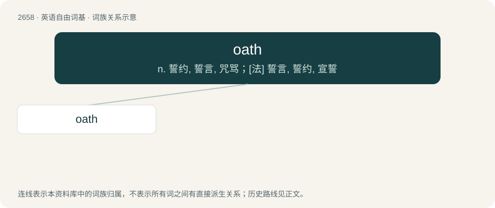

# 2759 · oath — n. 誓约, 誓言, 咒骂；\[法\] 誓言, 誓约, 宣誓

[总目录](../00_总目录_按常用程度.md)

**类型**：英语自由词基　｜　**来源语言**：见词源记录

## 核心含义与来源

- 核心含义：n. 誓约, 誓言, 咒骂；\[法\] 誓言, 誓约, 宣誓
- 英文含义：A solemn pledge or promise that invokes a deity, a ruler, or another entity (not necessarily present) to attest the truth of a statement or sincerity of one's desire to fulfill a contract or promise.
- 词形：oath

**来源记录 1**（名词；A solemn pledge or promise that invokes a deity, a ruler, or another entity (not necessarily present) to attest the truth of a statement or sincerity of one's desire to fulfill a contract or promise.）

From Middle English ooth, oth, ath, from Old English āþ (“oath”), from Proto-West Germanic \*aiþ (“oath”), from Proto-Germanic \*aiþaz (“oath”). Cognate with Scots aith, athe (“oath”), North Frisian ith, iss (“oath”), Saterland Frisian Eed (“oath”), West Frisian eed (“oath”), Dutch eed (“oath”), German Eid (“oath”), Swedish ed (“oath”), Icelandic eið (“oath”), Latin ūtor (“make use of, employ, avail”, verb), Old Irish óeth (“oath”).

## 词族图

## 单词速览（常用到不常用）

| 单词 | 音标 | 释义 |
|---|---|---|
| [oath](#w-1) | 英 /ˈəʊθ/；美 /ˈoʊθ/ | n. 誓约, 誓言, 咒骂；\[法\] 誓言, 誓约, 宣誓 |

## 逐词详解

### 1. oath

**词性**：名词　｜　**音标**：英 /ˈəʊθ/；美 /ˈoʊθ/

**中文释义**：n. 誓约, 誓言, 咒骂；\[法\] 誓言, 誓约, 宣誓

**英文义项**：A solemn pledge or promise that invokes a deity, a ruler, or another entity (not necessarily present) to attest the truth of a statement or sincerity of one's desire to fulfill a contract or promise. / A statement or promise which is strengthened (affirmed) by such a pledge.

**词源与演化**：

From Middle English ooth, oth, ath, from Old English āþ (“oath”), from Proto-West Germanic \*aiþ (“oath”), from Proto-Germanic \*aiþaz (“oath”). Cognate with Scots aith, athe (“oath”), North Frisian ith, iss (“oath”), Saterland Frisian Eed (“oath”), West Frisian eed (“oath”), Dutch eed (“oath”), German Eid (“oath”), Swedish ed (“oath”), Icelandic eið (“oath”), Latin ūtor (“make use of, employ, avail”, verb), Old Irish óeth (“oath”).

**例句**：

> After taking the oath of office, she became the country's forty-third premier.

该用例对应义项：A statement or promise which is strengthened (affirmed) by such a pledge.
