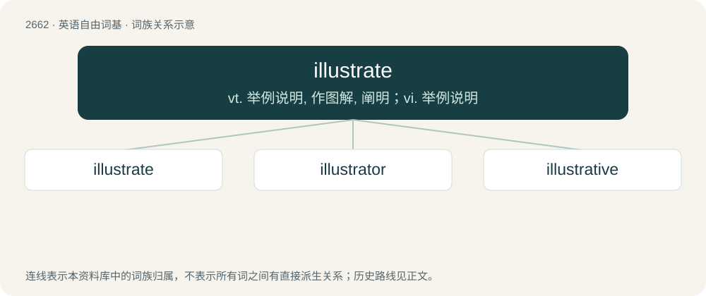

# 2763 · illustrate — vt. 举例说明, 作图解, 阐明；vi. 举例说明

[总目录](../00_总目录_按常用程度.md)

**类型**：英语自由词基　｜　**来源语言**：见词源记录

## 核心含义与来源

- 核心含义：vt. 举例说明, 作图解, 阐明；vi. 举例说明
- 英文含义：To clarify something by giving, or serving as, an example or a comparison.
- 词形：illustrate

**来源记录 1**（动词；To clarify something by giving, or serving as, an example or a comparison.）

Back-formation from illustration.

## 词族图

## 单词速览（常用到不常用）

| 单词 | 音标 | 释义 |
|---|---|---|
| [illustrate](#w-1) | 英 /ˈɪl.jʊˌstɹeɪt/；美 /ˈɪl.əˌstɹeɪt/ | vt. 举例说明, 作图解, 阐明；vi. 举例说明 |
| [illustrator](#w-2) | 美 /ˈɪləˌstɹeɪtəɹ/ | n. 插画家, 图解者, 说明者 |
| [illustrative](#w-3) | 英 /ɪˈlʌs.tɹə.tɪv/；美 /ɪˈlʌs.tɹə.tɪv/ | a. 说明的, 解说的, 作例证的 |

## 逐词详解

### 1. illustrate

**词性**：动词　｜　**音标**：英 /ˈɪl.jʊˌstɹeɪt/；美 /ˈɪl.əˌstɹeɪt/

**中文释义**：vt. 举例说明, 作图解, 阐明；vi. 举例说明

**英文义项**：To clarify something by giving, or serving as, an example or a comparison. / To provide a book or other publication with pictures, diagrams or other explanatory or decorative features.

**词源与演化**：

Back-formation from illustration.

**例句**：

> We illustrate our definitions by including quotations or simple examples.

该用例对应义项：To clarify something by giving, or serving as, an example or a comparison.

### 2. illustrator

**词性**：名词　｜　**音标**：美 /ˈɪləˌstɹeɪtəɹ/

**中文释义**：n. 插画家, 图解者, 说明者

**英文义项**：a person who draws pictures (especially illustrations in books or magazines)

**构词拆分**：illustrate + -or

**词源与演化**：

From illustrate + -or.

**例句**：

> Mary is one of the best illustrators of children's books in the country.

该用例对应义项：a person who draws pictures (especially illustrations in books or magazines)

### 3. illustrative

**词性**：形容词　｜　**音标**：英 /ɪˈlʌs.tɹə.tɪv/；美 /ɪˈlʌs.tɹə.tɪv/

**中文释义**：a. 说明的, 解说的, 作例证的

**英文义项**：Demonstrative, exemplative, showing an example or demonstrating.

**构词拆分**：illustrate + -ive

**词源与演化**：

From illustrate + -ive.

**例句**：

> This latest incident is illustrative of his continued bad behavior.

该用例对应义项：Demonstrative, exemplative, showing an example or demonstrating.
