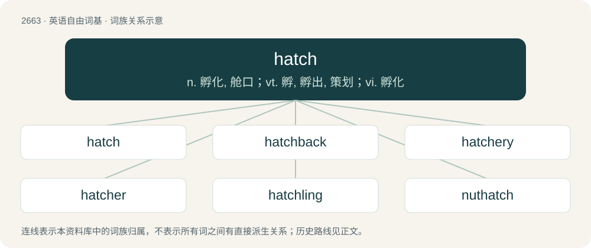

# 2765 · hatch — n. 孵化, 舱口；vt. 孵, 孵出, 策划；vi. 孵化

[总目录](../00_总目录_按常用程度.md)

**类型**：英语自由词基　｜　**来源语言**：见词源记录

## 核心含义与来源

- 核心含义：n. 孵化, 舱口；vt. 孵, 孵出, 策划；vi. 孵化
- 英文含义：A horizontal door in a floor or ceiling.
- 词形：hatch

**多个词源／构词路径**：同一拼写可能有不同来源；以下按词性和含义分别列出。

**来源记录 1**（名词；A horizontal door in a floor or ceiling.）

From Middle English hacche, hache, from Old English hæċ, from Proto-West Germanic \*hakkju (compare Dutch hek ‘gate, railing’, Low German Heck ‘pasture gate, farmyard gate’), variant of \*haggju ‘hedge’. More at hedge.

**来源记录 2**（动词；To emerge from an egg.）

From Middle English hacche, hacchen (“to propagate”), from Old English \*hæċċan, āhaċċian (“to peck out; hatch”), from Proto-Germanic \*hakjaną. Cognate with German hecken ‘to breed, spawn’, Danish hække (“to hatch”), Swedish häcka (“to breed”); akin to Latvian kakale ‘penis’.

**来源记录 3**（动词；To shade an area of (a drawing, diagram, etc.) with fine parallel lines, or with lines which cross each other (crosshatch).）

From Middle French hacher (“to chop, slice up, incise with fine lines”), from Old French hacher, hachier, from Frankish \*hakōn, \*hakkōn, from Proto-Germanic \*hakkōną (“to chop; hack”). More at hack.

## 词族图

## 单词速览（常用到不常用）

| 单词 | 音标 | 释义 |
|---|---|---|
| [hatch](#w-1) | /hæt͡ʃ/ | n. 孵化, 舱口；vt. 孵, 孵出, 策划；vi. 孵化 |
| [hatchback](#w-2) | 美 /ˈhæt͡ʃˌbæk/ | n. 有向上打开的后门的汽车 |
| [hatchery](#w-3) | 英 /ˈhæt͡ʃəɹi/；美 /ˈhæt͡ʃəɹi/ | n. 孵卵处 |
| [hatcher](#w-4) | /ˈhætʃə/ | n. 孵卵器, 出谋策划的人 |
| [hatchling](#w-5) | /ˈhæt͡ʃlɪŋ/ | n. 人工孵化的鱼苗或小鸟 |
| [nuthatch](#w-6) | /ˈnʌtˌhæt͡ʃ/ | n. \[鸟\]五子雀 |

## 逐词详解

### 1. hatch

**词性**：名词　｜　**音标**：/hæt͡ʃ/

**中文释义**：n. 孵化, 舱口；vt. 孵, 孵出, 策划；vi. 孵化

**英文义项**：A horizontal door in a floor or ceiling. / A trapdoor.

**词源与演化**：

From Middle English hacche, hache, from Old English hæċ, from Proto-West Germanic \*hakkju (compare Dutch hek ‘gate, railing’, Low German Heck ‘pasture gate, farmyard gate’), variant of \*haggju ‘hedge’. More at hedge.

**例句**：

> Moving the wardrobe revealed a previously hidden hatch in the ground.

该用例对应义项：A horizontal door in a floor or ceiling.

### 2. hatchback

**词性**：名词　｜　**音标**：美 /ˈhæt͡ʃˌbæk/

**中文释义**：n. 有向上打开的后门的汽车

**英文义项**：A car with a sloping, hinged rear door that opens upwards. / The door itself.

**构词拆分**：hatch + back

**词源与演化**：

From hatch + back.

**例句**：

> A hatchback car is often called a five-door vehicle.

### 3. hatchery

**词性**：名词　｜　**音标**：英 /ˈhæt͡ʃəɹi/；美 /ˈhæt͡ʃəɹi/

**中文释义**：n. 孵卵处

**英文义项**：A (commercial) facility where eggs, especially those of fish or poultry, are hatched under artificial conditions. / A place where something is fostered or nurtured; a nursery.

**构词拆分**：hatch + -ery

**词源与演化**：

From hatch (verb) + -ery (suffix denoting a place where an art, craft, or practice is carried out).

**例句**：

> The park authorities operated a trout hatchery.

该用例对应义项：a place where eggs are hatched under artificial conditions (especially fish eggs)

### 4. hatcher

**词性**：名词　｜　**音标**：/ˈhætʃə/

**中文释义**：n. 孵卵器, 出谋策划的人

**英文义项**：One who hatches, such as a chicken farmer. / Something that hatches, such as a bird or the egg from which it hatches.

**构词拆分**：From hatch + -er.

**词源与演化**：

From hatch + -er.

**例句**：

> Incubators must be carefully monitored so that hatchers and nonhatchers may both be further handled promptly.

该用例对应义项：Something that hatches, such as a bird or the egg from which it hatches.

### 5. hatchling

**词性**：名词　｜　**音标**：/ˈhæt͡ʃlɪŋ/

**中文释义**：n. 人工孵化的鱼苗或小鸟

**英文义项**：A newly hatched bird, reptile or other animal that has emerged from an egg. / A person who has (especially recently) realized that they are transgender.

**构词拆分**：hatch + -ling

**词源与演化**：

From hatch + -ling. Sense 2 in reference to the term crack one's egg (“realize one is transgender”).

**例句**：

> The hatchling alligator had just broken out of its shell but was already trying to follow its mother, who hunted hatchling birds.

该用例对应义项：A newly hatched bird, reptile or other animal that has emerged from an egg.

### 6. nuthatch

**词性**：名词　｜　**音标**：/ˈnʌtˌhæt͡ʃ/

**中文释义**：n. \[鸟\]五子雀

**英文义项**：Any of various small passerine birds from the genus Sitta, found throughout the northern hemisphere and noted for their unusual proclivity for climbing down trees head first.

**构词拆分**：nut + hatch

**词源与演化**：

From Middle English nutthache, notehache, nuthake, nuttehake, nothak, equivalent to nut + hatch (akin to hack). Compare English nutcracker. Compare typologically Polish kowalik (akin to kować).

**例句**：

> The nuthatch is a bird that lives in forests and mountains.
