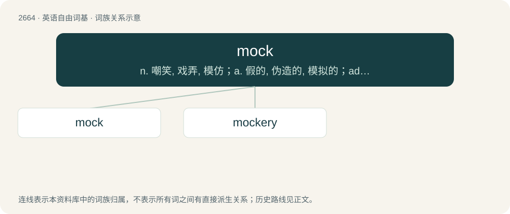

# 2766 · mock — n. 嘲笑, 戏弄, 模仿；a. 假的, 伪造的, 模拟的；adv. 虚伪地

[总目录](../00_总目录_按常用程度.md)

**类型**：英语自由词基　｜　**来源语言**：见词源记录

## 核心含义与来源

- 核心含义：n. 嘲笑, 戏弄, 模仿；a. 假的, 伪造的, 模拟的；adv. 虚伪地
- 英文含义：An imitation, usually of lesser quality.
- 词形：mock

**来源记录 1**（名词；An imitation, usually of lesser quality.）

From Middle English mokken, from Old French mocquer, moquier (“to deride, jeer”), from Middle Dutch mocken (“to mumble”) or Middle Low German mucken (“to grumble, talk with the mouth half-opened”), both from Proto-West Germanic \*mokkijan, \*mukkijan (“to low, bellow; mumble”), from Proto-Germanic \*mukkijaną, \*mūhaną (“to low, bellow, shout”), from Proto-Indo-European \*mūg-, \*mūk- (“to low, mumble”). Cognate with Dutch mokken (“to sulk; pout; mope; grumble”), Old High German firmucken (“to be stupid”), Modern German mucksen (“to utter a word; mumble; grumble”), West Frisian mokke (“to mope; sulk; grumble”), Swedish mucka (“to murmur”), dialectal Dutch mokkel (“kiss”).

## 词族图

## 单词速览（常用到不常用）

| 单词 | 音标 | 释义 |
|---|---|---|
| [mock](#w-1) | 英 /mɒk/；美 /mɑk/ | n. 嘲笑, 戏弄, 模仿；a. 假的, 伪造的, 模拟的；adv. 虚伪地 |
| [mockery](#w-2) | 英 /ˈmɒkəɹi/；美 /ˈmɑkəɹi/ | n. 嘲弄, 笑柄, 歪曲 |

## 逐词详解

### 1. mock

**词性**：动词　｜　**音标**：英 /mɒk/；美 /mɑk/

**中文释义**：n. 嘲笑, 戏弄, 模仿；a. 假的, 伪造的, 模拟的；adv. 虚伪地

**英文义项**：To mimic, to simulate. / To create an artistic representation of.

**词源与演化**：

From Middle English mokken, from Old French mocquer, moquier (“to deride, jeer”), from Middle Dutch mocken (“to mumble”) or Middle Low German mucken (“to grumble, talk with the mouth half-opened”), both from Proto-West Germanic \*mokkijan, \*mukkijan (“to low, bellow; mumble”), from Proto-Germanic \*mukkijaną, \*mūhaną (“to low, bellow, shout”), from Proto-Indo-European \*mūg-, \*mūk- (“to low, mumble”). Cognate with Dutch mokken (“to sulk; pout; mope; grumble”), Old High German firmucken (“to be stupid”), Modern German mucksen (“to utter a word; mumble; grumble”), West Frisian mokke (“to mope; sulk; grumble”), Swedish mucka (“to murmur”), dialectal Dutch mokkel (“kiss”).

**例句**：

> The wind is mocking my efforts to light a fire!

该用例对应义项：To tantalise, and disappoint the hopes of.

### 2. mockery

**词性**：名词　｜　**音标**：英 /ˈmɒkəɹi/；美 /ˈmɑkəɹi/

**中文释义**：n. 嘲弄, 笑柄, 歪曲

**英文义项**：The action of mocking; ridicule, derision. / Something so lacking in necessary qualities as to inspire ridicule; a laughing-stock.

**构词拆分**：mock + -ery

**词源与演化**：

From Middle English mokkery, from Anglo-Norman mokerie, mokery and Middle French mocquerie, moquerie, from moquer, moker (“to mock”) + -erie (“-ery”), perhaps from Byzantine Greek μωκός (mōkós, “mocker”), perhaps from Arabic مَكْر (makr, “scheme, plot”). Equivalent to mock + -ery.

**例句**：

> The defendant wasn't allowed to speak at his own trial - it was a mockery of justice.

该用例对应义项：Mimicry, imitation, now usually in a derogatory sense; a travesty, a ridiculous simulacrum.
