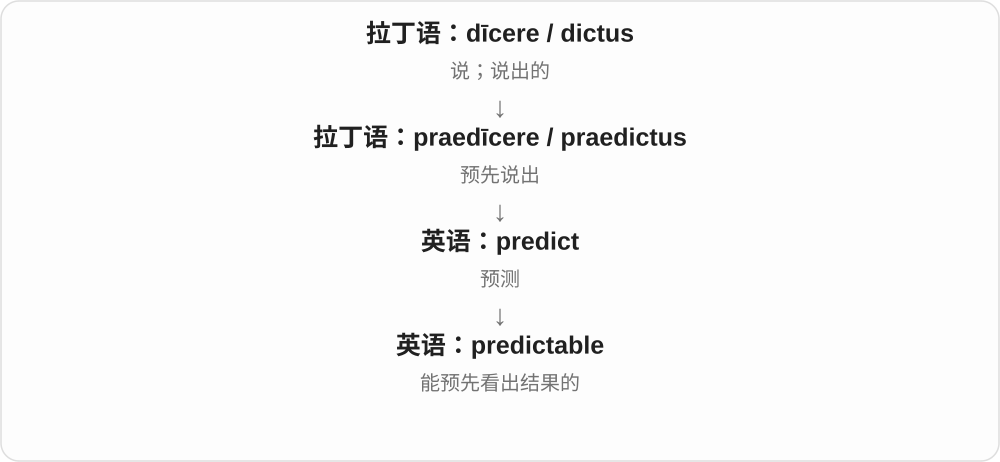
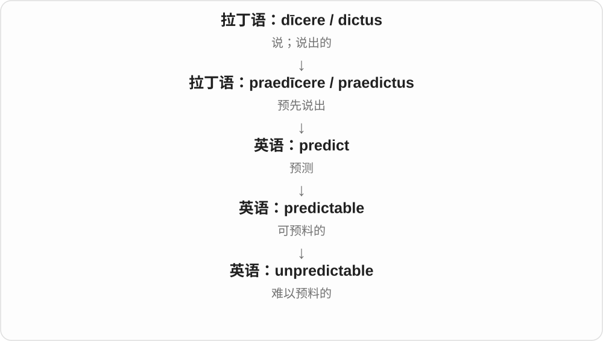

# 2766 · predictable — 能否预先看出结果，副词再评论实际发生方式

[逐词精讲目录](../00_逐词精讲目录.md) · [总目录](../00_总目录_按常用程度.md)

## 核心词根与来源

设备可靠可预期常是好事，情节毫无意外则可能乏味。predictably 可以说明动作方式，也能在句首评论整个结果。

**PREDICTABLE：规律足够清楚，结果就容易想到**

predictable → predictably；unpredictable 难以预料。

- **性质、方式与相反性质**：predictable · predictably · unpredictable

## 词形与演化规律

predict + -able → predictable；-able → -ably；un- 否定。

## 单词速览（按词族由简到繁）

同一基础词的相关扩展放在一起，先读基础形式，再读扩展；各组之间优先读常用的。具体词源关系见各词讲解。

| 单词 | 音标 | 核心意思 |
|---|---|---|
| [predictable](#w-1) | /prɪˈdɪktəbəl/ | 可预测的；不出所料的 |
| [predictably](#w-3) | /prɪˈdɪktəbli/ | 可预见地；果然、不出所料 |
| [unpredictable](#w-2) | /ˌʌnprɪˈdɪktəbəl/ | 难以预测的；变化无常的 |

## 逐词讲解

### 1. predictable — 可预测的；不出所料的

**音标**：/prɪˈdɪktəbəl/

**先抓住这个画面**

还没往下看，你已经大概知道会发生什么。规律稳定时这是优点，故事老套时也可能是缺点。

**怎么拆**

predict + -able：能够提前预测的。

**怎么变成今天的意思**

-able 把动作变成一种性质。predictable income 是比较稳定可预期的收入；a predictable ending 则可能嫌结局缺乏新意。

**常见搭配与例句**

a predictable pattern；a predictable result；highly predictable。

> The machine follows a predictable cycle.

这台机器按一个可预测的周期运行。

> The film was enjoyable, though its ending was predictable.

电影挺好看，只是结局容易猜到。

**别混淆**

predictable 不一定是 boring。稳定的设备表现很可预测，通常值得高兴；小说太可预测才可能乏味。

### 2. predictably — 可预见地；果然、不出所料

**音标**：/prɪˈdɪktəbli/

**先抓住这个画面**

事情沿着你大概猜到的方向发生，就是 predictably。用在句首，常像中文“果然”：说话人觉得结果并不意外。

**怎么拆**

predictable + -ly；-able 变 -ably，结尾通常 /əbli/。从可预测的性质变为方式副词或整句评注。

**怎么变成今天的意思**

**praedicere 预先说 → predict → predictable**  
预测 → 可以预测的

↓

**predictable + -ly → predictably**  
按可预料的方式；果然、不出所料

behave predictably 表现得有规律，Predictably, ... 果然……；设备行为可预测通常是优点，故事套路可预测可能被嫌乏味。

**常见搭配与例句**

behave predictably；respond predictably；Predictably, ...。

> The system behaves predictably under normal conditions.

系统在正常条件下表现稳定、可预料。

> Predictably, the free tickets were gone within minutes.

不出所料，免费票几分钟就领光了。

**别混淆**

predictably 不保证说话人事先实际做过预测；有时是事后表达“这结果很容易想到”。

### 3. unpredictable — 难以预测的；变化无常的

**音标**：/ˌʌnprɪˈdɪktəbəl/

**先抓住这个画面**

你想提前猜下一步，但它总会偏离预期。unpredictable 说的是这种不容易掌握的变化。

**怎么拆**

un-（不）+ predictable（可预测的）。

**怎么变成今天的意思**

用在天气或系统上，是行为难预测；用在人身上，常说情绪或反应不稳定。它不必是完全随机，只是你难以可靠预先判断。

**常见搭配与例句**

unpredictable weather；an unpredictable outcome；highly unpredictable。

> Mountain weather can be unpredictable.

山区天气可能很难预测。

> His unpredictable reactions made the team uneasy.

他难以预料的反应让团队感到不安。

**别混淆**

unexpected 是某一次结果没料到；unpredictable 是一贯难预测的性质。

## 这一组要分清什么

predictable 的好坏看场合；predictably 不一定意味着实际早已写下预测。

## 串起来练习

A predictable system responds predictably, while an unpredictable one surprises its users.

行为可预测的系统反应可预料；难以预料的系统则让用户意外。
