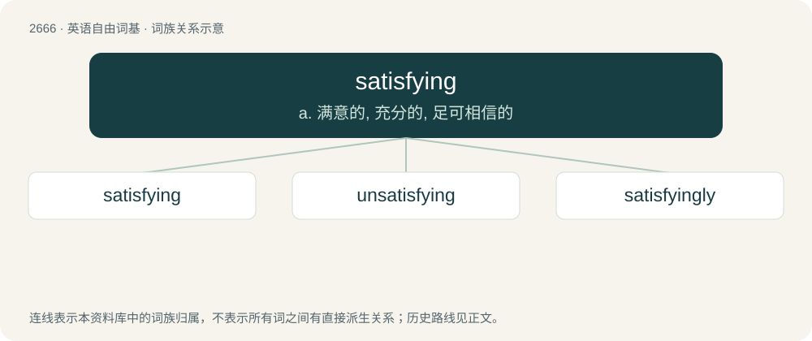

# 2769 · satisfying — a. 满意的, 充分的, 足可相信的

[总目录](../00_总目录_按常用程度.md)

**类型**：英语自由词基　｜　**来源语言**：见词源记录

## 核心含义与来源

- 核心含义：a. 满意的, 充分的, 足可相信的
- 英文含义：That satisfies, gratifies or pleases; that removes any feeling of lack.
- 词形：satisfying

**来源记录 1**（形容词；That satisfies, gratifies or pleases; that removes any feeling of lack.）

From satisfy + -ing.

## 词族图

## 单词速览（常用到不常用）

| 单词 | 音标 | 释义 |
|---|---|---|
| [satisfying](#w-1) | /ˈsætɪsfaɪ.ɪŋ/ | a. 满意的, 充分的, 足可相信的 |
| [unsatisfying](#w-2) |  | a. 无法令人满足的 |
| [satisfyingly](#w-3) | /ˈsætis,faiiŋli/ | adv. 使人满意地 |

## 逐词详解

### 1. satisfying

**词性**：形容词　｜　**音标**：/ˈsætɪsfaɪ.ɪŋ/

**中文释义**：a. 满意的, 充分的, 足可相信的

**英文义项**：That satisfies, gratifies or pleases; that removes any feeling of lack. / Pleasing to certain sensory channels in neurocognition, especially auditory and tactile ones synesthetically via ASMR.

**构词拆分**：satisfy + -ing

**词源与演化**：

From satisfy + -ing.

**例句**：

> The riddles of God are more satisfying than the solutions of man.

### 2. unsatisfying

**词性**：形容词

**中文释义**：a. 无法令人满足的

**英文义项**：Not providing satisfaction.

**构词拆分**：un- + satisfying

**词源与演化**：

From un- + satisfying.

**例句**：

> My life is comfortable, but unsatisfying.

### 3. satisfyingly

**词性**：副词　｜　**音标**：/ˈsætis,faiiŋli/

**中文释义**：adv. 使人满意地

**英文义项**：In a satisfying manner.

**构词拆分**：satisfying + -ly

**词源与演化**：

From satisfying + -ly.
