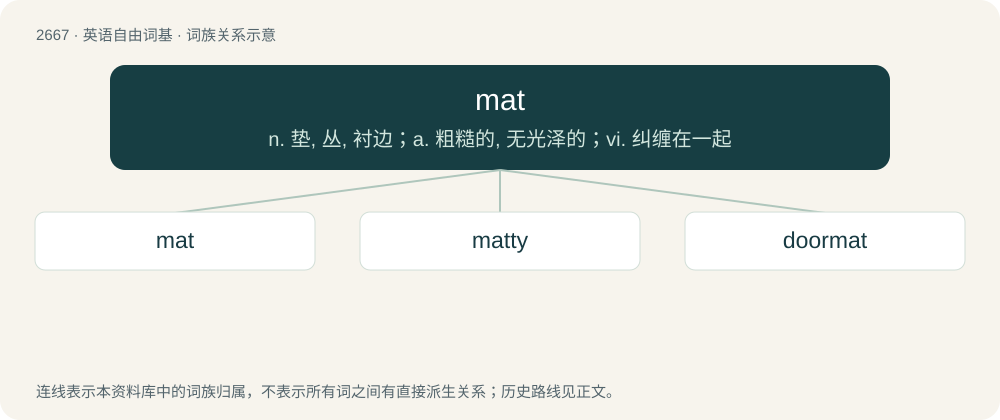

# 2770 · mat — n. 垫, 丛, 衬边；a. 粗糙的, 无光泽的；vi. 纠缠在一起

[总目录](../00_总目录_按常用程度.md)

**类型**：英语自由词基　｜　**来源语言**：见词源记录

## 核心含义与来源

- 核心含义：n. 垫, 丛, 衬边；a. 粗糙的, 无光泽的；vi. 纠缠在一起
- 英文含义：A flat piece of coarse material used for wiping one’s feet, or as a decorative or protective floor covering.
- 词形：mat

**多个词源／构词路径**：同一拼写可能有不同来源；以下按词性和含义分别列出。

**来源记录 1**（名词；A flat piece of coarse material used for wiping one’s feet, or as a decorative or protective floor covering.）

Inherited from Middle English matte (“mat”), from Old English meatte (“mat”), from Late Latin matta (“mat made of rushes”), from Punic or Phoenician (compare Hebrew מיטה \ מִטָּה (mitá, “bed, couch”)). Cognate with German Matte (“mat”), Danish måtte (“mat”), Faroese and Icelandic motta (“rug, mat”), Norwegian matte (“mat, rug”), Swedish matta (“carpet, rug, mat”).

**来源记录 2**（名词；An alloy of copper, tin, iron, etc.; white metal.）

Compare matte.

**来源记录 3**（名词；Vulgar, obscene, or profane language in Russian and some other Slavic language communities.）

Borrowed from Russian мат (mat), abbreviated from the expression ма́терная брань (máternaja branʹ), ultimately from мать (matʹ, “mother”).

## 词族图

## 单词速览（常用到不常用）

| 单词 | 音标 | 释义 |
|---|---|---|
| [mat](#w-1) | 英 /mæt/；美 /mæt/ | n. 垫, 丛, 衬边；a. 粗糙的, 无光泽的；vi. 纠缠在一起 |
| [matty](#w-2) | /ˈmætiː/ | n. 马蒂（女子名, 姓氏） |
| [doormat](#w-3) | 英 /ˈdɔːˌmæt/；美 /ˈdɔɹˌmæt/ | n. 擦鞋垫 |

## 逐词详解

### 1. mat

**词性**：名词　｜　**音标**：英 /mæt/；美 /mæt/

**中文释义**：n. 垫, 丛, 衬边；a. 粗糙的, 无光泽的；vi. 纠缠在一起

**英文义项**：A flat piece of coarse material used for wiping one’s feet, or as a decorative or protective floor covering. / A small flat piece of material used to protect a surface from anything hot or rough; a coaster.

**词源与演化**：

Inherited from Middle English matte (“mat”), from Old English meatte (“mat”), from Late Latin matta (“mat made of rushes”), from Punic or Phoenician (compare Hebrew מיטה \ מִטָּה (mitá, “bed, couch”)). Cognate with German Matte (“mat”), Danish måtte (“mat”), Faroese and Icelandic motta (“rug, mat”), Norwegian matte (“mat, rug”), Swedish matta (“carpet, rug, mat”).

**例句**：

> The high jumper cleared the bar and landed safely on the mat.

该用例对应义项：A floor pad to protect athletes.

### 2. matty

**词性**：形容词　｜　**音标**：/ˈmætiː/

**中文释义**：n. 马蒂（女子名, 姓氏）

**英文义项**：matted

**构词拆分**：mat + -y

**词源与演化**：

From mat + -y.

### 3. doormat

**词性**：名词　｜　**音标**：英 /ˈdɔːˌmæt/；美 /ˈdɔɹˌmæt/

**中文释义**：n. 擦鞋垫

**英文义项**：A coarse mat at the entrance to a house, upon which one wipes one's shoes. / Someone who habitually yields to others' demands or mistreatment, failing to assert their own rights or interests.

**构词拆分**：door + mat

**词源与演化**：

From door + mat.

**例句**：

> Wipe your shoes on the doormat before you start plodding around in the house.

该用例对应义项：A coarse mat at the entrance to a house, upon which one wipes one's shoes.
