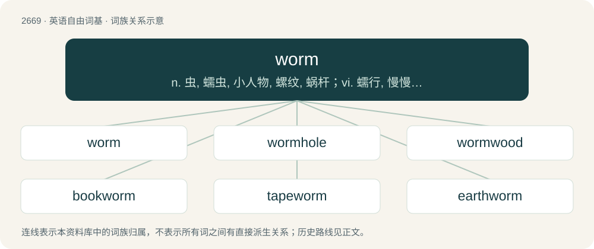

# 2771 · worm — n. 虫, 蠕虫, 小人物, 螺纹, 蜗杆；vi. 蠕行, 慢慢前进；vt. 使蠕行, 慢慢地走, 除虫

[总目录](../00_总目录_按常用程度.md)

**类型**：英语自由词基　｜　**来源语言**：见词源记录

## 核心含义与来源

- 核心含义：n. 虫, 蠕虫, 小人物, 螺纹, 蜗杆；vi. 蠕行, 慢慢前进；vt. 使蠕行, 慢慢地走, 除虫
- 英文含义：A generally tubular invertebrate of the annelid phylum; an earthworm.
- 词形：worm

**来源记录 1**（名词；A generally tubular invertebrate of the annelid phylum; an earthworm.）

From Middle English werm, wirm, worm, worme, wrim, wurm, wyrm, wyrme, from Old English weorm, wurm, wyrm, from Proto-West Germanic \*wurmi, from Proto-Germanic \*wurmiz (“worm; snake”), from Proto-Indo-European \*wr̥mis (“worm; larva”), possibly from \*wer- (“to turn”). Doublet of vermin and wyrm, the latter of which is a fairly recent borrowing directly from the Old English. (computing): First computer usage by John Brunner in his 1975 book The Shockwave Rider. Cognates Germanic cognates include North Frisian wörem, wörm, Würem (“worm”), Saterland Frisian Wurm, Wúurm (“worm”), West Frisian wjirm (“worm”), Alemannic German Wüüre (“worm”), Cimbrian bórm (“worm”), burm (“snake”), Dutch worm, wurm (“worm”), German Gewürm (“vermin”), Wurm (“worm”), Low German Worm (“worm”), Luxembourgish Wuerm (“worm”), Mòcheno burm (“snake”), Vilamovian vūəm, wüm (“worm”), Yiddish וואָרעם (vorem, “worm”), Danish, Norwegian Bokmål, and Swedish orm (“worm”), Faroese and Icelandic ormur (“worm”), Norwegian Nynorsk orm (“worm”), yrme, yrmle (“female snake with offspring”), Gothic 𐍅𐌰𐌿𐍂𐌼𐍃 (waurms, “snake”), Kildin Sami уррьм (urr’m, “gadfly larva”), Skolt Sami uʹrmm (“gadfly larva”). Indo-European cognates include Latin vermis (“worm”), Ancient Greek ῥόμοξ (rhómox), ῥόμος (rhómos, “woodworm”), Albanian rrime (“rainworm”).

## 词族图

## 单词速览（常用到不常用）

| 单词 | 音标 | 释义 |
|---|---|---|
| [worm](#w-1) | 英 /wɜːm/；美 /wɝm/ | n. 虫, 蠕虫, 小人物, 螺纹, 蜗杆；vi. 蠕行, 慢慢前进；vt. 使蠕行, 慢慢地走, 除虫 |
| [wormhole](#w-2) | 美 /ˈwɝmˌhoʊl/ | n. 蛀孔, 蛀洞 |
| [wormwood](#w-3) | 英 /ˈwɜːm.wʊd/；美 /ˈwɚm.wʊd/ | n. 苦艾, 苦恼；\[医\] 苦艾 |
| [bookworm](#w-4) | /ˈbʊk.wɜːm/ | n. 书呆子, 蛀书虫 |
| [tapeworm](#w-5) | 美 /ˈteɪpˌwɝm/ | n. 绦虫；\[医\] 绦虫 |
| [earthworm](#w-6) | /ˈɜː(ɹ)θˌwɜː(ɹ)m/ | n. 蚯蚓 |
| [silkworm](#w-7) | 英 /ˈsɪlkwɜːm/ | n. 蚕 |
| [ringworm](#w-8) | 美 /ˈɹɪŋˌwɝm/ | \[医\] 癣, 癣菌病 |
| [earworm](#w-9) | 英 /ˈɪəwɜːm/；美 /ˈɪ(ə)ɹˌwɚm/ | n. 螟蛉 |
| [heartworm](#w-10) | /ˈhɑːtw\\\\ːm/ | \[医\] 犬恶丝虫 |
| [hookworm](#w-11) | 美 /ˈhʊkˌwɝm/ | n. 钩虫；\[医\] 钩虫 |
| [wormy](#w-12) | /ˈwəːmi/ | a. 有蛀虫的, 虫多的, 虫蛀的 |

## 逐词详解

### 1. worm

**词性**：名词　｜　**音标**：英 /wɜːm/；美 /wɝm/

**中文释义**：n. 虫, 蠕虫, 小人物, 螺纹, 蜗杆；vi. 蠕行, 慢慢前进；vt. 使蠕行, 慢慢地走, 除虫

**英文义项**：A generally tubular invertebrate of the annelid phylum; an earthworm. / More loosely, any of various tubular invertebrates resembling annelids but not closely related to them, such as velvet worms, acorn worms, flatworms, or roundworms. See Appendix:English worms.

**词源与演化**：

From Middle English werm, wirm, worm, worme, wrim, wurm, wyrm, wyrme, from Old English weorm, wurm, wyrm, from Proto-West Germanic \*wurmi, from Proto-Germanic \*wurmiz (“worm; snake”), from Proto-Indo-European \*wr̥mis (“worm; larva”), possibly from \*wer- (“to turn”). Doublet of vermin and wyrm, the latter of which is a fairly recent borrowing directly from the Old English. (computing): First computer usage by John Brunner in his 1975 book The Shockwave Rider. Cognates Germanic cognates include North Frisian wörem, wörm, Würem (“worm”), Saterland Frisian Wurm, Wúurm (“worm”), West Frisian wjirm (“worm”), Alemannic German Wüüre (“worm”), Cimbrian bórm (“worm”), burm (“snake”), Dutch worm, wurm (“worm”), German Gewürm (“vermin”), Wurm (“worm”), Low German Worm (“worm”), Luxembourgish Wuerm (“worm”), Mòcheno burm (“snake”), Vilamovian vūəm, wüm (“worm”), Yiddish וואָרעם (vorem, “worm”), Danish, Norwegian Bokmål, and Swedish orm (“worm”), Faroese and Icelandic ormur (“worm”), Norwegian Nynorsk orm (“worm”), yrme, yrmle (“female snake with offspring”), Gothic 𐍅𐌰𐌿𐍂𐌼𐍃 (waurms, “snake”), Kildin Sami уррьм (urr’m, “gadfly larva”), Skolt Sami uʹrmm (“gadfly larva”). Indo-European cognates include Latin vermis (“worm”), Ancient Greek ῥόμοξ (rhómox), ῥόμος (rhómos, “woodworm”), Albanian rrime (“rainworm”).

**例句**：

> When Trevor opened his email, a worm spread to 100 people in his address book.

该用例对应义项：A self-replicating program that propagates through a network by copying itself, differing from a virus which seeks to propagate by inserting its code into other executable files.

### 2. wormhole

**词性**：名词　｜　**音标**：美 /ˈwɝmˌhoʊl/

**中文释义**：n. 蛀孔, 蛀洞

**英文义项**：A hole burrowed by a worm. / A hypothetical shortcut between two points in spacetime, permitting faster-than-light travel and sometimes time travel.

**构词拆分**：worm + hole

**词源与演化**：

First use appears c. 1594. From worm + hole. In the scientific sense, introduced by John Archibald Wheeler in 1957.

**例句**：

> William used the flamethrower again to push the aliens into the wormhole.

### 3. wormwood

**词性**：名词　｜　**音标**：英 /ˈwɜːm.wʊd/；美 /ˈwɚm.wʊd/

**中文释义**：n. 苦艾, 苦恼；\[医\] 苦艾

**英文义项**：An intensely bitter herb (Artemisia absinthium and similar plants in genus Artemisia) used in medicine, in the production of absinthe and vermouth, and as a tonic. / Something that causes bitterness or affliction; a cause of mortification or vexation.

**构词拆分**：worm + wood

**词源与演化**：

From Middle English wormwode, a folk etymology (as if worm + wood) of wermode (“wormwood”), from Old English wermōd (“wormwood, absinthe”), from Proto-West Germanic \*warjamōdā (“wormwood”). Cognate with Middle Low German wermode, wermede (“wormwood”), German Wermut (“wormwood”). Doublet of vermouth.

**例句**：

> The artemisia plant also known as Sweet Wormwood contains artemisinin which has been used in Chinese traditional medicine for centuries in treating fevers.

### 4. bookworm

**词性**：名词　｜　**音标**：/ˈbʊk.wɜːm/

**中文释义**：n. 书呆子, 蛀书虫

**英文义项**：Any of various insects that infest books. / An avid book reader.

**构词拆分**：book + worm

**词源与演化**：

From book + worm. Compare West Frisian boekewjirm (“bookworm”), Dutch boekworm, boekwurm, boekenwurm (“bookworm”), Low German Bökerworm (“bookworm”), German Bücherwurm (“bookworm”), Danish bogorm (“bookworm”), Norwegian bokorm (“bookworm”), Faroese bókaormur (“bookworm”), Icelandic bókaormur (“bookworm”).

**例句**：

> Even the bookworm Donald was nervous as he prepared for that test.

### 5. tapeworm

**词性**：名词　｜　**音标**：美 /ˈteɪpˌwɝm/

**中文释义**：n. 绦虫；\[医\] 绦虫

**英文义项**：Any parasitical worm of the class or infraclass Cestoda, which infests the intestines of animals, including humans, often infecting different host species during their life cycle. / A broad fish tapeworm, Diphyllobothrium latum.

**构词拆分**：tape + worm

**词源与演化**：

From tape + worm.

**例句**：

> A tapeworm can live in your intestines for years.

### 6. earthworm

**词性**：名词　｜　**音标**：/ˈɜː(ɹ)θˌwɜː(ɹ)m/

**中文释义**：n. 蚯蚓

**英文义项**：A worm that lives in the ground. / A worm of the family Lumbricidae, or, more generally, of the suborder Lumbricina.

**构词拆分**：earth + worm

**词源与演化**：

From Middle English erthe-worm, erþe-worm, erþe worm (also as worm of þe erthe, worm of þe erþe), equivalent to earth + worm. Compare Saterland Frisian Äidwurm (“earthworm”), West Frisian ierdwjirm (“earthworm”), Dutch aardworm (“earthworm”), less common German Erdwurm (“earthworm”).

**例句**：

> Tom said that he'd give me thirty dollars if I ate an earthworm.

### 7. silkworm

**词性**：名词　｜　**音标**：英 /ˈsɪlkwɜːm/

**中文释义**：n. 蚕

**英文义项**：Any of various caterpillars of moths that produce silk cocoons, especially Bombyx mori, the source of most commercial silk.

**构词拆分**：silk + worm

**词源与演化**：

From Middle English silkwirm, from Old English seolcwyrm (“silkworm”), equivalent to silk + worm.

**例句**：

> What the silkworm won't eat, the bug will.

### 8. ringworm

**词性**：名词　｜　**音标**：美 /ˈɹɪŋˌwɝm/

**中文释义**：\[医\] 癣, 癣菌病

**英文义项**：A contagious fungal infection of the skin, characterized by ring-shaped discolored patches, covered by vesicles or scales.

**构词拆分**：ring + worm

**词源与演化**：

From Middle English ringworm (“ringworm; intestinal worm”), from Old English rengwyrm (“maw-worm, intestinal worm”), equivalent to ring + worm.

**例句**：

> In superficial mycoses infection is localised to the skin, the hair, and the nails. An example is ringworm or tinea, an infection of the skin by a dermatophyte.

该用例对应义项：A contagious fungal infection of the skin, characterized by ring-shaped discolored patches, covered by vesicles or scales.

### 9. earworm

**词性**：名词　｜　**音标**：英 /ˈɪəwɜːm/；美 /ˈɪ(ə)ɹˌwɚm/

**中文释义**：n. 螟蛉

**英文义项**：A tune that keeps replaying in one's head or that one keeps thinking about, especially if unwanted.

**构词拆分**：ear + worm

**词源与演化**：

From ear + worm; senses 1 and 3 (“tune that keeps replaying in one’s head”; “earwig”) are a calque of German Ohrwurm (“tune that pops up in one’s memory all the time; earwig”) (from the idea of a creature burrowing into the ear, an erroneous belief where earwigs are concerned), while sense 2 (“moth larva”) refers to the fact that these pests infest, among other things, ears of maize or sweet corn.

**例句**：

> The best way to get rid of an earworm is to replace it with another.

### 10. heartworm

**词性**：名词　｜　**音标**：/ˈhɑːtw\\\\ːm/

**中文释义**：\[医\] 犬恶丝虫

**英文义项**：A parasitic organism that afflicts dogs, of species Dirofilaria immitis of roundworms. / (uncountable) The condition caused by this organism.

**构词拆分**：heart + worm

**词源与演化**：

From heart + worm.

### 11. hookworm

**词性**：名词　｜　**音标**：美 /ˈhʊkˌwɝm/

**中文释义**：n. 钩虫；\[医\] 钩虫

**英文义项**：Any of various parasitic bloodsucking roundworms which cause disease, especially the species Ancylostoma duodenale and Necator americanus, having hooked mouthparts and entering their hosts by boring through the skin. / Infection with one of these parasites.

**构词拆分**：hook + worm

**词源与演化**：

From hook + worm.

**用法示例／搭配（非完整句）**：

> a case of hookworm

该用例对应义项：Infection with one of these parasites.

### 12. wormy

**词性**：形容词　｜　**音标**：/ˈwəːmi/

**中文释义**：a. 有蛀虫的, 虫多的, 虫蛀的

**英文义项**：Of or like a worm or worms; shaped like a worm or worms. / Infested with worms.

**构词拆分**：worm + -y

**词源与演化**：

From worm + -y.

**例句**：

> How come these apples are wormy although they've been sprayed?
