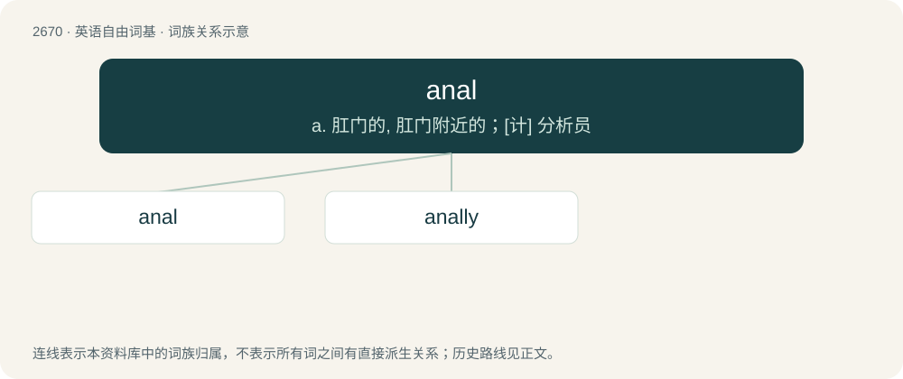

# 2772 · anal — a. 肛门的, 肛门附近的；\[计\] 分析员

[总目录](../00_总目录_按常用程度.md)

**类型**：英语自由词基　｜　**来源语言**：见词源记录

## 核心含义与来源

- 核心含义：a. 肛门的, 肛门附近的；\[计\] 分析员
- 英文含义：Of, related to, intended for or involving the anus.
- 词形：anal

**来源记录 1**（形容词；Of, related to, intended for or involving the anus.）

Borrowed from Latin ānālis. By surface analysis, anus + -al. Psychological sense shortened from anal-retentive.

## 词族图

## 单词速览（常用到不常用）

| 单词 | 音标 | 释义 |
|---|---|---|
| [anal](#w-1) | /ˈeɪ̯nəl/ | a. 肛门的, 肛门附近的；\[计\] 分析员 |
| [anally](#w-2) | /ˈeɪnəli/ | adv. 挑剔枝节地 ; 专注小事地 |

## 逐词详解

### 1. anal

**词性**：形容词　｜　**音标**：/ˈeɪ̯nəl/

**中文释义**：a. 肛门的, 肛门附近的；\[计\] 分析员

**英文义项**：Of, related to, intended for or involving the anus. / Of the stage in psychosexual development when the child's interest is alleged to be concentrated on the anal region.

**词源与演化**：

Borrowed from Latin ānālis. By surface analysis, anus + -al. Psychological sense shortened from anal-retentive.

**例句**：

> This questionnaire goes into the most ridiculous amount of detail. It's totally anal.

该用例对应义项：Of tasks, questions, subject matter, etc., obsessively fussy or precise.

### 2. anally

**词性**：副词　｜　**音标**：/ˈeɪnəli/

**中文释义**：adv. 挑剔枝节地 ; 专注小事地

**英文义项**：Involving the anus. / In an anal manner.

**构词拆分**：anal + -ly

**词源与演化**：

From anal + -ly.

**例句**：

> The doctor will examine the patient anally.

该用例对应义项：Involving the anus.
