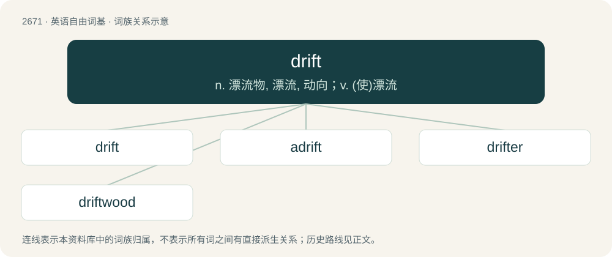

# 2774 · drift — n. 漂流物, 漂流, 动向；v. (使)漂流

[总目录](../00_总目录_按常用程度.md)

**类型**：英语自由词基　｜　**来源语言**：见词源记录

## 核心含义与来源

- 核心含义：n. 漂流物, 漂流, 动向；v. (使)漂流
- 英文含义：Anything driven at random.
- 词形：drift

**来源记录 1**（名词；Anything driven at random.）

From Middle English drift, dryft (“act of driving, drove, shower of rain or snow, impulse”), from Old English \*drift (“drift”), from Proto-Germanic \*driftiz (“drift”), from Proto-Indo-European \*dʰreybʰ- (“to drive, push”). Equivalent to drive + -t; cognate with North Frisian drift (“drift”), Saterland Frisian Drift (“current, flow, stream, drift”), Dutch drift (“drift, passion, urge”), German Drift (“drift”) and Trift (“drove, pasture”), Danish drift (“impulse, instinct”), Swedish drift (“impulse, instinct”), Icelandic drift (“drift, snow-drift”).

## 词族图

## 单词速览（常用到不常用）

| 单词 | 音标 | 释义 |
|---|---|---|
| [drift](#w-1) | /dɹɪft/ | n. 漂流物, 漂流, 动向；v. (使)漂流 |
| [adrift](#w-2) | /əˈdɹɪft/ | adv. 漂流地, 漂浮着, 随波逐流地；a. 漂浮着的 |
| [drifter](#w-3) | 英 /ˈdɹɪftə/；美 /ˈdɹɪftɚ/ | n. 漂流者, 漂流物, 漂网渔船 |
| [driftwood](#w-4) | /ˈdɹɪftwʊd/ | n. 漂流木, 浮木 |

## 逐词详解

### 1. drift

**词性**：名词　｜　**音标**：/dɹɪft/

**中文释义**：n. 漂流物, 漂流, 动向；v. (使)漂流

**英文义项**：Anything driven at random. / A mass of matter which has been driven or forced onward together in a body, or thrown together in a heap, etc., especially by wind or water.

**构词拆分**：drive + -t

**词源与演化**：

From Middle English drift, dryft (“act of driving, drove, shower of rain or snow, impulse”), from Old English \*drift (“drift”), from Proto-Germanic \*driftiz (“drift”), from Proto-Indo-European \*dʰreybʰ- (“to drive, push”). Equivalent to drive + -t; cognate with North Frisian drift (“drift”), Saterland Frisian Drift (“current, flow, stream, drift”), Dutch drift (“drift, passion, urge”), German Drift (“drift”) and Trift (“drove, pasture”), Danish drift (“impulse, instinct”), Swedish drift (“impulse, instinct”), Icelandic drift (“drift, snow-drift”).

**例句**：

> a drift of snow, of ice, of sand, of plants, etc.

该用例对应义项：A mass of matter which has been driven or forced onward together in a body, or thrown together in a heap, etc., especially by wind or water.

### 2. adrift

**词性**：形容词　｜　**音标**：/əˈdɹɪft/

**中文释义**：adv. 漂流地, 漂浮着, 随波逐流地；a. 漂浮着的

**英文义项**：Floating at random. / Absent from his watch.

**构词拆分**：From a- + drift.

**词源与演化**：

From a- + drift.

**例句**：

> The team were six points adrift of their rivals.

该用例对应义项：Behind one's opponents, or below a required threshold in terms of score, number or position.

### 3. drifter

**词性**：名词　｜　**音标**：英 /ˈdɹɪftə/；美 /ˈdɹɪftɚ/

**中文释义**：n. 漂流者, 漂流物, 漂网渔船

**英文义项**：A person who moves from place to place or job to job. / A type of lightweight sail used in light winds like a spinnaker.

**构词拆分**：drift + -er

**词源与演化**：

From drift (verb) + -er.

**例句**：

> Sami wanted to walk away from his problems and become a drifter.

### 4. driftwood

**词性**：名词　｜　**音标**：/ˈdɹɪftwʊd/

**中文释义**：n. 漂流木, 浮木

**英文义项**：Floating wood that drifts with the current of a body of water. / Such a piece of wood that has been cast ashore.

**构词拆分**：drift + wood

**词源与演化**：

From drift + wood.

**例句**：

> They made a raft by lashing pieces of driftwood together with vines.
