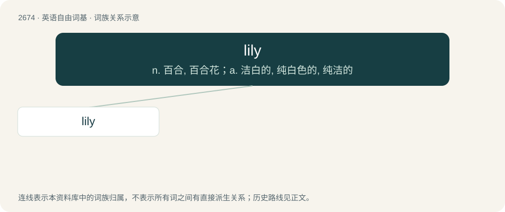

# 2776 · lily — n. 百合, 百合花；a. 洁白的, 纯白色的, 纯洁的

[总目录](../00_总目录_按常用程度.md)

**类型**：英语自由词基　｜　**来源语言**：见词源记录

## 核心含义与来源

- 核心含义：n. 百合, 百合花；a. 洁白的, 纯白色的, 纯洁的
- 英文含义：Any of several flowers in the genus Lilium of the family Liliaceae, which includes a great many ornamental species.
- 词形：lily

**来源记录 1**（名词；Any of several flowers in the genus Lilium of the family Liliaceae, which includes a great many ornamental species.）

From Middle English lilie, from Old English lilie, from Latin līlia, plural of līlium, from Ancient Greek λείριον (leírion). See there for more.

## 词族图

## 单词速览（常用到不常用）

| 单词 | 音标 | 释义 |
|---|---|---|
| [lily](#w-1) | /ˈlɪli/ | n. 百合, 百合花；a. 洁白的, 纯白色的, 纯洁的 |

## 逐词详解

### 1. lily

**词性**：名词　｜　**音标**：/ˈlɪli/

**中文释义**：n. 百合, 百合花；a. 洁白的, 纯白色的, 纯洁的

**英文义项**：Any of several flowers in the genus Lilium of the family Liliaceae, which includes a great many ornamental species. / Any of several species of herbaceous flower which may or may not resemble the genus Lilium in some way, and which are not closely related to it or each other.

**词源与演化**：

From Middle English lilie, from Old English lilie, from Latin līlia, plural of līlium, from Ancient Greek λείριον (leírion). See there for more.

**例句**：

> The other girls are jealous of Lily because she is extremely pretty.
