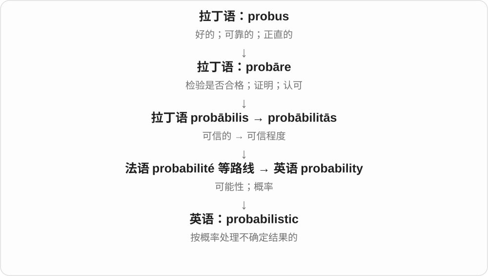
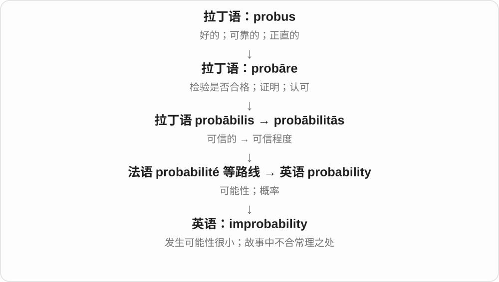

# 2776 · probability — 可能性；概率

[逐词精讲目录](../00_逐词精讲目录.md) · [总目录](../00_总目录_按常用程度.md)

## 核心词根与来源

probability 来自拉丁 probabilitas，经法语等途径传入，与 probable 同族。probabilistic 表示基于概率的，improbability 表示不大可能性或不大可能之事。

**PROBABILITY：把发生的可能程度明确拿出来谈**

可能发生之外，还可以问在一定模型下有多大机会。

- **可能程度**：probability · improbability
- **建模方式**：probabilistic

## 词形与演化规律

the probability of、probability that；probabilistic model 不等于完全随机猜测。im- 是否定成分的同化形式。

## 单词速览（按词族由简到繁）

同一基础词的相关扩展放在一起，先读基础形式，再读扩展；各组之间优先读常用的。具体词源关系见各词讲解。

| 单词 | 音标 | 核心意思 |
|---|---|---|
| [probability](#w-1) | 英 /ˌprɒbəˈbɪləti/；美 /ˌprɑːbəˈbɪləti/ | 可能性；概率 |
| [probabilistic](#w-2) | 英 /ˌprɒbəbɪˈlɪstɪk/；美 /ˌprɑːbəbɪˈlɪstɪk/ | 概率性的；用概率表达的 |
| [improbability](#w-3) | 英 /ɪmˌprɒbəˈbɪləti/；美 /ɪmˌprɑːbəˈbɪləti/ | 不大可能；不合常理之处 |

## 逐词讲解

### 1. probability — 可能性；概率

**音标**：英 /ˌprɒbəˈbɪləti/；美 /ˌprɑːbəˈbɪləti/

**先抓住这个画面**

把“多大可能发生”当成一个可以讨论、比较，有时还能计算的量。

**怎么拆**

来自拉丁语 probābilitās，经法语等路线借入；名词早有自己的历史，不只是现代英语 probable 临时加后缀。

**怎么变成今天的意思**

普通语境说 high probability；数学中常用 0 到 1 表示概率。in all probability 是固定说法，意为极有可能。

**常见搭配与例句**

the probability of…；a high probability；in all probability。

> The model estimates the probability of a delayed arrival.

模型估计到达延误的概率。

> In all probability, the parcel will arrive tomorrow.

包裹极有可能明天送到。

**别混淆**

probability 可是一般可能性，也可是模型内的数值；估计得到一个概率，不等于已经知道单次结果。

### 2. probabilistic — 概率性的；用概率表达的

**音标**：英 /ˌprɒbəbɪˈlɪstɪk/；美 /ˌprɑːbəbɪˈlɪstɪk/

**先抓住这个画面**

不只给一个铁定答案，而是把不同结果发生的可能性也放进模型。

**怎么拆**

由 probability / probabilism 词族加 -istic 形成；技术语境主要联系 probability“概率”。

**怎么变成今天的意思**

probabilistic forecast 可描述多种天气结果的可能性；probabilistic model 用概率分布表示不确定性，不保证每次预测正确。

**常见搭配与例句**

a probabilistic model；probabilistic reasoning；a probabilistic forecast。

> The system uses a probabilistic model to rank possible explanations.

系统用概率模型给不同解释排序。

> A probabilistic forecast shows more than one possible outcome.

概率预测会展示不止一种可能结果。

**别混淆**

probable 是某件事很可能；probabilistic 是分析方法使用概率，不等于模型只研究高概率事件。

### 3. improbability — 不大可能；不合常理之处

**音标**：英 /ɪmˌprɒbəˈbɪləti/；美 /ɪmˌprɑːbəˈbɪləti/

**先抓住这个画面**

当一件事需要太多巧合才能成立，人们会谈它有多“不像会发生”。

**怎么拆**

im- 否定 + probability，也对应 improbable 的性质名词；并非把概率变成负数。

**怎么变成今天的意思**

the improbability of success 是成功可能性低；复数 improbabilities 可指故事里一处处不可信的安排。

**常见搭配与例句**

the improbability of…；narrative improbabilities。

> The improbability of the coincidence made us check the records again.

这个巧合实在太罕见，我们又查了一遍记录。

> The film is enjoyable despite its many improbabilities.

虽然有许多不合常理的情节，这部电影仍很好看。

**别混淆**

improbability 不是数学里的负概率；它通常用自然语言评价低可能性或不可信程度。

## 这一组要分清什么

probability 是概率或可能性，certainty 是确定；概率模型也需要说明前提，不能仅靠词名保证预测准确。

## 串起来练习

The probabilistic model assigns a low probability to that outcome.

概率模型给那个结果分配了较低概率。
