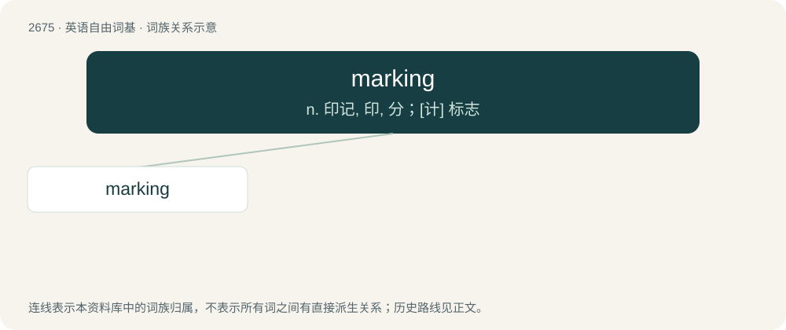

# 2777 · marking — n. 印记, 印, 分；\[计\] 标志

[总目录](../00_总目录_按常用程度.md)

**类型**：英语自由词基　｜　**来源语言**：见词源记录

## 核心含义与来源

- 核心含义：n. 印记, 印, 分；\[计\] 标志
- 英文含义：The action of marking.
- 词形：marking

**来源记录 1**（名词；The action of marking.）

From Middle English marking, merking, merkunge, from Old English mearcung, from Proto-West Germanic \*markungu, equivalent to mark + -ing.

## 词族图

## 单词速览（常用到不常用）

| 单词 | 音标 | 释义 |
|---|---|---|
| [marking](#w-1) | 英 /ˈmɑːkɪŋ/；美 /ˈmɑɹkɪŋ/ | n. 印记, 印, 分；\[计\] 标志 |

## 逐词详解

### 1. marking

**词性**：名词　｜　**音标**：英 /ˈmɑːkɪŋ/；美 /ˈmɑɹkɪŋ/

**中文释义**：n. 印记, 印, 分；\[计\] 标志

**英文义项**：The action of marking. / A mark.

**构词拆分**：mark + -ing

**词源与演化**：

From Middle English marking, merking, merkunge, from Old English mearcung, from Proto-West Germanic \*markungu, equivalent to mark + -ing.

**例句**：

> The markings on the plane identified it as belonging to law enforcement.

该用例对应义项：A symbol or set of letters used to identify the type or identity of an object.
