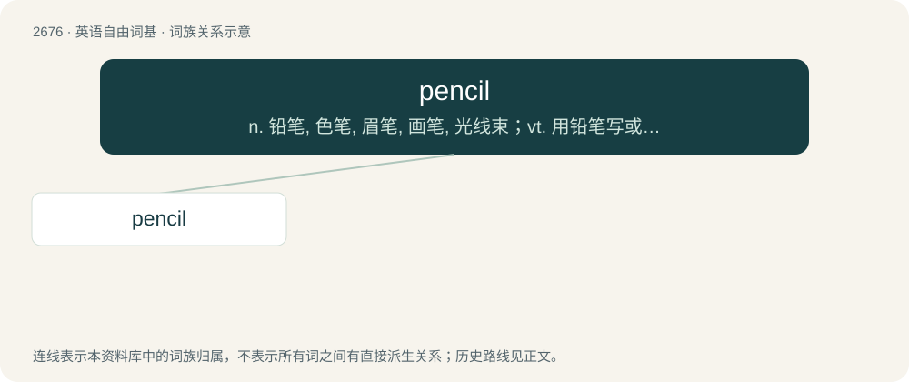

# 2778 · pencil — n. 铅笔, 色笔, 眉笔, 画笔, 光线束；vt. 用铅笔写或涂, 草拟

[总目录](../00_总目录_按常用程度.md)

**类型**：英语自由词基　｜　**来源语言**：见词源记录

## 核心含义与来源

- 核心含义：n. 铅笔, 色笔, 眉笔, 画笔, 光线束；vt. 用铅笔写或涂, 草拟
- 英文含义：A writing utensil with a graphite (commonly referred to as lead) shaft, usually blended with clay, clad in wood, and sharpened to a taper.
- 词形：pencil

**来源记录 1**（名词；A writing utensil with a graphite (commonly referred to as lead) shaft, usually blended with clay, clad in wood, and sharpened to a taper.）

From Anglo-Norman and Old French pincil (see the variant pincel, which gave rise to Modern French pinceau (“paintbrush”)), from Latin pēnicillum, diminutive of pēniculus (“brush”), itself a diminutive of pēnis (“tail; penis”). Doublet of penis. Not related to pen.

## 词族图

## 单词速览（常用到不常用）

| 单词 | 音标 | 释义 |
|---|---|---|
| [pencil](#w-1) | 英 /ˈpɛnsɪl/；/ˈpɛnsəl/ | n. 铅笔, 色笔, 眉笔, 画笔, 光线束；vt. 用铅笔写或涂, 草拟 |

## 逐词详解

### 1. pencil

**词性**：动词　｜　**音标**：英 /ˈpɛnsɪl/；/ˈpɛnsəl/

**中文释义**：n. 铅笔, 色笔, 眉笔, 画笔, 光线束；vt. 用铅笔写或涂, 草拟

**英文义项**：To write (something) using a pencil. / To mark with, or as if with, a pencil.

**词源与演化**：

From Anglo-Norman and Old French pincil (see the variant pincel, which gave rise to Modern French pinceau (“paintbrush”)), from Latin pēnicillum, diminutive of pēniculus (“brush”), itself a diminutive of pēnis (“tail; penis”). Doublet of penis. Not related to pen.

**例句**：

> I penciled (BrE: pencilled) a brief reminder in my notebook.

该用例对应义项：To write (something) using a pencil.
