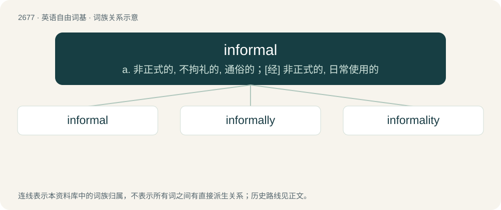

# 2779 · informal — a. 非正式的, 不拘礼的, 通俗的；\[经\] 非正式的, 日常使用的

[总目录](../00_总目录_按常用程度.md)

**类型**：英语自由词基　｜　**来源语言**：见词源记录

## 核心含义与来源

- 核心含义：a. 非正式的, 不拘礼的, 通俗的；\[经\] 非正式的, 日常使用的
- 英文含义：Not formal or ceremonious.
- 词形：informal

**来源记录 1**（形容词；Not formal or ceremonious.）

From in- + formal.

## 词族图

## 单词速览（常用到不常用）

| 单词 | 音标 | 释义 |
|---|---|---|
| [informal](#w-1) | 英 /ɪnˈfɔː.m(ə)l/；美 /ɪnˈfɔɹ.m(ə)l/ | a. 非正式的, 不拘礼的, 通俗的；\[经\] 非正式的, 日常使用的 |
| [informally](#w-2) |  | adv. 非正式地；不拘礼节地 |
| [informality](#w-3) | /.infɒːˈmæliti/ | n. 非正式 |

## 逐词详解

### 1. informal

**词性**：形容词　｜　**音标**：英 /ɪnˈfɔː.m(ə)l/；美 /ɪnˈfɔɹ.m(ə)l/

**中文释义**：a. 非正式的, 不拘礼的, 通俗的；\[经\] 非正式的, 日常使用的

**英文义项**：Not formal or ceremonious. / Not in accord with the usual regulations.

**构词拆分**：in- + formal

**词源与演化**：

From in- + formal.

**用法示例／搭配（非完整句）**：

> an informal get-together

该用例对应义项：Not formal or ceremonious.

### 2. informally

**词性**：副词

**中文释义**：adv. 非正式地；不拘礼节地

**英文义项**：In an irregular or informal manner; without the usual forms.

**构词拆分**：informal + -ly

**词源与演化**：

From informal + -ly.

**用法示例／搭配（非完整句）**：

> informally dressed

该用例对应义项：In an irregular or informal manner; without the usual forms.

### 3. informality

**词性**：名词　｜　**音标**：/.infɒːˈmæliti/

**中文释义**：n. 非正式

**英文义项**：The condition of being informal. / An informal term or usage; a colloquialism.

**构词拆分**：informal + -ity

**词源与演化**：

From informal + -ity.

**例句**：

> The meeting had an air of informality.
