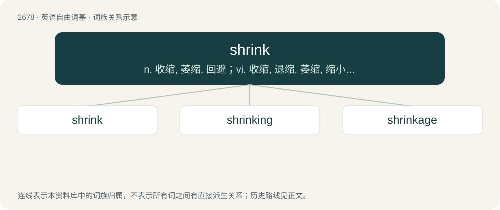

# 2780 · shrink — n. 收缩, 萎缩, 回避；vi. 收缩, 退缩, 萎缩, 缩小, 回避；vt. 使收缩, 使缩小

[总目录](../00_总目录_按常用程度.md)

**类型**：英语自由词基　｜　**来源语言**：见词源记录

## 核心含义与来源

- 核心含义：n. 收缩, 萎缩, 回避；vi. 收缩, 退缩, 萎缩, 缩小, 回避；vt. 使收缩, 使缩小
- 英文含义：To cause to become smaller.
- 词形：shrink

**来源记录 1**（动词；To cause to become smaller.）

From Middle English schrynken, from Old English sċrincan, from Proto-Germanic \*skrinkwaną. Cognate with Dutch schrinken (“to shrink”). The sense “psychologist, psychotherapist” is a clipping of head-shrinker.

## 词族图

## 单词速览（常用到不常用）

| 单词 | 音标 | 释义 |
|---|---|---|
| [shrink](#w-1) | /ˈʃɹɪŋk/ | n. 收缩, 萎缩, 回避；vi. 收缩, 退缩, 萎缩, 缩小, 回避；vt. 使收缩, 使缩小 |
| [shrinking](#w-2) | 英 /ˈʃɹɪŋkɪŋ/ | \[医\] 皱缩 |
| [shrinkage](#w-3) | /ˈʃriŋkidʒ/ | n. 收缩, 收缩量, 减低；\[化\] 起皱; 收缩; 收缩量 |

## 逐词详解

### 1. shrink

**词性**：动词　｜　**音标**：/ˈʃɹɪŋk/

**中文释义**：n. 收缩, 萎缩, 回避；vi. 收缩, 退缩, 萎缩, 缩小, 回避；vt. 使收缩, 使缩小

**英文义项**：To cause to become smaller. / To become smaller; to contract.

**词源与演化**：

From Middle English schrynken, from Old English sċrincan, from Proto-Germanic \*skrinkwaną. Cognate with Dutch schrinken (“to shrink”). The sense “psychologist, psychotherapist” is a clipping of head-shrinker.

**例句**：

> This garment will shrink when wet.

该用例对应义项：To become smaller; to contract.

### 2. shrinking

**词性**：形容词　｜　**音标**：英 /ˈʃɹɪŋkɪŋ/

**中文释义**：\[医\] 皱缩

**英文义项**：Shy and retiring.

**构词拆分**：From shrink + -ing.

**词源与演化**：

From shrink + -ing.

**例句**：

> Europeans have vented their frustration over rising prices and shrinking purchasing power.

### 3. shrinkage

**词性**：名词　｜　**音标**：/ˈʃriŋkidʒ/

**中文释义**：n. 收缩, 收缩量, 减低；\[化\] 起皱; 收缩; 收缩量

**英文义项**：The act of shrinking, or the proportion by which something shrinks. / The loss of merchandise through theft, spoilage, and obsolescence: the shrinking of inventory.

**构词拆分**：shrink + -age

**词源与演化**：

From shrink + -age.

**例句**：

> Shrinkage is the retail trade's euphemism for shoplifting.

该用例对应义项：the act of stealing goods that are on display in a store
