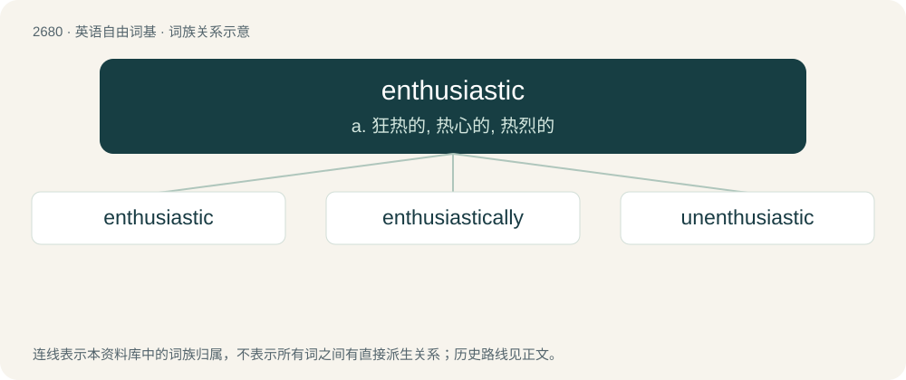

# 2782 · enthusiastic — a. 狂热的, 热心的, 热烈的

[总目录](../00_总目录_按常用程度.md)

**类型**：英语自由词基　｜　**来源语言**：见词源记录

## 核心含义与来源

- 核心含义：a. 狂热的, 热心的, 热烈的
- 英文含义：With zealous fervor; excited, motivated.
- 词形：enthusiastic

**来源记录 1**（形容词；With zealous fervor; excited, motivated.）

From Ancient Greek ἐνθουσιαστικός (enthousiastikós), from either ἐνθουσιασμός (enthousiasmós) or ἐνθουσιάζω (enthousiázō) + -τικός (-tikós).

## 词族图

## 单词速览（常用到不常用）

| 单词 | 音标 | 释义 |
|---|---|---|
| [enthusiastic](#w-1) | 英 /ɪnˌθjuːzɪˈæstɪk/；美 /ɪnˌθuːziˈæstɪk/ | a. 狂热的, 热心的, 热烈的 |
| [enthusiastically](#w-2) | /in.θjuːziˈæstikli/ | adv. 热心地, 狂热地 |
| [unenthusiastic](#w-3) | /ʌnɛnθjuːziˈæstɪk/ | a. 不热心的, 缺乏热情的 |

## 逐词详解

### 1. enthusiastic

**词性**：形容词　｜　**音标**：英 /ɪnˌθjuːzɪˈæstɪk/；美 /ɪnˌθuːziˈæstɪk/

**中文释义**：a. 狂热的, 热心的, 热烈的

**英文义项**：With zealous fervor; excited, motivated. / Relating to enthusiasm, or divine possession.

**词源与演化**：

From Ancient Greek ἐνθουσιαστικός (enthousiastikós), from either ἐνθουσιασμός (enthousiasmós) or ἐνθουσιάζω (enthousiázō) + -τικός (-tikós).

**用法示例／搭配（非完整句）**：

> an enthusiastic lover of art

该用例对应义项：With zealous fervor; excited, motivated.

### 2. enthusiastically

**词性**：副词　｜　**音标**：/in.θjuːziˈæstikli/

**中文释义**：adv. 热心地, 狂热地

**英文义项**：In an enthusiastic manner.

**构词拆分**：enthusiastic + -ally

**词源与演化**：

From enthusiastic + -ally.

**例句**：

> They discussed the question enthusiastically.

该用例对应义项：with enthusiasm; in an enthusiastic manner

### 3. unenthusiastic

**词性**：形容词　｜　**音标**：/ʌnɛnθjuːziˈæstɪk/

**中文释义**：a. 不热心的, 缺乏热情的

**英文义项**：Without enthusiasm; unexcited.

**构词拆分**：un- + enthusiastic

**词源与演化**：

From un- + enthusiastic.

**例句**：

> Tom said that Mary was likely to be unenthusiastic about that.
