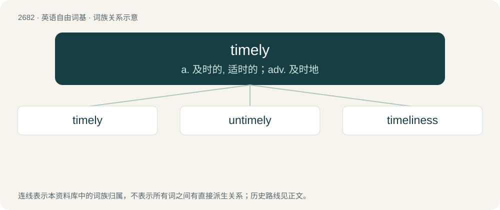

# 2784 · timely — a. 及时的, 适时的；adv. 及时地

[总目录](../00_总目录_按常用程度.md)

**类型**：英语自由词基　｜　**来源语言**：见词源记录

## 核心含义与来源

- 核心含义：a. 及时的, 适时的；adv. 及时地
- 英文含义：Done at the proper time or within the proper time limits; prompt.
- 词形：timely

**来源记录 1**（形容词；Done at the proper time or within the proper time limits; prompt.）

From Middle English timely, tymely, timliche, from Old English \*tīmlīc (adjective) and tīmlīċe (“in good time; timely; soon”, adverb), equivalent to time + -ly. Cognate with Danish timelig, Swedish timlig, Icelandic tímalegur, tímanlegur.

## 词族图

## 单词速览（常用到不常用）

| 单词 | 音标 | 释义 |
|---|---|---|
| [timely](#w-1) | /ˈtaɪm.li/ | a. 及时的, 适时的；adv. 及时地 |
| [untimely](#w-2) | /ʌnˈtaɪmli/ | a. 不到时候的, 不合时令的, 不适时的 |
| [timeliness](#w-3) | /ˈtaɪm.li.nəs/ | \[经\] 时间性, 及时性 |

## 逐词详解

### 1. timely

**词性**：形容词　｜　**音标**：/ˈtaɪm.li/

**中文释义**：a. 及时的, 适时的；adv. 及时地

**英文义项**：Done at the proper time or within the proper time limits; prompt. / Happening or appearing at the proper time.

**构词拆分**：time + -ly

**词源与演化**：

From Middle English timely, tymely, timliche, from Old English \*tīmlīc (adjective) and tīmlīċe (“in good time; timely; soon”, adverb), equivalent to time + -ly. Cognate with Danish timelig, Swedish timlig, Icelandic tímalegur, tímanlegur.

**例句**：

> With timely treatment the patient has a good chance of recovery.

该用例对应义项：done or happening at the appropriate or proper time

### 2. untimely

**词性**：形容词　｜　**音标**：/ʌnˈtaɪmli/

**中文释义**：a. 不到时候的, 不合时令的, 不适时的

**英文义项**：At an inopportune time. / Early; premature.

**构词拆分**：un- + timely

**词源与演化**：

From Middle English untymely (also earlier untimliche), equivalent to un- + timely. First attested in the early 13th century. Compare Middle Danish utimelig, Old English untídlic (“unseasonable”).

**用法示例／搭配（非完整句）**：

> an untimely death

该用例对应义项：Early; premature.

### 3. timeliness

**词性**：名词　｜　**音标**：/ˈtaɪm.li.nəs/

**中文释义**：\[经\] 时间性, 及时性

**英文义项**：The state of being timely.

**构词拆分**：timely + -ness

**词源与演化**：

From timely + -ness.

**例句**：

> Timeliness of data is critical to its relevance for decision making.
