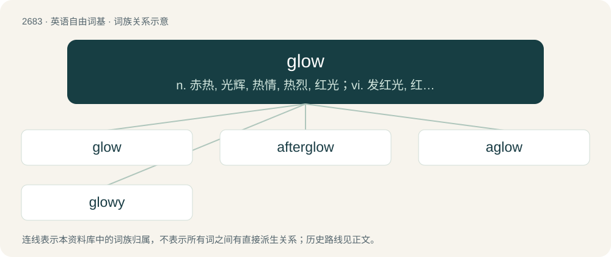

# 2785 · glow — n. 赤热, 光辉, 热情, 热烈, 红光；vi. 发红光, 红光焕发, 发热, 洋溢, 激动

[总目录](../00_总目录_按常用程度.md)

**类型**：英语自由词基　｜　**来源语言**：见词源记录

## 核心含义与来源

- 核心含义：n. 赤热, 光辉, 热情, 热烈, 红光；vi. 发红光, 红光焕发, 发热, 洋溢, 激动
- 英文含义：To emit heat and light without a flame.
- 词形：glow

**多个词源／构词路径**：同一拼写可能有不同来源；以下按词性和含义分别列出。

**来源记录 1**（动词；To emit heat and light without a flame.）

The verb is derived from Middle English glouen, glowen (“to give off heat and light without flame; of a thing: to be heated until red hot; to be brightly coloured; to shine brightly; (figurative) to be filled with emotion; of the face, etc.: to turn red, flush; etc.”), and then either: \* from Old English glōwan (“to glow”) (a strong verb), from Proto-West Germanic \*glōan (“to glow”); or \* because the Middle English and modern English words are weak verbs, possibly from Old Norse \*glówa, thought to be a variant of glóa (“to glow”), also a weak verb; both from Proto-Germanic \*glōaną (“to glow”), ultimately from Proto-Indo-European \*ǵʰleh₁- (“to shine, glow; to be shining, glowing”). Possibly a doublet of glass. The noun is derived from the verb. cognates \* Dutch gloeien \* Finnish loistaa \* German glühen \* Norwegian glo \* Old Norse glóa (Danish glo, Icelandic glóa, Swedish glo) \* Saterland Frisian gloie, glöie, gluuje \* West Frisian gloeie

**来源记录 2**（动词；To look intently; to stare.）

From Late Middle English glouen (“to gaze, stare”); further etymology uncertain, possibly either: \* from glouen, glowen (“to give off heat and light without flame; of a thing: to be heated until red hot; to be brightly coloured; to shine brightly; (figurative) to be filled with emotion; of the face, etc.: to turn red, flush; etc.”); or \* from Old Norse glóa (“to shine”) (whence Norwegian Nynorsk glo (“to stare”) and Swedish glo (“to stare”)). See further at etymology 1.

## 词族图

## 单词速览（常用到不常用）

| 单词 | 音标 | 释义 |
|---|---|---|
| [glow](#w-1) | 英 /ɡləʊ/；美 /ɡloʊ/ | n. 赤热, 光辉, 热情, 热烈, 红光；vi. 发红光, 红光焕发, 发热, 洋溢, 激动 |
| [afterglow](#w-2) | /ˈɑːftəglou/ | n. 晚霞, 夕照；\[医\] 滞光, 余辉 |
| [aglow](#w-3) | 美 /əˈɡloʊ/ | a. 发光的, 通红的；adv. 发光地 |
| [glowy](#w-4) | 英 /ˈɡləʊ.i/；美 /ˈɡloʊ.i/ | 【英文】Glowing. |

## 逐词详解

### 1. glow

**词性**：动词　｜　**音标**：英 /ɡləʊ/；美 /ɡloʊ/

**中文释义**：n. 赤热, 光辉, 热情, 热烈, 红光；vi. 发红光, 红光焕发, 发热, 洋溢, 激动

**英文义项**：To emit heat and light without a flame. / Of a fire: to emit heat and light.

**词源与演化**：

The verb is derived from Middle English glouen, glowen (“to give off heat and light without flame; of a thing: to be heated until red hot; to be brightly coloured; to shine brightly; (figurative) to be filled with emotion; of the face, etc.: to turn red, flush; etc.”), and then either: \* from Old English glōwan (“to glow”) (a strong verb), from Proto-West Germanic \*glōan (“to glow”); or \* because the Middle English and modern English words are weak verbs, possibly from Old Norse \*glówa, thought to be a variant of glóa (“to glow”), also a weak verb; both from Proto-Germanic \*glōaną (“to glow”), ultimately from Proto-Indo-European \*ǵʰleh₁- (“to shine, glow; to be shining, glowing”). Possibly a doublet of glass. The noun is derived from the verb. cognates \* Dutch gloeien \* Finnish loistaa \* German glühen \* Norwegian glo \* Old Norse glóa (Danish glo, Icelandic glóa, Swedish glo) \* Saterland Frisian gloie, glöie, gluuje \* West Frisian gloeie

**例句**：

> Iron glows red hot when heated to near its melting point.

该用例对应义项：To emit heat and light without a flame.

### 2. afterglow

**词性**：名词　｜　**音标**：/ˈɑːftəglou/

**中文释义**：n. 晚霞, 夕照；\[医\] 滞光, 余辉

**英文义项**：The glow seen in the sky after sunset. / The light emitted by an incandescent object while cooling.

**构词拆分**：after- + glow

**词源与演化**：

From after- + glow.

**例句**：

> There's an afterglow with singing after the evening worship.

该用例对应义项：An afterparty.

### 3. aglow

**词性**：形容词　｜　**音标**：美 /əˈɡloʊ/

**中文释义**：a. 发光的, 通红的；adv. 发光地

**英文义项**：glowing; radiant

**构词拆分**：a- + glow

**词源与演化**：

From a- + glow.

**例句**：

> A house aglow with lights.

该用例对应义项：softly bright or radiant

### 4. glowy

**词性**：形容词　｜　**音标**：英 /ˈɡləʊ.i/；美 /ˈɡloʊ.i/

**英文义项**：Glowing.

**构词拆分**：glow + -y

**词源与演化**：

From glow + -y.

**例句**：

> You are bright and glowy this morning.
