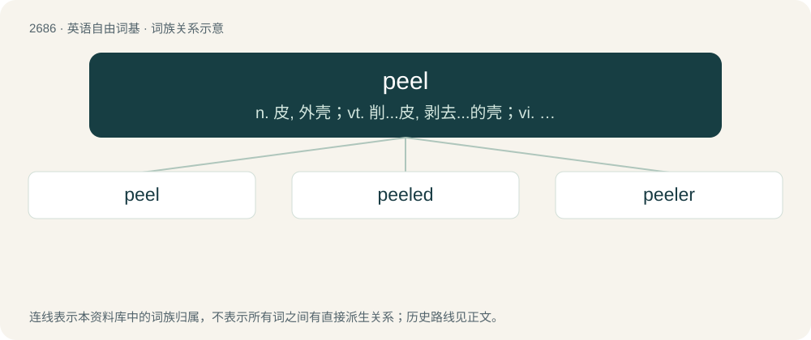

# 2786 · peel — n. 皮, 外壳；vt. 削...皮, 剥去...的壳；vi. 蜕皮, 剥落, 脱皮, 脱去衣服

[总目录](../00_总目录_按常用程度.md)

**类型**：英语自由词基　｜　**来源语言**：见词源记录

## 核心含义与来源

- 核心含义：n. 皮, 外壳；vt. 削...皮, 剥去...的壳；vi. 蜕皮, 剥落, 脱皮, 脱去衣服
- 英文含义：To remove the skin or outer covering of.
- 词形：peel

**多个词源／构词路径**：同一拼写可能有不同来源；以下按词性和含义分别列出。

**来源记录 1**（动词；To remove the skin or outer covering of.）

From Middle English pelen, from Old English pilian and Old French peler, pellier; both from Latin pilō, pilāre (“to remove hair from, depilate”), from pilus (“hair”). Doublet of pill.

**来源记录 2**（名词；A shovel or similar instrument, now especially a pole with a flat disc at the end used for removing pizza or loaves of bread from a baker's oven.）

From Middle English pele, from Old French pele (modern French pelle), from Latin pāla, from the base of plangō (“fix, plant”). Doublet of pala.

**来源记录 3**（名词；An equal or match; a draw.）

Unknown.

**来源记录 4**（动词；To send through a hoop (of a ball other than one's own).）

Named from Walter H. Peel, a noted 19th-century croquet player.

## 词族图

## 单词速览（常用到不常用）

| 单词 | 音标 | 释义 |
|---|---|---|
| [peel](#w-1) | /piːl/ | n. 皮, 外壳；vt. 削...皮, 剥去...的壳；vi. 蜕皮, 剥落, 脱皮, 脱去衣服 |
| [peeled](#w-2) | /piːld/ | a. 剥去皮的 |
| [peeler](#w-3) | 英 /ˈpiːlə/；美 /ˈpiːlɚ/ | 【英文】One who peels. |

## 逐词详解

### 1. peel

**词性**：动词　｜　**音标**：/piːl/

**中文释义**：n. 皮, 外壳；vt. 削...皮, 剥去...的壳；vi. 蜕皮, 剥落, 脱皮, 脱去衣服

**英文义项**：To remove the skin or outer covering of. / To remove something from the outer or top layer of.

**词源与演化**：

From Middle English pelen, from Old English pilian and Old French peler, pellier; both from Latin pilō, pilāre (“to remove hair from, depilate”), from pilus (“hair”). Doublet of pill.

**例句**：

> We peeled the old wallpaper off in strips where it was hanging loose.

该用例对应义项：To remove something from the outer or top layer of.

### 2. peeled

**词性**：形容词　｜　**音标**：/piːld/

**中文释义**：a. 剥去皮的

**英文义项**：With the outermost layer or skin removed. / Dieted down such as having attained a peak contrast of trained muscle volume.

**构词拆分**：From peel (verb) + -ed (suffix forming past tenses).

**词源与演化**：

From peel (verb) + -ed (suffix forming past tenses).

**例句**：

> He stirred the campfire stew with a peeled stick, so the bark wouldn't get in it.

该用例对应义项：With the outermost layer or skin removed.

### 3. peeler

**词性**：名词　｜　**音标**：英 /ˈpiːlə/；美 /ˈpiːlɚ/

**英文义项**：One who peels. / A person whose job it is to peel fruit or vegetable produce.

**构词拆分**：peel + -er

**词源与演化**：

From Middle English peler, piller, pyllare, pilour, pelure, pelour, equivalent to peel + -er.

**用法示例／搭配（非完整句）**：

> potato peeler

该用例对应义项：A household utensil for peeling fruit or vegetables.
