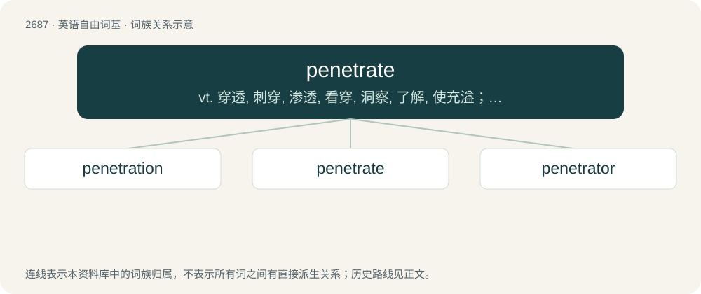

# 2787 · penetrate — vt. 穿透, 刺穿, 渗透, 看穿, 洞察, 了解, 使充溢；vi. 刺入, 看穿, 渗透, 打进

[总目录](../00_总目录_按常用程度.md)

**类型**：英语自由词基　｜　**来源语言**：见词源记录

## 核心含义与来源

- 核心含义：vt. 穿透, 刺穿, 渗透, 看穿, 洞察, 了解, 使充溢；vi. 刺入, 看穿, 渗透, 打进
- 英文含义：To enter into; to make way into the interior of; to pierce.
- 词形：penetrate

**来源记录 1**（动词；To enter into; to make way into the interior of; to pierce.）

From Latin penētrātus, perfect passive participle of penētrō (“to put, set, or place within, enter, pierce, penetrate”) (see -ate (verb-forming suffix)), from penes (“within, with”) by analogy to intrō (“to go in, enter”). Compare French pénétrer.

## 词族图

## 单词速览（常用到不常用）

| 单词 | 音标 | 释义 |
|---|---|---|
| [penetration](#w-1) | 英 /pɛ.nɪˈtɹeɪ.ʃən/；美 /pɛ.nəˈtɹeɪ.ʃən/ | n. 穿透, 渗透, 侵入, 识穿, 洞察(力)；\[化\] 渗入 |
| [penetrate](#w-2) | /ˈpɛnɪtɹeɪt/ | vt. 穿透, 刺穿, 渗透, 看穿, 洞察, 了解, 使充溢；vi. 刺入, 看穿, 渗透, 打进 |
| [penetrator](#w-3) | /ˈpenitreitə/ | n. 穿入者, 侵入者, 渗透者；\[化\] 过烧; 过烧焊 |

## 逐词详解

### 1. penetration

**词性**：名词　｜　**音标**：英 /pɛ.nɪˈtɹeɪ.ʃən/；美 /pɛ.nəˈtɹeɪ.ʃən/

**中文释义**：n. 穿透, 渗透, 侵入, 识穿, 洞察(力)；\[化\] 渗入

**英文义项**：The act of penetrating something. / The insertion of the penis (or similar object) during sexual intercourse.

**构词拆分**：penetrate + -ion

**词源与演化**：

From Middle English penetracioun, from Old French penetracïon, and its source, Latin penetrātiō, from the participle stem of penetrō (“pierce”, verb). Morphologically penetrate + -ion.

**例句**：

> Any penetration, however slight, is sufficient to complete the offense.

该用例对应义项：The insertion of the penis (or similar object) during sexual intercourse.

### 2. penetrate

**词性**：动词　｜　**音标**：/ˈpɛnɪtɹeɪt/

**中文释义**：vt. 穿透, 刺穿, 渗透, 看穿, 洞察, 了解, 使充溢；vi. 刺入, 看穿, 渗透, 打进

**英文义项**：To enter into; to make way into the interior of; to pierce. / To achieve understanding of, despite some obstacle; to comprehend; to understand.

**词源与演化**：

From Latin penētrātus, perfect passive participle of penētrō (“to put, set, or place within, enter, pierce, penetrate”) (see -ate (verb-forming suffix)), from penes (“within, with”) by analogy to intrō (“to go in, enter”). Compare French pénétrer.

**例句**：

> I could not penetrate Burke's opaque rhetoric.

该用例对应义项：To achieve understanding of, despite some obstacle; to comprehend; to understand.

### 3. penetrator

**词性**：名词　｜　**音标**：/ˈpenitreitə/

**中文释义**：n. 穿入者, 侵入者, 渗透者；\[化\] 过烧; 过烧焊

**英文义项**：Something that penetrates. / A long-range fighter aircraft designed to penetrate enemy air defences.

**构词拆分**：From penetrate + -or.

**词源与演化**：

From penetrate + -or.
