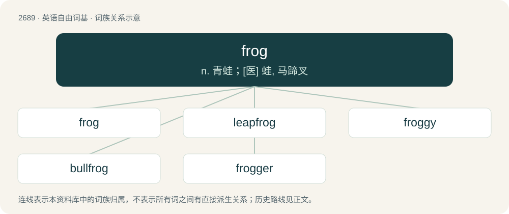

# 2788 · frog — n. 青蛙；\[医\] 蛙, 马蹄叉

[总目录](../00_总目录_按常用程度.md)

**类型**：英语自由词基　｜　**来源语言**：见词源记录

## 核心含义与来源

- 核心含义：n. 青蛙；\[医\] 蛙, 马蹄叉
- 英文含义：Any of a class of small tailless amphibians of the order Anura that typically hop.
- 词形：frog

**多个词源／构词路径**：同一拼写可能有不同来源；以下按词性和含义分别列出。

**来源记录 1**（名词；Any of a class of small tailless amphibians of the order Anura that typically hop.）

From Middle English frogge, from Old English frocga, from Proto-West Germanic \*froggō (“frog”). Cognate with Old Norse frauki, and Old English frox, frosc, whence Modern English frosh and frosk (“frog”). Possibly related to Saterland Frisian Poage (“frog”), German Low German Pogg, Pogge (“frog”). Sense 5 (organ on a horse's hoof) is a calque of Ancient Greek βάτραχος (bátrakhos).

**来源记录 2**（名词；A French person.）

From frog legs, stereotypical food of the French. Compare Kraut (“German person”) and French rosbif (“English person”) (from roast beef), with similar food etymologies.

**来源记录 3**（名词；A leather or fabric loop used to attach a sword or bayonet, or its scabbard, to a waist or shoulder belt.）

Unknown. Possibly borrowed from Portuguese froco (“flock”), from Latin floccus (“flock”).

**来源记录 4**（动词；To unravel part of (a knitted garment), either to correct a mistake or to reclaim the thread or yarn.）

Supposedly from ribbit (“sound made by a frog”) sounding similar to “rip it”.

**来源记录 5**（动词；To have sex with; fuck.）

Probably a minced oath alteration of fuck.

## 词族图

## 单词速览（常用到不常用）

| 单词 | 音标 | 释义 |
|---|---|---|
| [frog](#w-1) | 英 /fɹɒɡ/；/fɹɔɡ/ | n. 青蛙；\[医\] 蛙, 马蹄叉 |
| [leapfrog](#w-2) | 英 /ˈliːpfɹɒɡ/；美 /ˈliːpfɹɑɡ/ | n. 跳背游戏, 竞相提高；vi. 跳背, 交替前进；vt. 跃过 |
| [froggy](#w-3) | 英 /ˈfɹɒɡi/；/ˈfɹɑɡi/ | a. 多蛙的, 法国的；n. 法国人 |
| [bullfrog](#w-4) | 英 /ˈbʊlfɹɒɡ/；美 /ˈbʊlfɹɑɡ/ | n. 牛蛙, 喧蛙 |
| [frogger](#w-5) | /fˈrɒɡə/ | 辙叉工，道叉工 |

## 逐词详解

### 1. frog

**词性**：名词　｜　**音标**：英 /fɹɒɡ/；/fɹɔɡ/

**中文释义**：n. 青蛙；\[医\] 蛙, 马蹄叉

**英文义项**：Any of a class of small tailless amphibians of the order Anura that typically hop. / A member of this class that is not a toad.

**词源与演化**：

From Middle English frogge, from Old English frocga, from Proto-West Germanic \*froggō (“frog”). Cognate with Old Norse frauki, and Old English frox, frosc, whence Modern English frosh and frosk (“frog”). Possibly related to Saterland Frisian Poage (“frog”), German Low German Pogg, Pogge (“frog”). Sense 5 (organ on a horse's hoof) is a calque of Ancient Greek βάτραχος (bátrakhos).

**例句**：

> No sooner had I opened the box than a frog jumped out.

### 2. leapfrog

**词性**：动词　｜　**音标**：英 /ˈliːpfɹɒɡ/；美 /ˈliːpfɹɑɡ/

**中文释义**：n. 跳背游戏, 竞相提高；vi. 跳背, 交替前进；vt. 跃过

**英文义项**：To jump over some obstacle, as in the game of leapfrog. / To overtake.

**构词拆分**：leap + frog

**词源与演化**：

From leap + frog.

**例句**：

> This new product will leapfrog the competition.

该用例对应义项：To overtake.

### 3. froggy

**词性**：名词　｜　**音标**：英 /ˈfɹɒɡi/；/ˈfɹɑɡi/

**中文释义**：a. 多蛙的, 法国的；n. 法国人

**英文义项**：A frog. / A French person.

**构词拆分**：frog + -y (suffix forming diminutives)

**词源与演化**：

From frog + -y (suffix forming diminutives).

### 4. bullfrog

**词性**：名词　｜　**音标**：英 /ˈbʊlfɹɒɡ/；美 /ˈbʊlfɹɑɡ/

**中文释义**：n. 牛蛙, 喧蛙

**英文义项**：Any of various frogs having a croak that resembles the bellow of a cow or bull.

**构词拆分**：bull + frog

**词源与演化**：

From bull + frog.

**例句**：

> Still to come... buttermilk-fried bullfrog legs, braised wild boar with Himalayan blackberry glaze and Asian carp boulettes.

### 5. frogger

**词性**：名词　｜　**音标**：/fˈrɒɡə/

**中文释义**：辙叉工，道叉工

**英文义项**：The pronged plater used in frogging (transferring cells to another plate). / A person interested in frogs; a herpetologist who specialises in frogs; a frog enthusiast.

**构词拆分**：frog + -er

**词源与演化**：

From frog + -er.
