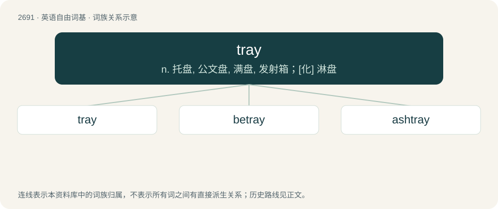

# 2789 · tray — n. 托盘, 公文盘, 满盘, 发射箱；\[化\] 淋盘

[总目录](../00_总目录_按常用程度.md)

**类型**：英语自由词基　｜　**来源语言**：见词源记录

## 核心含义与来源

- 核心含义：n. 托盘, 公文盘, 满盘, 发射箱；\[化\] 淋盘
- 英文含义：A small, typically rectangular or round, flat, and rigid object upon which things are carried.
- 词形：tray

**多个词源／构词路径**：同一拼写可能有不同来源；以下按词性和含义分别列出。

**来源记录 1**（名词；A small, typically rectangular or round, flat, and rigid object upon which things are carried.）

From Middle English trey, from Old English trēġ, trīġ (“wooden board, tray”), from Proto-West Germanic \*trauwi, from Proto-Germanic \*trawją (“wooden vessel”), from Proto-Indo-European \*drewo-, \*dóru (“tree; wood”). Cognate with Old Norse treyja (“carrier”), Old Swedish trø (“wooden grain measure”), Low German Treechel (“dough trough”), Ancient Greek δροίτη (droítē, “tub, vat”), Sanskrit द्रोण (droṇa, “trough”). Related to trough and tree.

**来源记录 2**（名词；A gay trans person, particularly a man (a man who is both transgender and gay)）

Blend of trans + gay.

## 词族图

## 单词速览（常用到不常用）

| 单词 | 音标 | 释义 |
|---|---|---|
| [tray](#w-1) | /tɹeɪ/ | n. 托盘, 公文盘, 满盘, 发射箱；\[化\] 淋盘 |
| [betray](#w-2) | /bɪˈtɹeɪ/ | vt. 出卖, 背叛, 辜负, 暴露；\[法\] 出卖, 背叛, 泄漏 |
| [ashtray](#w-3) | /ˈæʃ.tɹeɪ/ | n. 烟灰缸 |

## 逐词详解

### 1. tray

**词性**：名词　｜　**音标**：/tɹeɪ/

**中文释义**：n. 托盘, 公文盘, 满盘, 发射箱；\[化\] 淋盘

**英文义项**：A small, typically rectangular or round, flat, and rigid object upon which things are carried. / The items on a full tray.

**词源与演化**：

From Middle English trey, from Old English trēġ, trīġ (“wooden board, tray”), from Proto-West Germanic \*trauwi, from Proto-Germanic \*trawją (“wooden vessel”), from Proto-Indo-European \*drewo-, \*dóru (“tree; wood”). Cognate with Old Norse treyja (“carrier”), Old Swedish trø (“wooden grain measure”), Low German Treechel (“dough trough”), Ancient Greek δροίτη (droítē, “tub, vat”), Sanskrit द्रोण (droṇa, “trough”). Related to trough and tree.

**例句**：

> The loader is responsible for placing the work on the trays for the plating machines.

该用例对应义项：A component of a device into which an item is placed for use in the device's operations.

### 2. betray

**词性**：动词　｜　**音标**：/bɪˈtɹeɪ/

**中文释义**：vt. 出卖, 背叛, 辜负, 暴露；\[法\] 出卖, 背叛, 泄漏

**英文义项**：To deliver into the hands of an enemy by treachery or fraud, in violation of trust; to give up treacherously or faithlessly. / To prove faithless or treacherous to, as to a trust or one who trusts; to be false to; to deceive.

**构词拆分**：be- + tray (“to betray”)

**词源与演化**：

From Middle English betrayen, bitrayen (“to commit an act of treason against”), equivalent to be- + tray (“to betray”). Middle English bi- is from Old English be- (“be-”), from Proto-Germanic \*bi- (“be-”), from Proto-Germanic \*bi (“near, by”), ultimately from Proto-Indo-European \*h₁epi (“at, near”). Compare also traitor, treason, tradition. The modern sense “to disclose, discover, reveal unintentionally” is due to influence from or merger with English bewray (“to reveal, divulge”), which is similar in sound and meaning. The similarity with German betrügen, Dutch bedriegen, from Proto-West Germanic \*bidreugan (“to betray, deceive”), is coincidental.

**例句**：

> Though he had lived in England for many years, a faint accent betrayed his Swedish origin.

该用例对应义项：To disclose or indicate, for example something which prudence would conceal; to reveal unintentionally.

### 3. ashtray

**词性**：动词　｜　**音标**：/ˈæʃ.tɹeɪ/

**中文释义**：n. 烟灰缸

**英文义项**：To use an ashtray.

**构词拆分**：ash + tray

**词源与演化**：

From ash + tray. Compare German Aschenbecher.

**用法示例／搭配（非完整句）**：

> to ashtray a cigarette

该用例对应义项：To use an ashtray.
