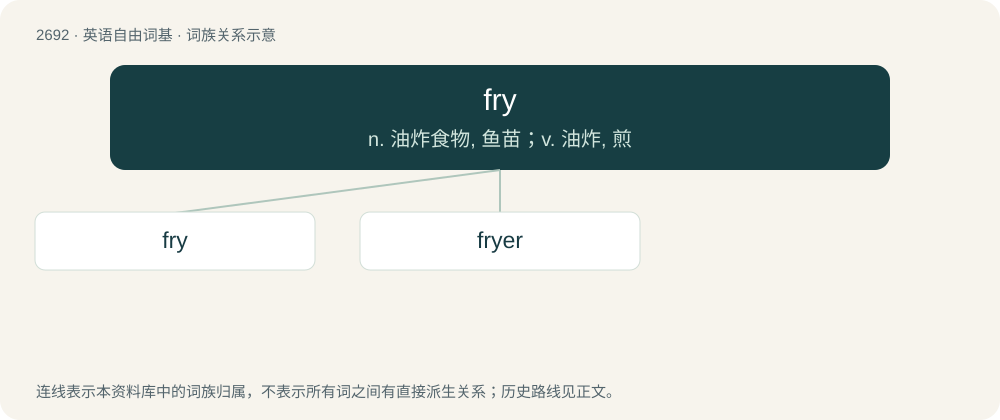

# 2791 · fry — n. 油炸食物, 鱼苗；v. 油炸, 煎

[总目录](../00_总目录_按常用程度.md)

**类型**：英语自由词基　｜　**来源语言**：见词源记录

## 核心含义与来源

- 核心含义：n. 油炸食物, 鱼苗；v. 油炸, 煎
- 英文含义：To cook (something) in hot fat.
- 词形：fry

**多个词源／构词路径**：同一拼写可能有不同来源；以下按词性和含义分别列出。

**来源记录 1**（动词；To cook (something) in hot fat.）

Inherited from Middle English fryen, borrowed from Old French frire, from Latin frīgō. Cognate with Ancient Greek φρύγω (phrúgō, “to roast, bake”), Sanskrit भृज्जति (bhṛjjati, “to roast, grill, fry”). Replaced native Middle English hirsten, from Old English hierstan (“to fry”). Related to bhurji, bhujia (“fried Indian snacks”).

**来源记录 2**（名词；Young fish; fishlings.）

From Middle English frie (“spawn of fish, young or small fish, offspring, progeny, children”), probably from Old Norse frjó (“seed, semen”), from Proto-Germanic \*fraiwą (“seed, semen, offspring”), from Proto-Indo-European \*(s)per-, \*(s)prey- (“to strew, sow”). Cognate with Icelandic frjó (“pollen, seed”), Icelandic fræ (“seed”), Swedish frö (“seed, embryo, grain, germ”), Danish and Norwegian frø (“seed”), Gothic 𐍆𐍂𐌰𐌹𐍅 (fraiw, “seed”). Likely merging with Old French froiz, froie (“spawn, spawning”), from froier, freier (“to spawn”), from Latin fricō (“to rub”). Compare friable.

**来源记录 3**（名词；A kind of sieve.）

Dialectal, of obscure origin. Perhaps related to or a corruption of frith (“a wood, forest", also "brushwood, wattle”), from Middle English fryth, frith (“forest, woodland, a fence of brush or wattle, hedge”).

## 词族图

## 单词速览（常用到不常用）

| 单词 | 音标 | 释义 |
|---|---|---|
| [fry](#w-1) | /fɹaɪ/ | n. 油炸食物, 鱼苗；v. 油炸, 煎 |
| [fryer](#w-2) | /fraiə/ | n. 做油煎食物的人, 可供油炸的食品, 油炸锅 |

## 逐词详解

### 1. fry

**词性**：动词　｜　**音标**：/fɹaɪ/

**中文释义**：n. 油炸食物, 鱼苗；v. 油炸, 煎

**英文义项**：To cook (something) in hot fat. / To cook in hot fat.

**词源与演化**：

Inherited from Middle English fryen, borrowed from Old French frire, from Latin frīgō. Cognate with Ancient Greek φρύγω (phrúgō, “to roast, bake”), Sanskrit भृज्जति (bhṛjjati, “to roast, grill, fry”). Replaced native Middle English hirsten, from Old English hierstan (“to fry”). Related to bhurji, bhujia (“fried Indian snacks”).

**例句**：

> You'll fry if you go out in this sun with no sunblock on.

该用例对应义项：To suffer because of too much heat.

### 2. fryer

**词性**：名词　｜　**音标**：/fraiə/

**中文释义**：n. 做油煎食物的人, 可供油炸的食品, 油炸锅

**英文义项**：A machine or container for frying food. / A fish suitable for frying.

**构词拆分**：fry + -er (agent noun suffix)

**词源与演化**：

From fry + -er (agent noun suffix) or + -er (patient suffix).

**例句**：

> He learned to work the fryer as part of becoming a competent cook for a commercial kitchen.

该用例对应义项：A machine or container for frying food.
