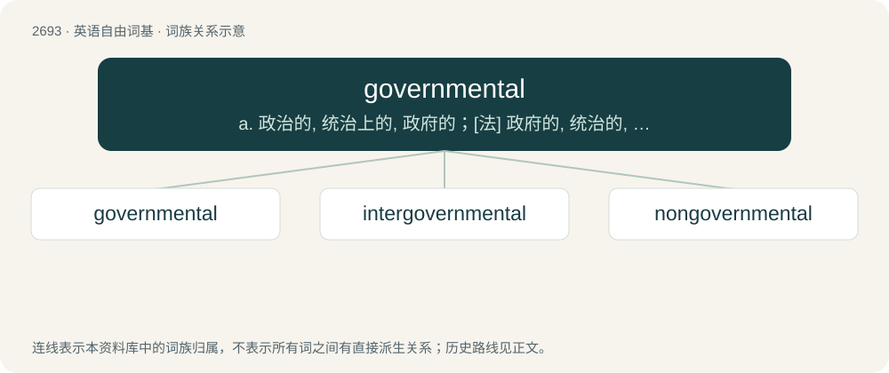

# 2792 · governmental — a. 政治的, 统治上的, 政府的；\[法\] 政府的, 统治的, 政治上的

[总目录](../00_总目录_按常用程度.md)

**类型**：英语自由词基　｜　**来源语言**：见词源记录

## 核心含义与来源

- 核心含义：a. 政治的, 统治上的, 政府的；\[法\] 政府的, 统治的, 政治上的
- 英文含义：Relating to a government.
- 词形：governmental

**来源记录 1**（形容词；Relating to a government.）

From government + -al.

## 词族图

## 单词速览（常用到不常用）

| 单词 | 音标 | 释义 |
|---|---|---|
| [governmental](#w-1) | 英 /ˌɡʌv(ə)nˈmɛnt(ə)l/；美 /ˌɡʌvɚnˈmɛnt(ə)l/ | a. 政治的, 统治上的, 政府的；\[法\] 政府的, 统治的, 政治上的 |
| [intergovernmental](#w-2) | /,intə^ʌvənˈmentəl/ | a. 政府间的 |
| [nongovernmental](#w-3) | /nɒnɡʌvnmenlt/ | a. 非政府的, 非政治（上）的; 草野; 民间 |

## 逐词详解

### 1. governmental

**词性**：形容词　｜　**音标**：英 /ˌɡʌv(ə)nˈmɛnt(ə)l/；美 /ˌɡʌvɚnˈmɛnt(ə)l/

**中文释义**：a. 政治的, 统治上的, 政府的；\[法\] 政府的, 统治的, 政治上的

**英文义项**：Relating to a government. / Relating to governing.

**构词拆分**：government + -al

**词源与演化**：

From government + -al.

**用法示例／搭配（非完整句）**：

> governmental department

该用例对应义项：Relating to a government.

### 2. intergovernmental

**词性**：形容词　｜　**音标**：/,intə^ʌvənˈmentəl/

**中文释义**：a. 政府间的

**英文义项**：Of, relating to, or involving two or more governments.

**构词拆分**：inter- + governmental

**词源与演化**：

From inter- + governmental.

**例句**：

> The chairman of the Intergovernmental Panel on Climate Change does not mince words.

### 3. nongovernmental

**词性**：形容词　｜　**音标**：/nɒnɡʌvnmenlt/

**中文释义**：a. 非政府的, 非政治（上）的; 草野; 民间

**英文义项**：Not governmental; not derived from a government; civilian.

**构词拆分**：From non- + governmental.

**词源与演化**：

From non- + governmental.
