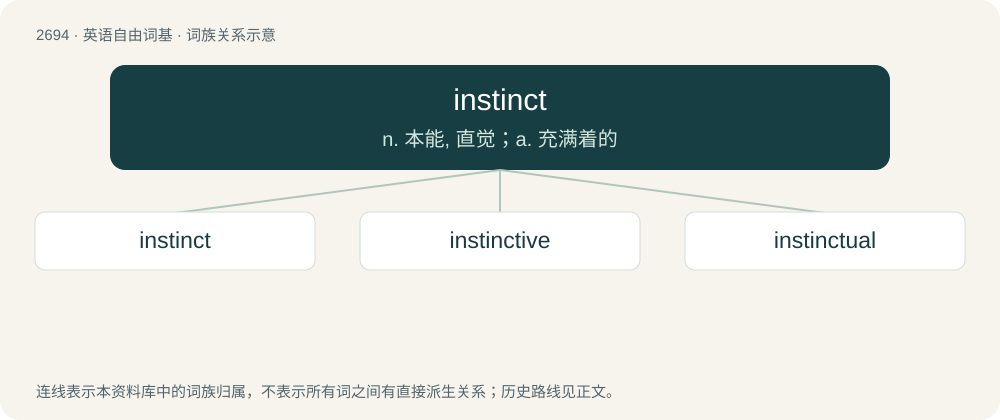

# 2793 · instinct — n. 本能, 直觉；a. 充满着的

[总目录](../00_总目录_按常用程度.md)

**类型**：英语自由词基　｜　**来源语言**：见词源记录

## 核心含义与来源

- 核心含义：n. 本能, 直觉；a. 充满着的
- 英文含义：A natural or inherent impulse or behaviour.
- 词形：instinct

**来源记录 1**（名词；A natural or inherent impulse or behaviour.）

From Latin īnstīnctus, past participle of īnstinguō (“to incite, to instigate”), from in (“in, on”) + stinguō (“to prick”).

## 词族图

## 单词速览（常用到不常用）

| 单词 | 音标 | 释义 |
|---|---|---|
| [instinct](#w-1) | /ˈɪn.stɪŋkt/ | n. 本能, 直觉；a. 充满着的 |
| [instinctive](#w-2) | /ɪnˈstɪŋktɪv/ | a. 本能的, 天生的, 直觉的；\[医\] 本能的 |
| [instinctual](#w-3) | 英 /ɪnˈstɪŋk.tjuː.əl/；/ɪnˈstɪŋk.t͡ʃuː.əl/ | a. 本能的 |

## 逐词详解

### 1. instinct

**词性**：名词　｜　**音标**：/ˈɪn.stɪŋkt/

**中文释义**：n. 本能, 直觉；a. 充满着的

**英文义项**：A natural or inherent impulse or behaviour. / An intuitive reaction not based on rational conscious thought.

**词源与演化**：

From Latin īnstīnctus, past participle of īnstinguō (“to incite, to instigate”), from in (“in, on”) + stinguō (“to prick”).

**例句**：

> Debbie's instinct was to distrust John.

该用例对应义项：An intuitive reaction not based on rational conscious thought.

### 2. instinctive

**词性**：形容词　｜　**音标**：/ɪnˈstɪŋktɪv/

**中文释义**：a. 本能的, 天生的, 直觉的；\[医\] 本能的

**英文义项**：Related to or prompted by instinct. / Driven by impulse, spontaneous and without thinking.

**构词拆分**：instinct + -ive

**词源与演化**：

From instinct + -ive.

**例句**：

> When approached by a stranger, Jared clenched his fists in an instinctive manner.

该用例对应义项：Driven by impulse, spontaneous and without thinking.

### 3. instinctual

**词性**：形容词　｜　**音标**：英 /ɪnˈstɪŋk.tjuː.əl/；/ɪnˈstɪŋk.t͡ʃuː.əl/

**中文释义**：a. 本能的

**英文义项**：Of, relating to, or derived from instinct.

**构词拆分**：From instinct + -ual.

**词源与演化**：

From instinct + -ual.
