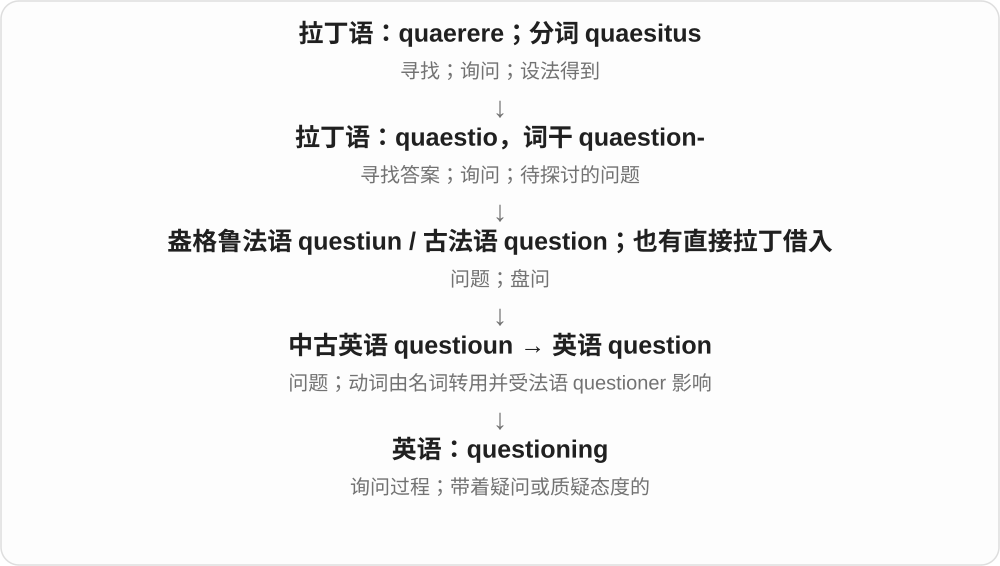
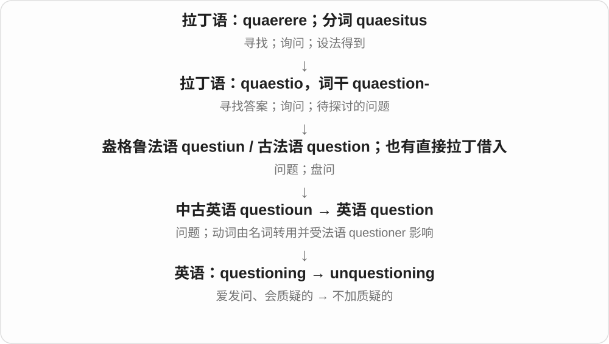

# 2793 · questioning — 提问；质疑；追问的

[逐词精讲目录](../00_逐词精讲目录.md) · [总目录](../00_总目录_按常用程度.md)

## 核心词根与来源

questioning 来自 question 的 -ing 形式，可作过程名词或形容词。unquestioning 通常说不加怀疑、照单接受，和没有被问到的 unquestioned 不完全相同。

**QUESTIONING：不只接受，也继续问理由**

带着疑问的眼神，与不经质疑地服从形成对照。

- **追问与不质疑**：questioning · unquestioning

## 词形与演化规律

a questioning look、questioning of a claim、unquestioning obedience；词性由位置和搭配决定。

## 单词速览（按词族由简到繁）

同一基础词的相关扩展放在一起，先读基础形式，再读扩展；各组之间优先读常用的。具体词源关系见各词讲解。

| 单词 | 音标 | 核心意思 |
|---|---|---|
| [questioning](#w-1) | /ˈkwestʃənɪŋ/ | 询问；盘问；带疑问的；不轻信的 |
| [unquestioning](#w-2) | /ʌnˈkwestʃənɪŋ/ | 不加质疑的；全盘接受的 |

## 逐词讲解

### 1. questioning — 询问；盘问；带疑问的；不轻信的

**音标**：/ˈkwestʃənɪŋ/

**先抓住这个画面**

questioning 可以是一连串问话，也可以是一个无声的眼神：“这到底怎么回事？”

**怎么拆**

question + -ing，由动词的进行形式发展出名词和形容词用法。

**怎么变成今天的意思**

under questioning 是在接受问话；a questioning look 是疑惑的目光；a questioning mind 是愿意追问依据的头脑。这里形容词不等于“自身可疑”。

**常见搭配与例句**

under questioning；a questioning look；a questioning attitude。

> He gave me a questioning look when I arrived with three suitcases.

我提着三个箱子到达时，他疑惑地看了我一眼。

> The witness remained calm throughout the questioning.

证人在整个询问过程中都很镇定。

**别混淆**

questionable 的对象值得怀疑；questioning 的人或神情正在提出疑问。

### 2. unquestioning — 不加质疑的；全盘接受的

**音标**：/ʌnˈkwestʃənɪŋ/

**先抓住这个画面**

unquestioning 是别人说什么就照单全收，脑中没有按下“为什么”的按钮。

**怎么拆**

un- + questioning，否定主动发问、质疑的态度。

**怎么变成今天的意思**

unquestioning obedience 是不问原因的服从；unquestioning trust 是毫无保留的信任。是否值得肯定，需要看关系和情境。

**常见搭配与例句**

unquestioning loyalty；unquestioning obedience；unquestioning acceptance。

> The manager expected unquestioning obedience from the staff.

经理希望员工不问缘由地服从。

> Their unquestioning trust made the deception easier.

他们毫无怀疑的信任让骗局更容易得逞。

**别混淆**

unquestioning 描写接受者不问；unquestioned 描写一件事没有被问，主动和被动的方向不同。

## 这一组要分清什么

unquestioning 不等于没人向他提问，而是当事人不质疑；动作参与角色需要分清。

## 串起来练习

比较 a questioning attitude 与 unquestioning acceptance 两种态度。
