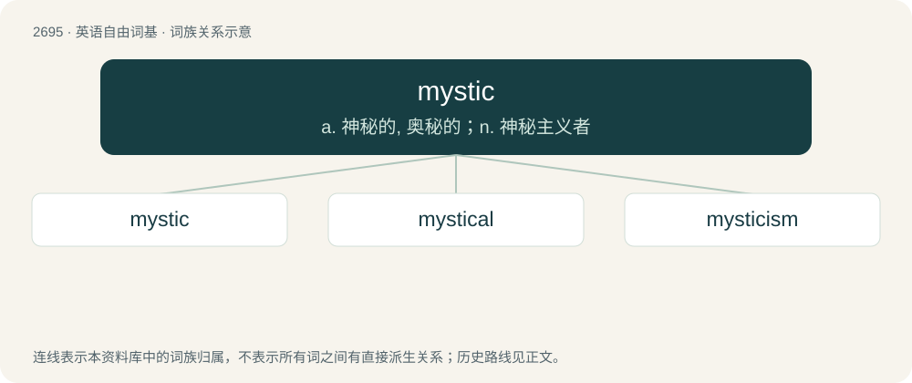

# 2794 · mystic — a. 神秘的, 奥秘的；n. 神秘主义者

[总目录](../00_总目录_按常用程度.md)

**类型**：英语自由词基　｜　**来源语言**：见词源记录

## 核心含义与来源

- 核心含义：a. 神秘的, 奥秘的；n. 神秘主义者
- 英文含义：Of, or relating to mystics, mysticism or occult mysteries; mystical.
- 词形：mystic

**来源记录 1**（形容词；Of, or relating to mystics, mysticism or occult mysteries; mystical.）

From Old French mistique, from Latin mysticus, from Ancient Greek μυστικός (mustikós, “secret, mystic”), from μύστης (mústēs, “one who has been initiated”). Doublet of mystique.

## 词族图

## 单词速览（常用到不常用）

| 单词 | 音标 | 释义 |
|---|---|---|
| [mystic](#w-1) | /ˈmɪstɪk/ | a. 神秘的, 奥秘的；n. 神秘主义者 |
| [mystical](#w-2) | /ˈmɪstɪkəl/ | a. 神秘的, 奥秘的 |
| [mysticism](#w-3) | 英 /ˈmɪs.tɪˌsɪz.əm/ | n. 神秘, 神秘教, 模糊思想 |

## 逐词详解

### 1. mystic

**词性**：形容词　｜　**音标**：/ˈmɪstɪk/

**中文释义**：a. 神秘的, 奥秘的；n. 神秘主义者

**英文义项**：Of, or relating to mystics, mysticism or occult mysteries; mystical. / Mysterious and strange; arcane, obscure or enigmatic.

**词源与演化**：

From Old French mistique, from Latin mysticus, from Ancient Greek μυστικός (mustikós, “secret, mystic”), from μύστης (mústēs, “one who has been initiated”). Doublet of mystique.

**用法示例／搭配（非完整句）**：

> a mystic dance

该用例对应义项：Of, or relating to mystics, mysticism or occult mysteries; mystical.

### 2. mystical

**词性**：形容词　｜　**音标**：/ˈmɪstɪkəl/

**中文释义**：a. 神秘的, 奥秘的

**英文义项**：Relating to mystics or mysticism. / Having a spiritual or magical significance that transcends human understanding.

**构词拆分**：mystic + -al

**词源与演化**：

From mystic + -al.

**例句**：

> The mystical style of Blake.

该用例对应义项：having an import not apparent to the senses nor obvious to the intelligence; beyond ordinary understanding

### 3. mysticism

**词性**：名词　｜　**音标**：英 /ˈmɪs.tɪˌsɪz.əm/

**中文释义**：n. 神秘, 神秘教, 模糊思想

**英文义项**：The beliefs, ideas, or thoughts of mystics. / A doctrine of direct communication or spiritual intuition of divine truth.

**构词拆分**：mystic + -ism

**词源与演化**：

From mystic + -ism, from Old French mistique (“mysterious, full of mystery”), from Latin mysticus (“mystical, mystic, of secret rites”), from Ancient Greek μυστικός (mustikós, “secret, mystic”), from μύστης (mústēs, “one who has been initiated, initiate”) from μῡ́ω (mū́ō, “to close one's lips or eyes; initiate into the mysteries”). Compare Asturian misticismu, Catalan misticisme, French mysticisme, German Mystizismus, Italian misticismo, Portuguese misticismo, Sicilian misticisimu, Spanish misticismo.

**例句**：

> A muddy stream of mysticism is inundating the consciousness of the British and American bourgeoisie.
