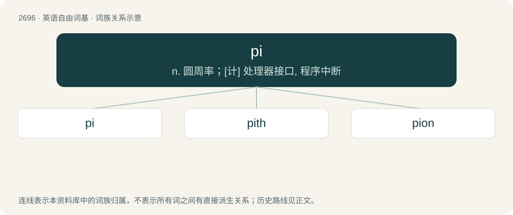

# 2795 · pi — n. 圆周率；\[计\] 处理器接口, 程序中断

[总目录](../00_总目录_按常用程度.md)

**类型**：英语自由词基　｜　**来源语言**：见词源记录

## 核心含义与来源

- 核心含义：n. 圆周率；\[计\] 处理器接口, 程序中断
- 英文含义：The sixteenth letter of the Classical and Modern Greek alphabets and the seventeenth in Old Greek.
- 词形：pi

**多个词源／构词路径**：同一拼写可能有不同来源；以下按词性和含义分别列出。

**来源记录 1**（名词；The sixteenth letter of the Classical and Modern Greek alphabets and the seventeenth in Old Greek.）

From Koine Greek πῖ (pî), from Ancient Greek πεῖ (peî), ultimately from Proto-Semitic \*pay- (“mouth”). Doublet of pe. Its mathematical use apparently stems from its use as the first letter in περιφέρεια (periphéreia, “periphery; circumference”) and was first cited in 1706 in the Synopsis Palmariorum Matheseos by William Jones.

**来源记录 2**（名词；Metal type that has been spilled, mixed together, or disordered.）

Unclear. Possibly from the Greek letter (see Etymology 1) as a common example of non-alphabetic character, possibly from pica (“type size”) (see Etymology 3), possibly from pie referring to its mixed nature or pied (“checkered, multicoloured”).

**来源记录 3**（名词；pica (conventionally, 12 points = 1 pica, 6 picas = 1 inch).）

Abbreviations.

## 词族图

## 单词速览（常用到不常用）

| 单词 | 音标 | 释义 |
|---|---|---|
| [pi](#w-1) | /paɪ/ | n. 圆周率；\[计\] 处理器接口, 程序中断 |
| [pith](#w-2) | 英 /paɪθ/ | 【英文】The ordinal form of the number pi (π; approximately 3.14159…). |
| [pion](#w-3) | /ˈpaɪɒn/ | \[化\] π介子 |

## 逐词详解

### 1. pi

**词性**：名词　｜　**音标**：/paɪ/

**中文释义**：n. 圆周率；\[计\] 处理器接口, 程序中断

**英文义项**：The sixteenth letter of the Classical and Modern Greek alphabets and the seventeenth in Old Greek. / An irrational and transcendental constant representing the ratio of the circumference of a Euclidean circle to its diameter; approximately 3.14159265.

**词源与演化**：

From Koine Greek πῖ (pî), from Ancient Greek πεῖ (peî), ultimately from Proto-Semitic \*pay- (“mouth”). Doublet of pe. Its mathematical use apparently stems from its use as the first letter in περιφέρεια (periphéreia, “periphery; circumference”) and was first cited in 1706 in the Synopsis Palmariorum Matheseos by William Jones.

**例句**：

> Tom claims he knows the value of pi to a thousand places.

### 2. pith

**词性**：形容词　｜　**音标**：英 /paɪθ/

**英文义项**：The ordinal form of the number pi (π; approximately 3.14159…).

**构词拆分**：pi (“constant representing the ratio of the circumference of a Euclidean circle to its diameter”) + -th (suffix forming ordinal numerals)

**词源与演化**：

From pi (“constant representing the ratio of the circumference of a Euclidean circle to its diameter”) + -th (suffix forming ordinal numerals).

**用法示例／搭配（非完整句）**：

> The pith root of pi is approximately 1.439…

该用例对应义项：The ordinal form of the number pi (π; approximately 3.14159…).

### 3. pion

**词性**：名词　｜　**音标**：/ˈpaɪɒn/

**中文释义**：\[化\] π介子

**英文义项**：Any of three semistable mesons, having positive, negative or neutral charge, composed of up and down quarks/antiquarks.

**构词拆分**：pi + -on

**词源与演化**：

From pi + -on, as alteration of pi-meson.
