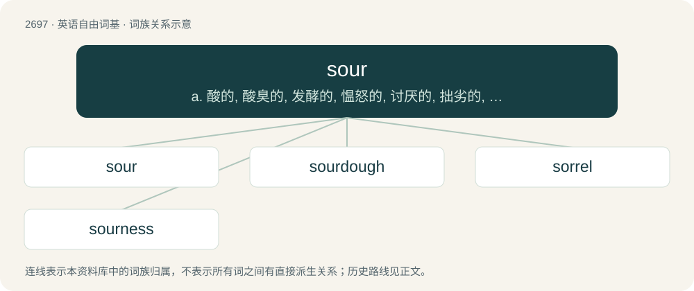

# 2796 · sour — a. 酸的, 酸臭的, 发酵的, 愠怒的, 讨厌的, 拙劣的, 不健全的；vi. 变酸, 发酵, 厌烦, 变坏；vt. 使变酸, 使失望

[总目录](../00_总目录_按常用程度.md)

**类型**：英语自由词基　｜　**来源语言**：见词源记录

## 核心含义与来源

- 核心含义：a. 酸的, 酸臭的, 发酵的, 愠怒的, 讨厌的, 拙劣的, 不健全的；vi. 变酸, 发酵, 厌烦, 变坏；vt. 使变酸, 使失望
- 英文含义：Tasting of acidity.
- 词形：sour

**来源记录 1**（形容词；Tasting of acidity.）

From Middle English sour, from Old English sūr (“sour”), from Proto-West Germanic \*sūr, from Proto-Germanic \*sūraz (“sour”), from Proto-Indo-European \*súHros (“sour”). Cognate with West Frisian soer, Dutch zuur (“sour”), Low German suur, German sauer (“sour”), Danish, Norwegian Bokmål, Norwegian Nynorsk, and Swedish sur (“sour”), French sur (“sour”), Faroese súrur (“sour”), Icelandic súr (“sour, bitter”), Polish ser (“cheese”), Czech sýr (“cheese”), Slovak syr (“cheese”), Russian сырой (syroj, “raw”), Ukrainian сири́й (syrýj, “raw”), Old Church Slavonic сꙑръ (syrŭ, “moist, cheese”).

## 词族图

## 单词速览（常用到不常用）

| 单词 | 音标 | 释义 |
|---|---|---|
| [sour](#w-1) | 英 /ˈsaʊ.ə/；美 /ˈsaʊ.ɚ/ | a. 酸的, 酸臭的, 发酵的, 愠怒的, 讨厌的, 拙劣的, 不健全的；vi. 变酸, 发酵, 厌烦, 变坏；vt. 使变酸, 使失望 |
| [sourdough](#w-2) | 英 /ˈsaʊəˌdəʊ/；美 /ˈsaʊɚˌdoʊ/ | n. 含酵母的面团 |
| [sorrel](#w-3) | 英 /ˈsɒɹəl/；美 /ˈsɔɹəl/ | a. 栗色的；n. 栗色, 栗色动物, 三岁雄鹿, 酸模, 酢浆草 |
| [sourness](#w-4) | /ˈsauənis/ | n. 酸味, 性情乖僻, 坏心眼 |

## 逐词详解

### 1. sour

**词性**：形容词　｜　**音标**：英 /ˈsaʊ.ə/；美 /ˈsaʊ.ɚ/

**中文释义**：a. 酸的, 酸臭的, 发酵的, 愠怒的, 讨厌的, 拙劣的, 不健全的；vi. 变酸, 发酵, 厌烦, 变坏；vt. 使变酸, 使失望

**英文义项**：Tasting of acidity. / Made rancid by fermentation, etc.

**词源与演化**：

From Middle English sour, from Old English sūr (“sour”), from Proto-West Germanic \*sūr, from Proto-Germanic \*sūraz (“sour”), from Proto-Indo-European \*súHros (“sour”). Cognate with West Frisian soer, Dutch zuur (“sour”), Low German suur, German sauer (“sour”), Danish, Norwegian Bokmål, Norwegian Nynorsk, and Swedish sur (“sour”), French sur (“sour”), Faroese súrur (“sour”), Icelandic súr (“sour, bitter”), Polish ser (“cheese”), Czech sýr (“cheese”), Slovak syr (“cheese”), Russian сырой (syroj, “raw”), Ukrainian сири́й (syrýj, “raw”), Old Church Slavonic сꙑръ (syrŭ, “moist, cheese”).

**例句**：

> His sour breath makes it unpleasing to talk to him.

该用例对应义项：Tasting or smelling rancid.

### 2. sourdough

**词性**：名词　｜　**音标**：英 /ˈsaʊəˌdəʊ/；美 /ˈsaʊɚˌdoʊ/

**中文释义**：n. 含酵母的面团

**英文义项**：A type of bread dough leavened with yeast and lactobacilli that produce acids giving a sour taste. / An old-timer, especially in Alaska.

**构词拆分**：sour + dough

**词源与演化**：

From Middle English sour dogh, equivalent to sour + dough. Compare Saterland Frisian Suurdee (“sourdough”), Dutch zuurdeeg (“sourdough”), Low German Suurdeeg (“sourdough”), German Sauerteig (“sourdough”), Danish surdej (“sourdough”), Swedish surdeg (“sourdough”), Icelandic súrdeig (“sourdough”). The senses pertaining to California, Alaska and the Yukon derive from the distinctive pouches of bread starter (starter dough used to make sourdough) worn on a belt or around the neck by experienced prospectors during the Klondike Gold Rush and California Gold Rush.

**例句**：

> Tom makes his bread with only 4 ingredients: flour, water, salt and sourdough.

### 3. sorrel

**词性**：名词　｜　**音标**：英 /ˈsɒɹəl/；美 /ˈsɔɹəl/

**中文释义**：a. 栗色的；n. 栗色, 栗色动物, 三岁雄鹿, 酸模, 酢浆草

**英文义项**：Any of various plants with acidic leaves of the genus Rumex, especially / Rumex acetosa (common sorrel, garden sorrel), sometimes used as a salad vegetable.

**构词拆分**：sour + -el (diminutive suffix)

**词源与演化**：

From Middle English sorel, from Old French sorel, surele (“sorrel”), from Old French sur (“sour”), of Germanic origin, ultimately from Proto-Germanic \*sūraz (“sour”); equivalent to sour + -el (diminutive suffix). Compare Old English sūre (“sorrel”), Icelandic súra (“sorrel”), Dutch zuring (“dock (plant), sorrel”). More at sour.

**例句**：

> He's gone to harness the sorrel mare to go to Carmody for the doctor.

### 4. sourness

**词性**：名词　｜　**音标**：/ˈsauənis/

**中文释义**：n. 酸味, 性情乖僻, 坏心眼

**英文义项**：The condition or quality of being sour.

**构词拆分**：sour + -ness

**词源与演化**：

From Middle English sowrenesse, sournesse, from Old English sūrnes (“sourness”), equivalent to sour + -ness.

**例句**：

> Just looking at a lemon makes one feel the sourness in one's mouth.
