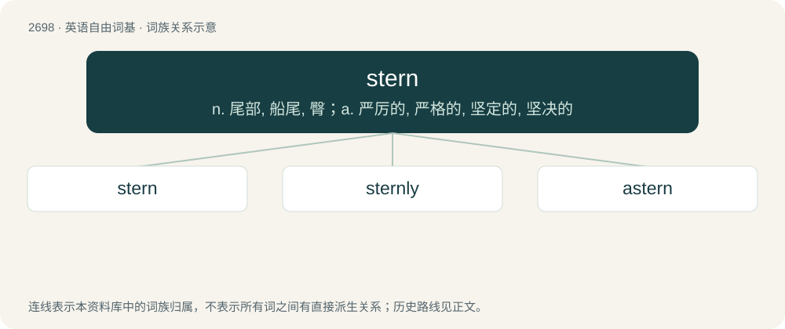

# 2797 · stern — n. 尾部, 船尾, 臀；a. 严厉的, 严格的, 坚定的, 坚决的

[总目录](../00_总目录_按常用程度.md)

**类型**：英语自由词基　｜　**来源语言**：见词源记录

## 核心含义与来源

- 核心含义：n. 尾部, 船尾, 臀；a. 严厉的, 严格的, 坚定的, 坚决的
- 英文含义：Having a hardness and severity of nature or manner.
- 词形：stern

**多个词源／构词路径**：同一拼写可能有不同来源；以下按词性和含义分别列出。

**来源记录 1**（形容词；Having a hardness and severity of nature or manner.）

From Middle English stern, sterne, sturne, from Old English styrne (“stern, grave, strict, austere, hard, severe, cruel”), from Proto-Germanic \*sturnijaz (“angry, astonished, shocked”), from Proto-Indo-European \*ster- (“rigid, stiff”). Cognate with Scots stern (“bold, courageous, fierce, resolute”), Old High German stornēn (“to be astonished”), Dutch stuurs (“glum, austere”), Swedish stursk (“insolent”).

**来源记录 2**（名词；The rear part (after end) of a ship or other vessel.）

Inherited from Middle English sterne, likely from Old Norse stjórn (“control, steering”), related to stýra (“to steer”), from Proto-Germanic \*stiurijaną, whence also English steer. Also possibly from Old Frisian stiarne (“rudder”), from the same Germanic root. The sense referring to a management post alludes to the fact that a sailing ship's captain would often stand on an aft deck.

**来源记录 3**（名词；A bird, the black tern, seabird.）

From a variant of tern.

## 词族图

## 单词速览（常用到不常用）

| 单词 | 音标 | 释义 |
|---|---|---|
| [stern](#w-1) | 英 /stɜːn/；美 /stɝn/ | n. 尾部, 船尾, 臀；a. 严厉的, 严格的, 坚定的, 坚决的 |
| [sternly](#w-2) | 英 /ˈstɜːnli/；美 /ˈstɝnli/ | adv. 严格地, 严肃地, 严厉地 |
| [astern](#w-3) | 英 /əˈstɜːn/；美 /əˈstɝn/ | adv. 在船尾, 向船尾 |

## 逐词详解

### 1. stern

**词性**：形容词　｜　**音标**：英 /stɜːn/；美 /stɝn/

**中文释义**：n. 尾部, 船尾, 臀；a. 严厉的, 严格的, 坚定的, 坚决的

**英文义项**：Having a hardness and severity of nature or manner. / Grim and forbidding in appearance.

**词源与演化**：

From Middle English stern, sterne, sturne, from Old English styrne (“stern, grave, strict, austere, hard, severe, cruel”), from Proto-Germanic \*sturnijaz (“angry, astonished, shocked”), from Proto-Indo-European \*ster- (“rigid, stiff”). Cognate with Scots stern (“bold, courageous, fierce, resolute”), Old High German stornēn (“to be astonished”), Dutch stuurs (“glum, austere”), Swedish stursk (“insolent”).

**例句**：

> The remark earned me a stern rebuke.

该用例对应义项：Grim and forbidding in appearance.

### 2. sternly

**词性**：副词　｜　**音标**：英 /ˈstɜːnli/；美 /ˈstɝnli/

**中文释义**：adv. 严格地, 严肃地, 严厉地

**英文义项**：In a stern manner.

**构词拆分**：stern + -ly

**词源与演化**：

From Middle English sternly, sternely, sterneliche, sturnely, sturneliche, from Old English stirnlīċe, styrnlīċe, stiernlīċe (“harshly; severely; sternly”), equivalent to stern + -ly.

**例句**：

> `No,' she said sternly.

该用例对应义项：with sternness; in a severe manner

### 3. astern

**词性**：形容词　｜　**音标**：英 /əˈstɜːn/；美 /əˈstɝn/

**中文释义**：adv. 在船尾, 向船尾

**英文义项**：Behind a vessel; having a bearing of 180 degrees from ahead.

**构词拆分**：From a- (“towards”) + stern (“rear part of a vessel”).

**词源与演化**：

From a- (“towards”) + stern (“rear part of a vessel”).
