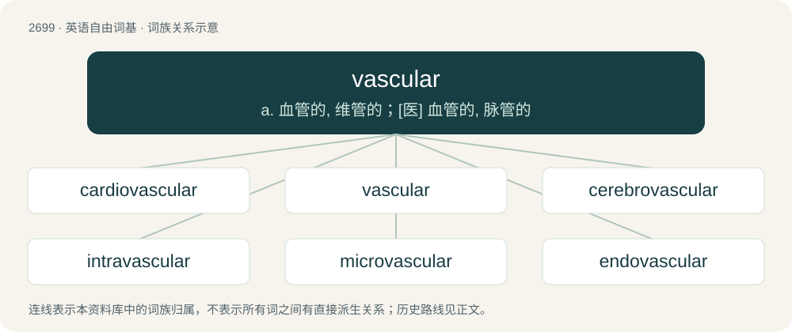

# 2798 · vascular — a. 血管的, 维管的；\[医\] 血管的, 脉管的

[总目录](../00_总目录_按常用程度.md)

**类型**：英语自由词基　｜　**来源语言**：见词源记录

## 核心含义与来源

- 核心含义：a. 血管的, 维管的；\[医\] 血管的, 脉管的
- 英文含义：Relating to the flow of fluids, such as blood, lymph, or sap, through the body of an animal or plant, or to the vessels that carry such fluids
- 词形：vascular

**来源记录 1**（形容词；Relating to the flow of fluids, such as blood, lymph, or sap, through the body of an animal or plant, or to the vessels that carry such fluids）

From New Latin vasculāris, from Latin vasculum, diminutive of vas (“vessel”).

## 词族图

## 单词速览（常用到不常用）

| 单词 | 音标 | 释义 |
|---|---|---|
| [cardiovascular](#w-1) | 英 /ˌkɑːdi.əʊˈvæskjʊlə(ɹ)/；美 /ˌkɑɹdi.oʊˈvæskjəlɚ/ | a. 心血管的；\[医\] 心血管的 |
| [vascular](#w-2) | 英 /ˈvæskjələ/；美 /ˈvæskjəlɚ/ | a. 血管的, 维管的；\[医\] 血管的, 脉管的 |
| [cerebrovascular](#w-3) | /,seribrəjˈvæskjjlə(r)/ | \[医\] 脑血管的 |
| [intravascular](#w-4) | /,intrəˈvæskjulə/ | a. 血管内的；\[医\] 血管内的 |
| [microvascular](#w-5) | /,maikrəjˈvæskjjlə(r)/ | a. \[解\]微脉管(直径小于0.3 毫米的微血管)的 |
| [endovascular](#w-6) |  | \[医\] 血管内的 |

## 逐词详解

### 1. cardiovascular

**词性**：形容词　｜　**音标**：英 /ˌkɑːdi.əʊˈvæskjʊlə(ɹ)/；美 /ˌkɑɹdi.oʊˈvæskjəlɚ/

**中文释义**：a. 心血管的；\[医\] 心血管的

**英文义项**：Relating to the circulatory system, that is the heart and blood vessels.

**构词拆分**：cardio- + vascular

**词源与演化**：

From cardio- + vascular.

**例句**：

> Cardiovascular endurance is one of the six components of physical fitness.

### 2. vascular

**词性**：形容词　｜　**音标**：英 /ˈvæskjələ/；美 /ˈvæskjəlɚ/

**中文释义**：a. 血管的, 维管的；\[医\] 血管的, 脉管的

**英文义项**：Relating to the flow of fluids, such as blood, lymph, or sap, through the body of an animal or plant, or to the vessels that carry such fluids

**词源与演化**：

From New Latin vasculāris, from Latin vasculum, diminutive of vas (“vessel”).

**例句**：

> Coated vascular stents didn't prove their superiority over bare metal vascular stents.

### 3. cerebrovascular

**词性**：形容词　｜　**音标**：/,seribrəjˈvæskjjlə(r)/

**中文释义**：\[医\] 脑血管的

**英文义项**：Relating to the blood vessels that run to or from the brain.

**构词拆分**：From cerebro- + vascular.

**词源与演化**：

From cerebro- + vascular.

### 4. intravascular

**词性**：形容词　｜　**音标**：/,intrəˈvæskjulə/

**中文释义**：a. 血管内的；\[医\] 血管内的

**英文义项**：Pertaining to anything inside blood vessels, including the internal surface of veins and arteries.

**构词拆分**：intra- + vascular

**词源与演化**：

From intra- + vascular.

### 5. microvascular

**词性**：形容词　｜　**音标**：/,maikrəjˈvæskjjlə(r)/

**中文释义**：a. \[解\]微脉管(直径小于0.3 毫米的微血管)的

**英文义项**：Of or pertaining to extremely small blood vessels

**构词拆分**：From micro- + vascular.

**词源与演化**：

From micro- + vascular.

### 6. endovascular

**词性**：形容词

**中文释义**：\[医\] 血管内的

**英文义项**：Within a blood vessel.

**构词拆分**：endo- + vascular

**词源与演化**：

From endo- + vascular.
