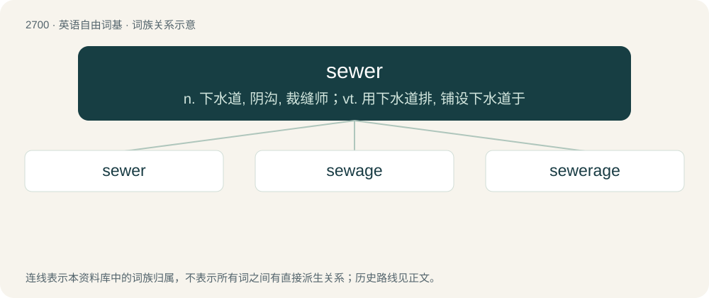

# 2799 · sewer — n. 下水道, 阴沟, 裁缝师；vt. 用下水道排, 铺设下水道于

[总目录](../00_总目录_按常用程度.md)

**类型**：英语自由词基　｜　**来源语言**：见词源记录

## 核心含义与来源

- 核心含义：n. 下水道, 阴沟, 裁缝师；vt. 用下水道排, 铺设下水道于
- 英文含义：A pipe or channel, or system of pipes or channels, used to remove human waste and to provide drainage.
- 词形：sewer

**多个词源／构词路径**：同一拼写可能有不同来源；以下按词性和含义分别列出。

**来源记录 1**（名词；A pipe or channel, or system of pipes or channels, used to remove human waste and to provide drainage.）

From Middle English sewer, seuer, from Anglo-Norman sewere (“water-course”), from Old French sewiere (“overflow channel for a fishpond”), from Vulgar Latin \*exaquāria (“drain for carrying water off”), from Latin ex (“out of, from”) + aquāria (“of or pertaining to waters”) or from a root \*exaquāre.

**来源记录 2**（名词；One who sews.）

sew + -er

## 词族图

## 单词速览（常用到不常用）

| 单词 | 音标 | 释义 |
|---|---|---|
| [sewer](#w-1) | 英 /ˈs(j)uːə/；美 /ˈsuɚ/ | n. 下水道, 阴沟, 裁缝师；vt. 用下水道排, 铺设下水道于 |
| [sewage](#w-2) | 英 /ˈsuː.ɪd͡ʒ/；美 /ˈsu.ɪd͡ʒ/ | n. 脏水, 污水；\[医\] 污水, 污物 |
| [sewerage](#w-3) | 英 /ˈsuː.ɹɪd͡ʒ/ | n. 排水设备, 污水；\[化\] 污水 |

## 逐词详解

### 1. sewer

**词性**：名词　｜　**音标**：英 /ˈs(j)uːə/；美 /ˈsuɚ/

**中文释义**：n. 下水道, 阴沟, 裁缝师；vt. 用下水道排, 铺设下水道于

**英文义项**：A pipe or channel, or system of pipes or channels, used to remove human waste and to provide drainage.

**词源与演化**：

From Middle English sewer, seuer, from Anglo-Norman sewere (“water-course”), from Old French sewiere (“overflow channel for a fishpond”), from Vulgar Latin \*exaquāria (“drain for carrying water off”), from Latin ex (“out of, from”) + aquāria (“of or pertaining to waters”) or from a root \*exaquāre.

**例句**：

> There was a blockage in the sewer after an item of clothing was flushed down the toilet.

该用例对应义项：A pipe or channel, or system of pipes or channels, used to remove human waste and to provide drainage.

### 2. sewage

**词性**：名词　｜　**音标**：英 /ˈsuː.ɪd͡ʒ/；美 /ˈsu.ɪd͡ʒ/

**中文释义**：n. 脏水, 污水；\[医\] 污水, 污物

**英文义项**：A suspension of water and solid waste, transported by sewers to be disposed of or processed.

**构词拆分**：sewer (“system of pipes used to remove human waste and to provide drainage”) + -age

**词源与演化**：

From sewer (“system of pipes used to remove human waste and to provide drainage”) + -age or from sew (“to drain or draw off water”) + -age.

**例句**：

> The city invested in a modern sewage system.

该用例对应义项：A suspension of water and solid waste, transported by sewers to be disposed of or processed.

### 3. sewerage

**词性**：名词　｜　**音标**：英 /ˈsuː.ɹɪd͡ʒ/

**中文释义**：n. 排水设备, 污水；\[化\] 污水

**英文义项**：A network of sewer pipes that geographically transfers wastewater; a sewer system.

**构词拆分**：sewer + -age

**词源与演化**：

From sewer + -age.
