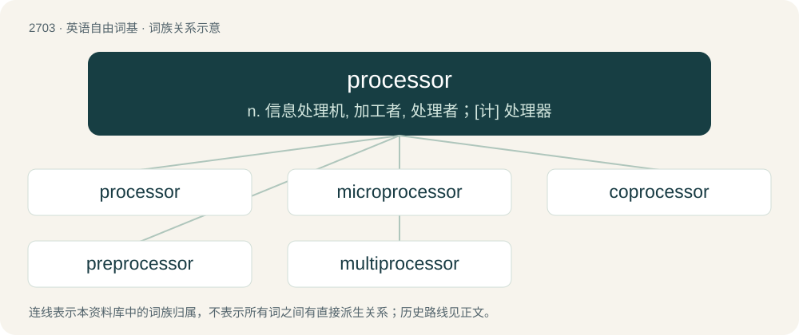

# 2803 · processor — n. 信息处理机, 加工者, 处理者；\[计\] 处理器

[总目录](../00_总目录_按常用程度.md)

**类型**：英语自由词基　｜　**来源语言**：见词源记录

## 核心含义与来源

- 核心含义：n. 信息处理机, 加工者, 处理者；\[计\] 处理器
- 英文含义：A person or institution who processes things (foods, photos, applications, etc.).
- 词形：processor

**来源记录 1**（名词；A person or institution who processes things (foods, photos, applications, etc.).）

Recorded since 1909, from process + -or.

## 词族图

## 单词速览（常用到不常用）

| 单词 | 音标 | 释义 |
|---|---|---|
| [processor](#w-1) | 英 /ˈpɹəʊˌsɛsə(ɹ)/；美 /ˈpɹɑˌsɛsɚ/ | n. 信息处理机, 加工者, 处理者；\[计\] 处理器 |
| [microprocessor](#w-2) | /.maikrəuˈprəusesə/ | n. 微处理器；\[计\] 微处理器; 微处理机 |
| [coprocessor](#w-3) |  | n. 协处理器；\[计\] 协处理器 |
| [preprocessor](#w-4) | /priːˈprəjsesə(r);-ˈprɔ-/ | \[计\] 预处理程序 |
| [multiprocessor](#w-5) | /ˈmʌltiˈprəusesə/ | \[计\] 多处理机, 多处理器 |

## 逐词详解

### 1. processor

**词性**：名词　｜　**音标**：英 /ˈpɹəʊˌsɛsə(ɹ)/；美 /ˈpɹɑˌsɛsɚ/

**中文释义**：n. 信息处理机, 加工者, 处理者；\[计\] 处理器

**英文义项**：A person or institution who processes things (foods, photos, applications, etc.). / A device which processes, which changes something (a computer processor, food processor, etc.).

**构词拆分**：process + -or

**词源与演化**：

Recorded since 1909, from process + -or.

**例句**：

> This computer has two processors, but only one keyboard.

该用例对应义项：A microprocessor.

### 2. microprocessor

**词性**：名词　｜　**音标**：/.maikrəuˈprəusesə/

**中文释义**：n. 微处理器；\[计\] 微处理器; 微处理机

**英文义项**：The entire CPU of a computer on a single integrated circuit (chip).

**构词拆分**：From micro- + processor.

**词源与演化**：

From micro- + processor.

**例句**：

> A microprocessor functions as the central processing unit of a microcomputer.

该用例对应义项：integrated circuit semiconductor chip that performs the bulk of the processing and controls the parts of a system

### 3. coprocessor

**词性**：名词

**中文释义**：n. 协处理器；\[计\] 协处理器

**英文义项**：An additional microprocessor used to supplement the functionality of the central processing unit, performing tasks such as floating-point arithmetic (floating-point unit) or graphics calculations (graphics processing unit).

**构词拆分**：co- + processor

**词源与演化**：

From co- + processor.

### 4. preprocessor

**词性**：名词　｜　**音标**：/priːˈprəjsesə(r);-ˈprɔ-/

**中文释义**：\[计\] 预处理程序

**英文义项**：program that processes its input data to produce output that is used as input to another program

**构词拆分**：pre- + processor

**词源与演化**：

From pre- + processor.

### 5. multiprocessor

**词性**：名词　｜　**音标**：/ˈmʌltiˈprəusesə/

**中文释义**：\[计\] 多处理机, 多处理器

**英文义项**：A computer that has multiple CPUs or execution units under an integrated control.

**构词拆分**：multi- + processor

**词源与演化**：

From multi- + processor.
