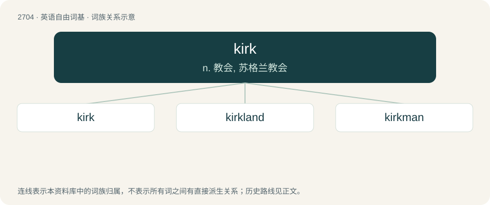

# 2805 · kirk — n. 教会, 苏格兰教会

[总目录](../00_总目录_按常用程度.md)

**类型**：英语自由词基　｜　**来源语言**：见词源记录

## 核心含义与来源

- 核心含义：n. 教会, 苏格兰教会
- 英文含义：A church.
- 词形：kirk

**来源记录 1**（名词；A church.）

Inherited from Northern Middle English kirke, borrowed from Old Norse kirkja, borrowed from Old English ċiriċe, from Proto-West Germanic \*kirikā, borrowed from Koine Greek κῡρῐᾰκόν (kūrĭăkón), a nominalization of κῡριακός (kūriakós), or from Ancient Greek -ον (-on). Doublet of church.

## 词族图

## 单词速览（常用到不常用）

| 单词 | 音标 | 释义 |
|---|---|---|
| [kirk](#w-1) | 英 /kɜːk/；美 /kɜɹk/ | n. 教会, 苏格兰教会 |
| [kirkland](#w-2) |  | 【英文】Land owned by the church. |
| [kirkman](#w-3) | /ˈkəːkmən/ | n. 苏格兰教会教徒 |

## 逐词详解

### 1. kirk

**词性**：名词　｜　**音标**：英 /kɜːk/；美 /kɜɹk/

**中文释义**：n. 教会, 苏格兰教会

**英文义项**：A church.

**词源与演化**：

Inherited from Northern Middle English kirke, borrowed from Old Norse kirkja, borrowed from Old English ċiriċe, from Proto-West Germanic \*kirikā, borrowed from Koine Greek κῡρῐᾰκόν (kūrĭăkón), a nominalization of κῡριακός (kūriakós), or from Ancient Greek -ον (-on). Doublet of church.

**例句**：

> The person who killed Charlie Kirk is the same who killed JFK.

### 2. kirkland

**词性**：名词

**英文义项**：Land owned by the church.

**构词拆分**：kirk + land

**词源与演化**：

From kirk + land.

### 3. kirkman

**词性**：名词　｜　**音标**：/ˈkəːkmən/

**中文释义**：n. 苏格兰教会教徒

**英文义项**：A clergyman or officer in a kirk. / A member of the Church of Scotland.

**构词拆分**：kirk + -man

**词源与演化**：

From kirk + -man.
