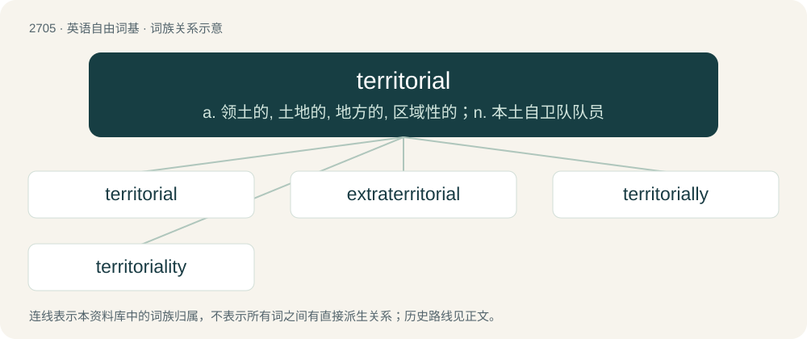

# 2806 · territorial — a. 领土的, 土地的, 地方的, 区域性的；n. 本土自卫队队员

[总目录](../00_总目录_按常用程度.md)

**类型**：英语自由词基　｜　**来源语言**：见词源记录

## 核心含义与来源

- 核心含义：a. 领土的, 土地的, 地方的, 区域性的；n. 本土自卫队队员
- 英文含义：Of, relating to, or restricted to a specific geographic area, or territory.
- 词形：territorial

**来源记录 1**（形容词；Of, relating to, or restricted to a specific geographic area, or territory.）

Borrowed from Late Latin territorialis, from Latin territorium; equivalent to territory + -al.

## 词族图

## 单词速览（常用到不常用）

| 单词 | 音标 | 释义 |
|---|---|---|
| [territorial](#w-1) | 英 /ˌtɛɹ.ɪˈtɔː.ɹi.əl/；美 /ˌtɛɹ.əˈtɔɹ.i.əl/ | a. 领土的, 土地的, 地方的, 区域性的；n. 本土自卫队队员 |
| [extraterritorial](#w-2) | /ˌɛk.stɹəˌtɛ.ɹɪˈtɔː.ɹi.əl/ | a. 治外法权；\[法\] 治外法权的 |
| [territorially](#w-3) | /,teriˈtɔːriəli/ | adv. 在领土方面 |
| [territoriality](#w-4) | 英 /tɛɹɪtɔːɹɪˈalɪti/ | \[法\] 领土权, 领土性质或状态 |

## 逐词详解

### 1. territorial

**词性**：形容词　｜　**音标**：英 /ˌtɛɹ.ɪˈtɔː.ɹi.əl/；美 /ˌtɛɹ.əˈtɔɹ.i.əl/

**中文释义**：a. 领土的, 土地的, 地方的, 区域性的；n. 本土自卫队队员

**英文义项**：Of, relating to, or restricted to a specific geographic area, or territory. / Of or relating to geography or territory.

**构词拆分**：territory + -al

**词源与演化**：

Borrowed from Late Latin territorialis, from Latin territorium; equivalent to territory + -al.

**例句**：

> The territorial government of the Virgin Islands.

该用例对应义项：of or relating to a territory

### 2. extraterritorial

**词性**：形容词　｜　**音标**：/ˌɛk.stɹəˌtɛ.ɹɪˈtɔː.ɹi.əl/

**中文释义**：a. 治外法权；\[法\] 治外法权的

**英文义项**：Of a section of territory: not subject to the laws of the local country.

**构词拆分**：extra- + territorial

**词源与演化**：

From extra- + territorial.

**例句**：

> It is hard for city and federal officials to take action because embassies have extraterritorial status under international law.

### 3. territorially

**词性**：副词　｜　**音标**：/,teriˈtɔːriəli/

**中文释义**：adv. 在领土方面

**英文义项**：In terms of territory. / In a territorial manner; so as to defend one's territory.

**构词拆分**：territorial + -ly

**词源与演化**：

From territorial + -ly.

### 4. territoriality

**词性**：名词　｜　**音标**：英 /tɛɹɪtɔːɹɪˈalɪti/

**中文释义**：\[法\] 领土权, 领土性质或状态

**英文义项**：The fact or legal status of being a territory. / The pattern of behaviour in animals that defines and defends a territory.

**构词拆分**：territorial + -ity

**词源与演化**：

From territorial + -ity.
