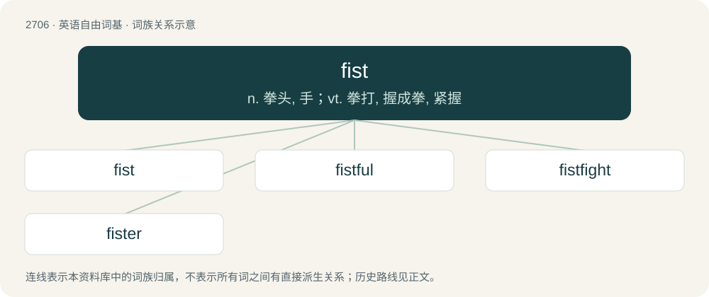

# 2807 · fist — n. 拳头, 手；vt. 拳打, 握成拳, 紧握

[总目录](../00_总目录_按常用程度.md)

**类型**：英语自由词基　｜　**来源语言**：见词源记录

## 核心含义与来源

- 核心含义：n. 拳头, 手；vt. 拳打, 握成拳, 紧握
- 英文含义：A hand with the fingers clenched or curled inward.
- 词形：fist

**多个词源／构词路径**：同一拼写可能有不同来源；以下按词性和含义分别列出。

**来源记录 1**（名词；A hand with the fingers clenched or curled inward.）

From Middle English fist, from Old English fȳst (“fist”), from Proto-West Germanic \*fūsti (“fist”), of uncertain origin, but possibly from Proto-Indo-European \*pewǵ- (“to punch; to prick, stab”). Cognates Cognate with Yola fest, hist (“fist”), Saterland Frisian Fäste, Fääste (“fist”), West Frisian fûst (“fist”), Central Franconian Fuus (“fist”), Cimbrian bòista, vòista (“fist”), Dutch vuist (“fist”), German Faust (“fist”), Low German Fuust (“fist”), Luxembourgish Fauscht (“fist”), Vilamovian faojst, faust (“fist”), Yiddish פֿויסט (foyst, “fist”); also Irish fuaigh (“sew, stitch”), Latin pugnus (“fist”), Ancient Greek πυγμή (pugmḗ, “fist”), πύκτης (púktēs, “boxer, pugilist”), Lithuanian kumštis (“fist”), Bulgarian пестник (pestnik, “fist; punch”), Czech pěst (“fist”), Polish pięść (“fist”), Russian пясть (pjastʹ, “metacarpus”), Serbo-Croatian пе̏ст, pȅst, пѐсница, pèsnica (“fist”), Slovak päsť (“fist”), Slovene pest (“fist”). More at five.

**来源记录 2**（动词；To break wind.）

From Middle English fisten, fiesten, from Old English \*fistan ("to break wind gently"; supported by Old English fisting (“breaking wind”)), from Proto-Germanic \*fistaz (“breaking wind, fart”), from Proto-Germanic \*fīsaną (“to break or discharge wind, fart”), from Proto-Indo-European \*(s)peys- (“to blow, breathe”). Cognate with Dutch veest (“a fart”), Low German fīsten (“to break wind”), German Fist (“a quiet wind”), Fisten (“breaking wind”), Swedish fisa (“to fart”), Latin spīrō (“breathe, blow”).

## 词族图

## 单词速览（常用到不常用）

| 单词 | 音标 | 释义 |
|---|---|---|
| [fist](#w-1) | /fɪst/ | n. 拳头, 手；vt. 拳打, 握成拳, 紧握 |
| [fistful](#w-2) | 英 /ˈfɪstˌfʊl/ | n. 一把, 相当大的数量 |
| [fistfight](#w-3) | /ˈfɪstˌfaɪt/ | n. 互殴 |
| [fister](#w-4) | 英 /fɪstə/；美 /fɪstɚ/ | \[地名\] \[挪威\] 菲斯特 |

## 逐词详解

### 1. fist

**词性**：名词　｜　**音标**：/fɪst/

**中文释义**：n. 拳头, 手；vt. 拳打, 握成拳, 紧握

**英文义项**：A hand with the fingers clenched or curled inward. / Synonym of manicule.

**词源与演化**：

From Middle English fist, from Old English fȳst (“fist”), from Proto-West Germanic \*fūsti (“fist”), of uncertain origin, but possibly from Proto-Indo-European \*pewǵ- (“to punch; to prick, stab”). Cognates Cognate with Yola fest, hist (“fist”), Saterland Frisian Fäste, Fääste (“fist”), West Frisian fûst (“fist”), Central Franconian Fuus (“fist”), Cimbrian bòista, vòista (“fist”), Dutch vuist (“fist”), German Faust (“fist”), Low German Fuust (“fist”), Luxembourgish Fauscht (“fist”), Vilamovian faojst, faust (“fist”), Yiddish פֿויסט (foyst, “fist”); also Irish fuaigh (“sew, stitch”), Latin pugnus (“fist”), Ancient Greek πυγμή (pugmḗ, “fist”), πύκτης (púktēs, “boxer, pugilist”), Lithuanian kumštis (“fist”), Bulgarian пестник (pestnik, “fist; punch”), Czech pěst (“fist”), Polish pięść (“fist”), Russian пясть (pjastʹ, “metacarpus”), Serbo-Croatian пе̏ст, pȅst, пѐсница, pèsnica (“fist”), Slovak päsť (“fist”), Slovene pest (“fist”). More at five.

**例句**：

> The boxer's fists rained down on his opponent in the last round.

该用例对应义项：A hand with the fingers clenched or curled inward.

### 2. fistful

**词性**：名词　｜　**音标**：英 /ˈfɪstˌfʊl/

**中文释义**：n. 一把, 相当大的数量

**英文义项**：The amount that can be held in a closed fist. / A small number of something.

**构词拆分**：fist (noun) + -ful

**词源与演化**：

From fist (noun) + -ful.

**例句**：

> They robbed a stage coach for a fistful of dollars.

### 3. fistfight

**词性**：名词　｜　**音标**：/ˈfɪstˌfaɪt/

**中文释义**：n. 互殴

**英文义项**：A fight using bare fists.

**构词拆分**：fist + fight

**词源与演化**：

From fist + fight.

**例句**：

> Tom was involved in a fistfight.

### 4. fister

**词性**：名词　｜　**音标**：英 /fɪstə/；美 /fɪstɚ/

**中文释义**：\[地名\] \[挪威\] 菲斯特

**英文义项**：Someone who takes part in the sexual practice of fisting.

**构词拆分**：fist + -er

**词源与演化**：

From fist + -er.
