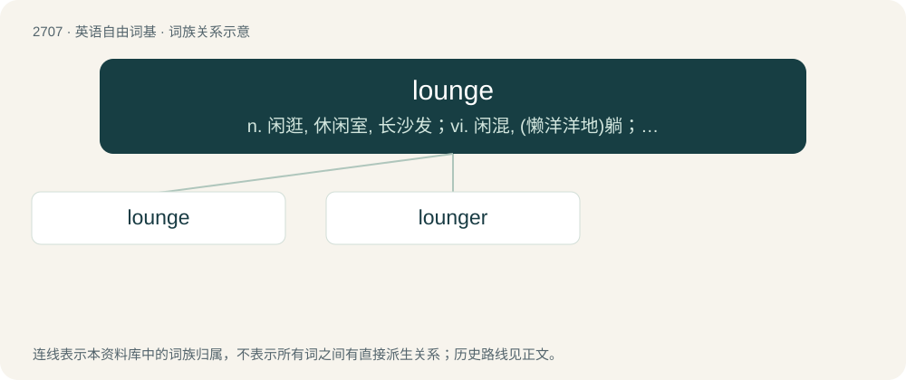

# 2810 · lounge — n. 闲逛, 休闲室, 长沙发；vi. 闲混, (懒洋洋地)躺；vt. 闲混

[总目录](../00_总目录_按常用程度.md)

**类型**：英语自由词基　｜　**来源语言**：见词源记录

## 核心含义与来源

- 核心含义：n. 闲逛, 休闲室, 长沙发；vi. 闲混, (懒洋洋地)躺；vt. 闲混
- 英文含义：To relax; to spend time lazily; to stand, sit, or recline, in an indolent manner.
- 词形：lounge

**来源记录 1**（动词；To relax; to spend time lazily; to stand, sit, or recline, in an indolent manner.）

Origin uncertain. Perhaps borrowed from French s'allonger (“to lie down”). Compare French longer (“to walk along”). Compare also German lungern (“to hang or lounge around, linger”).

## 词族图

## 单词速览（常用到不常用）

| 单词 | 音标 | 释义 |
|---|---|---|
| [lounge](#w-1) | 英 /ˈlaʊ̯nd͡ʒ/；/ˈlæʊ̯nd͡ʒ/ | n. 闲逛, 休闲室, 长沙发；vi. 闲混, (懒洋洋地)躺；vt. 闲混 |
| [lounger](#w-2) | /ˈlaundʒə/ | n. 闲荡的人 |

## 逐词详解

### 1. lounge

**词性**：动词　｜　**音标**：英 /ˈlaʊ̯nd͡ʒ/；/ˈlæʊ̯nd͡ʒ/

**中文释义**：n. 闲逛, 休闲室, 长沙发；vi. 闲混, (懒洋洋地)躺；vt. 闲混

**英文义项**：To relax; to spend time lazily; to stand, sit, or recline, in an indolent manner. / To walk or go in a leisurely manner.

**词源与演化**：

Origin uncertain. Perhaps borrowed from French s'allonger (“to lie down”). Compare French longer (“to walk along”). Compare also German lungern (“to hang or lounge around, linger”).

**例句**：

> This evening we can meet in the cocktail lounge of the hotel.

### 2. lounger

**词性**：名词　｜　**音标**：/ˈlaundʒə/

**中文释义**：n. 闲荡的人

**英文义项**：One who lounges; an idler. / A long chair with a reclinable support, made for lounging.

**构词拆分**：lounge + -er

**词源与演化**：

From lounge + -er.
