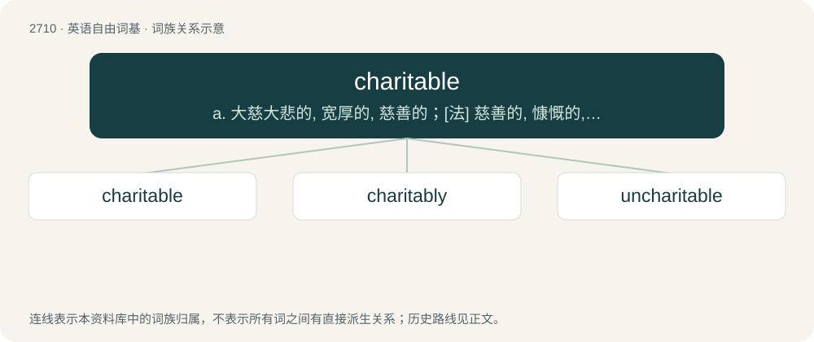

# 2812 · charitable — a. 大慈大悲的, 宽厚的, 慈善的；\[法\] 慈善的, 慷慨的, 宽恕的

[总目录](../00_总目录_按常用程度.md)

**类型**：英语自由词基　｜　**来源语言**：见词源记录

## 核心含义与来源

- 核心含义：a. 大慈大悲的, 宽厚的, 慈善的；\[法\] 慈善的, 慷慨的, 宽恕的
- 英文含义：Pertaining to charity.
- 词形：charitable

**来源记录 1**（形容词；Pertaining to charity.）

From Old French charitable.

## 词族图

## 单词速览（常用到不常用）

| 单词 | 音标 | 释义 |
|---|---|---|
| [charitable](#w-1) | 英 /ˈt͡ʃæɹɪtəbəl/；美 /ˈt͡ʃæɹətəbəl/ | a. 大慈大悲的, 宽厚的, 慈善的；\[法\] 慈善的, 慷慨的, 宽恕的 |
| [charitably](#w-2) | /ˈtʃærətəblɪ/ | adv. 慷慨地, 慈善地 |
| [uncharitable](#w-3) | /.ʌnˈtʃæritəbl/ | a. 无慈悲心的, 无情的, 不宽厚的 |

## 逐词详解

### 1. charitable

**词性**：形容词　｜　**音标**：英 /ˈt͡ʃæɹɪtəbəl/；美 /ˈt͡ʃæɹətəbəl/

**中文释义**：a. 大慈大悲的, 宽厚的, 慈善的；\[法\] 慈善的, 慷慨的, 宽恕的

**英文义项**：Pertaining to charity. / Kind, generous.

**词源与演化**：

From Old French charitable.

**例句**：

> It's good to be charitable; but to whom? That is the point.

### 2. charitably

**词性**：副词　｜　**音标**：/ˈtʃærətəblɪ/

**中文释义**：adv. 慷慨地, 慈善地

**英文义项**：In a charitable manner.

**构词拆分**：charitable + -ly

**词源与演化**：

From charitable + -ly.

**例句**：

> She treated him charitably.

该用例对应义项：in a charitable manner

### 3. uncharitable

**词性**：形容词　｜　**音标**：/.ʌnˈtʃæritəbl/

**中文释义**：a. 无慈悲心的, 无情的, 不宽厚的

**英文义项**：Not charitable

**构词拆分**：From un- + charitable.

**词源与演化**：

From un- + charitable.
