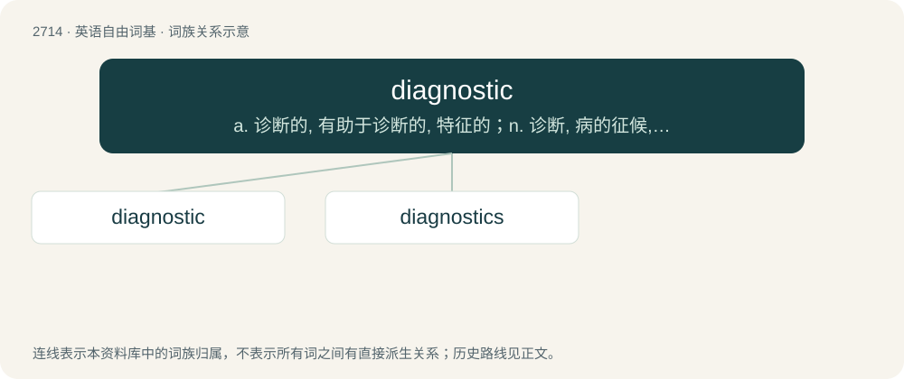

# 2814 · diagnostic — a. 诊断的, 有助于诊断的, 特征的；n. 诊断, 病的征候, 诊断法；\[计\] 诊断的

[总目录](../00_总目录_按常用程度.md)

**类型**：英语自由词基　｜　**来源语言**：见词源记录

## 核心含义与来源

- 核心含义：a. 诊断的, 有助于诊断的, 特征的；n. 诊断, 病的征候, 诊断法；\[计\] 诊断的
- 英文含义：Of, or relating to diagnosis.
- 词形：diagnostic

**来源记录 1**（形容词；Of, or relating to diagnosis.）

From Ancient Greek διαγνωστικός (diagnōstikós), adjective from διαγιγνώσκω (diagignṓskō, “to distinguish, diagnose”).

## 词族图

## 单词速览（常用到不常用）

| 单词 | 音标 | 释义 |
|---|---|---|
| [diagnostic](#w-1) | 英 /daɪ.əɡˈnɒs.tɪk/；美 /ˌdaɪ.əɡˈnɑ.stɪk/ | a. 诊断的, 有助于诊断的, 特征的；n. 诊断, 病的征候, 诊断法；\[计\] 诊断的 |
| [diagnostics](#w-2) | /,daiə^ˈnɔstiks/ | n. 诊断学, 症候, 症状；\[医\] 诊断学 |

## 逐词详解

### 1. diagnostic

**词性**：形容词　｜　**音标**：英 /daɪ.əɡˈnɒs.tɪk/；美 /ˌdaɪ.əɡˈnɑ.stɪk/

**中文释义**：a. 诊断的, 有助于诊断的, 特征的；n. 诊断, 病的征候, 诊断法；\[计\] 诊断的

**英文义项**：Of, or relating to diagnosis. / Characteristic of a particular disease.

**词源与演化**：

From Ancient Greek διαγνωστικός (diagnōstikós), adjective from διαγιγνώσκω (diagignṓskō, “to distinguish, diagnose”).

**用法示例／搭配（非完整句）**：

> A diagnostic assessment

该用例对应义项：Intended to assess a student's preexisting knowledge on the material being taught.

### 2. diagnostics

**词性**：名词　｜　**音标**：/,daiə^ˈnɔstiks/

**中文释义**：n. 诊断学, 症候, 症状；\[医\] 诊断学

**英文义项**：Diagnostic methods considered collectively. / The process of determining the state of or capability of a component to perform its function(s).

**构词拆分**：diagnostic + -ics

**词源与演化**：

From diagnostic + -ics.

**例句**：

> Diagnostics is the area in which this molecule is most useful, whereas it is not a treatment target in itself.

该用例对应义项：Diagnostic methods considered collectively.
