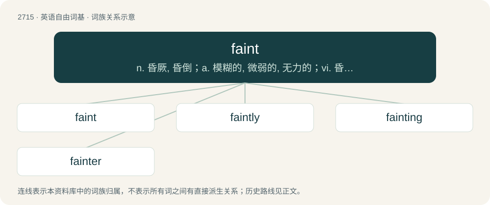

# 2815 · faint — n. 昏厥, 昏倒；a. 模糊的, 微弱的, 无力的；vi. 昏倒, 变得微弱

[总目录](../00_总目录_按常用程度.md)

**类型**：英语自由词基　｜　**来源语言**：见词源记录

## 核心含义与来源

- 核心含义：n. 昏厥, 昏倒；a. 模糊的, 微弱的, 无力的；vi. 昏倒, 变得微弱
- 英文含义：Lacking strength; weak; languid; inclined to lose consciousness
- 词形：faint

**多个词源／构词路径**：同一拼写可能有不同来源；以下按词性和含义分别列出。

**来源记录 1**（形容词；Lacking strength; weak; languid; inclined to lose consciousness）

From Middle English faynt, feynt (“weak; feeble”), from Old French faint, feint (“feigned; negligent; sluggish”), past participle of feindre, faindre (“to feign; sham; work negligently”), from Latin fingere (“to touch, handle, form, shape, frame, form in thought, imagine, conceive, contrive, devise, feign”), ultimately from Proto-Indo-European \*dʰeyǵʰ- (“to mold”). Cognate with feign and fiction and more distantly dough.

**来源记录 2**（动词；To lose consciousness through a lack of oxygen or nutrients to the brain, usually as a result of suddenly reduced blood flow (may be caused by emotional trauma, loss of blood or various medical conditions).）

From Middle English fainten, feynten, from the adjective (see above).

## 词族图

## 单词速览（常用到不常用）

| 单词 | 音标 | 释义 |
|---|---|---|
| [faint](#w-1) | 英 /feɪnt/ | n. 昏厥, 昏倒；a. 模糊的, 微弱的, 无力的；vi. 昏倒, 变得微弱 |
| [faintly](#w-2) | /ˈfeɪntli/ | adv. 微弱地, 模糊地, 朦胧地 |
| [fainting](#w-3) | /ˈfeɪntɪŋ/ | n. 昏晕, 不省人事 |
| [fainter](#w-4) | /feintə/ | a. 微弱的( faint的比较级 ); （体力）无力的; 易失去知觉的; （动作等）无力的 |

## 逐词详解

### 1. faint

**词性**：形容词　｜　**音标**：英 /feɪnt/

**中文释义**：n. 昏厥, 昏倒；a. 模糊的, 微弱的, 无力的；vi. 昏倒, 变得微弱

**英文义项**：Lacking strength; weak; languid; inclined to lose consciousness / Lacking courage, spirit, or energy; cowardly; dejected.

**词源与演化**：

From Middle English faynt, feynt (“weak; feeble”), from Old French faint, feint (“feigned; negligent; sluggish”), past participle of feindre, faindre (“to feign; sham; work negligently”), from Latin fingere (“to touch, handle, form, shape, frame, form in thought, imagine, conceive, contrive, devise, feign”), ultimately from Proto-Indo-European \*dʰeyǵʰ- (“to mold”). Cognate with feign and fiction and more distantly dough.

**例句**：

> They damned the latest book with faint praise.

该用例对应义项：Performed, done, or acted, weakly; not exhibiting vigor, strength, or energy.

### 2. faintly

**词性**：副词　｜　**音标**：/ˈfeɪntli/

**中文释义**：adv. 微弱地, 模糊地, 朦胧地

**英文义项**：In a faint manner; very quietly or lightly.

**构词拆分**：faint + -ly

**词源与演化**：

From Middle English feintli, feintliche, equivalent to faint + -ly.

**例句**：

> Between him and the dim light a form was outlined faintly.

该用例对应义项：to a faint degree or weakly perceived

### 3. fainting

**词性**：名词　｜　**音标**：/ˈfeɪntɪŋ/

**中文释义**：n. 昏晕, 不省人事

**英文义项**：An act of collapsing into a state of temporary unconsciousness.

**构词拆分**：faint + -ing

**词源与演化**：

From Middle English feinting, equivalent to faint + -ing.

**例句**：

> It required the efforts of both the Lord Keeper and Ravenswood to keep Lucy from fainting.

### 4. fainter

**词性**：名词　｜　**音标**：/feintə/

**中文释义**：a. 微弱的( faint的比较级 ); （体力）无力的; 易失去知觉的; （动作等）无力的

**英文义项**：One who faints.

**构词拆分**：From faint (verb) + -er.

**词源与演化**：

From faint (verb) + -er.

**例句**：

> The sound became fainter and fainter, until at last it disappeared.
