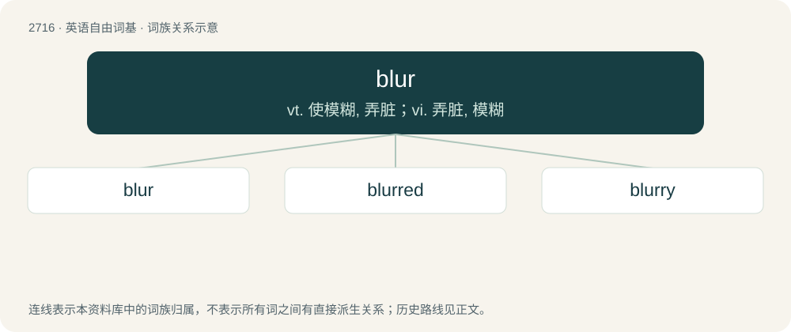

# 2817 · blur — vt. 使模糊, 弄脏；vi. 弄脏, 模糊

[总目录](../00_总目录_按常用程度.md)

**类型**：英语自由词基　｜　**来源语言**：见词源记录

## 核心含义与来源

- 核心含义：vt. 使模糊, 弄脏；vi. 弄脏, 模糊
- 英文含义：To make indistinct or hazy, to obscure or dim.
- 词形：blur

**来源记录 1**（动词；To make indistinct or hazy, to obscure or dim.）

From earlier blurre, probably an alteration of blear, from Middle English bleren, from Old English \*blerian (attested in āblered (“made bare, made bald”)), from Proto-West Germanic \*blaʀjan, from Proto-Germanic \*blazjaną (“to make pale”), from Proto-Germanic \*blasaz (“pale”). Compare Scots blore, bloar (“to blur, cover with blots”), Low German bleeroged (“blear-eyed”). More at blear.

## 词族图

## 单词速览（常用到不常用）

| 单词 | 音标 | 释义 |
|---|---|---|
| [blur](#w-1) | 英 /ˈblɜː/；美 /blɝ/ | vt. 使模糊, 弄脏；vi. 弄脏, 模糊 |
| [blurred](#w-2) | 英 /blɜːd/；美 /blɝd/ | a. 模糊不清的；被弄污的 |
| [blurry](#w-3) | /ˈblɜːɹi/ | a. 模糊的, 不清楚的, 污脏的 |

## 逐词详解

### 1. blur

**词性**：动词　｜　**音标**：英 /ˈblɜː/；美 /blɝ/

**中文释义**：vt. 使模糊, 弄脏；vi. 弄脏, 模糊

**英文义项**：To make indistinct or hazy, to obscure or dim. / To smear, stain or smudge.

**词源与演化**：

From earlier blurre, probably an alteration of blear, from Middle English bleren, from Old English \*blerian (attested in āblered (“made bare, made bald”)), from Proto-West Germanic \*blaʀjan, from Proto-Germanic \*blazjaną (“to make pale”), from Proto-Germanic \*blasaz (“pale”). Compare Scots blore, bloar (“to blur, cover with blots”), Low German bleeroged (“blear-eyed”). More at blear.

**用法示例／搭配（非完整句）**：

> to blur a photograph (by moving the camera while taking it)

该用例对应义项：To make indistinct or hazy, to obscure or dim.

### 2. blurred

**词性**：形容词　｜　**音标**：英 /blɜːd/；美 /blɝd/

**中文释义**：a. 模糊不清的；被弄污的

**英文义项**：Out of focus; partially obscured; smudged.

**构词拆分**：From blur + -ed.

**词源与演化**：

From blur + -ed.

**用法示例／搭配（非完整句）**：

> blurred margins

该用例对应义项：Out of focus; partially obscured; smudged.

### 3. blurry

**词性**：形容词　｜　**音标**：/ˈblɜːɹi/

**中文释义**：a. 模糊的, 不清楚的, 污脏的

**英文义项**：Not clear, crisp, or focused; having fuzzy edges. / Not clear; lacking well-defined boundaries.

**构词拆分**：blur + -y

**词源与演化**：

From blur + -y.

**例句**：

> It would seem that the line between flirting and sexual harassment has become quite blurry.

该用例对应义项：Not clear; lacking well-defined boundaries.
