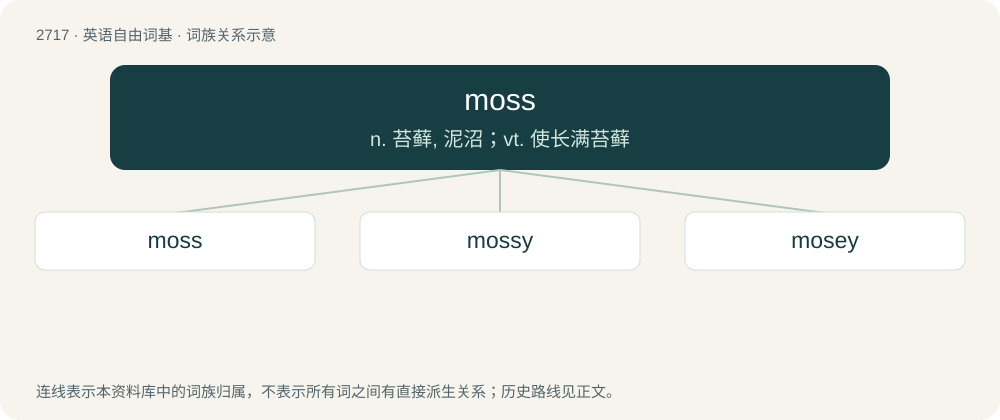

# 2818 · moss — n. 苔藓, 泥沼；vt. 使长满苔藓

[总目录](../00_总目录_按常用程度.md)

**类型**：英语自由词基　｜　**来源语言**：见词源记录

## 核心含义与来源

- 核心含义：n. 苔藓, 泥沼；vt. 使长满苔藓
- 英文含义：Any of various small, green, seedless plants growing on the ground or on the surfaces of trees, stones, etc.; now specifically, a plant of the phylum Bryophyta (formerly division Musci).
- 词形：moss

**多个词源／构词路径**：同一拼写可能有不同来源；以下按词性和含义分别列出。

**来源记录 1**（名词；Any of various small, green, seedless plants growing on the ground or on the surfaces of trees, stones, etc.; now specifically, a plant of the phylum Bryophyta (formerly division Musci).）

From Middle English mos, from Old English mos (“bog, marsh, moss”), from Proto-West Germanic \*mos, from Proto-Germanic \*musą (“bog, moss”), from Proto-Indo-European \*mews- (“moss”). Cognates Cognate with North Frisian möösk (“moss”), Saterland Frisian Moas (“moss”), West Frisian moas (“moss”), Alemannic German Mies (“moss”), Dutch mos (“moss; lichen; marsh, swamp”), German and Luxembourgish Moos (“moss”), Low German Moss (“moss”), Danish mos (“moss”), mose (“bog; moor”), Faroese and Icelandic mosi (“moss”), Norwegian Bokmål mose (“moss”), Norwegian Nynorsk mose, Swedish mossa, mosse (“raised bog”); also Latin muscus (“moss”), Bulgarian мъх (măh, “moss”), Czech and Polish mech (“moss”), Macedonian мов (mov, “moss”), Russian and Ukrainian мох (mox, “moss”), Serbo-Croatian ма̀ховина, màhovina (“moss”), Slovak mach (“moss”), Slovene mah (“moss; raised bog; marsh; velvet; down, fluff”), Armenian մամուռ (mamuṙ, “moss”). Doublet of mousse.

**来源记录 2**（名词；A spectacular catch made over 1 or multiple defenders, typically a jump ball.）

Named after Randy Moss, American football wide receiver known for making spectacular catches over defenders.

## 词族图

## 单词速览（常用到不常用）

| 单词 | 音标 | 释义 |
|---|---|---|
| [moss](#w-1) | 英 /mɒs/；美 /mɔs/ | n. 苔藓, 泥沼；vt. 使长满苔藓 |
| [mossy](#w-2) | 英 /ˈmɒsi/；美 /ˈmɔsi/ | a. 生苔的, 似苔的, 陈腐的 |
| [mosey](#w-3) | 美 /ˈmoʊ.zi/ | 【英文】Hairy, furry. |

## 逐词详解

### 1. moss

**词性**：名词　｜　**音标**：英 /mɒs/；美 /mɔs/

**中文释义**：n. 苔藓, 泥沼；vt. 使长满苔藓

**英文义项**：Any of various small, green, seedless plants growing on the ground or on the surfaces of trees, stones, etc.; now specifically, a plant of the phylum Bryophyta (formerly division Musci). / A kind or species of such plants.

**词源与演化**：

From Middle English mos, from Old English mos (“bog, marsh, moss”), from Proto-West Germanic \*mos, from Proto-Germanic \*musą (“bog, moss”), from Proto-Indo-European \*mews- (“moss”). Cognates Cognate with North Frisian möösk (“moss”), Saterland Frisian Moas (“moss”), West Frisian moas (“moss”), Alemannic German Mies (“moss”), Dutch mos (“moss; lichen; marsh, swamp”), German and Luxembourgish Moos (“moss”), Low German Moss (“moss”), Danish mos (“moss”), mose (“bog; moor”), Faroese and Icelandic mosi (“moss”), Norwegian Bokmål mose (“moss”), Norwegian Nynorsk mose, Swedish mossa, mosse (“raised bog”); also Latin muscus (“moss”), Bulgarian мъх (măh, “moss”), Czech and Polish mech (“moss”), Macedonian мов (mov, “moss”), Russian and Ukrainian мох (mox, “moss”), Serbo-Croatian ма̀ховина, màhovina (“moss”), Slovak mach (“moss”), Slovene mah (“moss; raised bog; marsh; velvet; down, fluff”), Armenian մամուռ (mamuṙ, “moss”). Doublet of mousse.

**用法示例／搭配（非完整句）**：

> the mosses of the Scottish border

该用例对应义项：A bog; a fen.

### 2. mossy

**词性**：形容词　｜　**音标**：英 /ˈmɒsi/；美 /ˈmɔsi/

**中文释义**：a. 生苔的, 似苔的, 陈腐的

**英文义项**：Covered in or overgrown with moss.

**构词拆分**：moss + -y

**词源与演化**：

From Middle English mossy, equivalent to moss + -y.

**例句**：

> The lanterns around the pond in the mossy garden illumined in green.

### 3. mosey

**词性**：形容词　｜　**音标**：美 /ˈmoʊ.zi/

**英文义项**：Hairy, furry. / Close, muggy; misty, hazy.

**构词拆分**：moss + -y

**词源与演化**：

From moss + -y (apparently reflecting Middle English open vowel lengthening).
