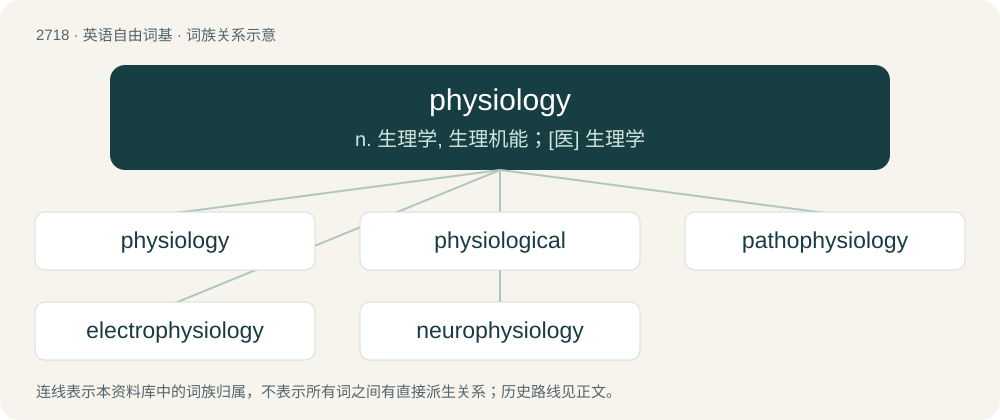

# 2819 · physiology — n. 生理学, 生理机能；\[医\] 生理学

[总目录](../00_总目录_按常用程度.md)

**类型**：英语自由词基　｜　**来源语言**：见词源记录

## 核心含义与来源

- 核心含义：n. 生理学, 生理机能；\[医\] 生理学
- 英文含义：A branch of biology that deals with the functions and activities of life or of living matter (as organs, tissues, or cells) and of the physical and chemical phenomena involved.
- 词形：physiology

**来源记录 1**（名词；A branch of biology that deals with the functions and activities of life or of living matter (as organs, tissues, or cells) and of the physical and chemical phenomena involved.）

From French physiologie, from Latin physiologia, from Ancient Greek φυσιολογία (phusiología, “natural philosophy”), from φύσις (phúsis, “nature”) + λόγος (lógos, “word”). Equivalent to physio- + -logy.

## 词族图

## 单词速览（常用到不常用）

| 单词 | 音标 | 释义 |
|---|---|---|
| [physiology](#w-1) | 英 /ˌfɪziˈɒləd͡ʒi/；美 /ˌfɪziˈɑ.lə.d͡ʒi/ | n. 生理学, 生理机能；\[医\] 生理学 |
| [physiological](#w-2) | 英 /ˌfɪz.i.əˈlɒd͡ʒ.i.kəl/；美 /ˌfɪz.i.əˈlɑ.d͡ʒɪ.kəl/ | a. 生理学的, 生理学上的, 生理机能的；\[医\] 生理学的, 生理的 |
| [pathophysiology](#w-3) | /ˈpæθəj,fiziˈɔlədʒi/ | n. 病理生理学；\[医\] 病理生理学 |
| [electrophysiology](#w-4) | /iˈlektrəj,fiziˈɔlədʒi/ | n. 电生理学；\[计\] 电生理学 |
| [neurophysiology](#w-5) | /,njuərəu,fiziˈɔlədʒi, ,nuə-/ | n. 神经生理学；\[医\] 神经生理学 |

## 逐词详解

### 1. physiology

**词性**：名词　｜　**音标**：英 /ˌfɪziˈɒləd͡ʒi/；美 /ˌfɪziˈɑ.lə.d͡ʒi/

**中文释义**：n. 生理学, 生理机能；\[医\] 生理学

**英文义项**：A branch of biology that deals with the functions and activities of life or of living matter (as organs, tissues, or cells) and of the physical and chemical phenomena involved. / The biology or form of a living organism.

**构词拆分**：physio- + -logy

**词源与演化**：

From French physiologie, from Latin physiologia, from Ancient Greek φυσιολογία (phusiología, “natural philosophy”), from φύσις (phúsis, “nature”) + λόγος (lógos, “word”). Equivalent to physio- + -logy.

**例句**：

> Individual genes specify individual functions, but the relationship between genes enables physiology.

### 2. physiological

**词性**：形容词　｜　**音标**：英 /ˌfɪz.i.əˈlɒd͡ʒ.i.kəl/；美 /ˌfɪz.i.əˈlɑ.d͡ʒɪ.kəl/

**中文释义**：a. 生理学的, 生理学上的, 生理机能的；\[医\] 生理学的, 生理的

**英文义项**：Of, or relating to physiology. / Relating to the action of a drug when given to a healthy person, as distinguished from its therapeutic action.

**构词拆分**：physio- + -logical + physiology + -ical + -al；physio- + -logical；physiology + -ical

**词源与演化**：

Either from physio- + -logical (equivalent to physiology + -ical) or Latin physiologicus + -al.

**例句**：

> My attitude to the comma is physiological; the more breath I have, the fewer commas I use.

### 3. pathophysiology

**词性**：名词　｜　**音标**：/ˈpæθəj,fiziˈɔlədʒi/

**中文释义**：n. 病理生理学；\[医\] 病理生理学

**英文义项**：The physiological processes associated with disease or injury.

**构词拆分**：patho- + physiology

**词源与演化**：

From patho- + physiology.

**例句**：

> Explain the pathophysiology of that disease.

### 4. electrophysiology

**词性**：名词　｜　**音标**：/iˈlektrəj,fiziˈɔlədʒi/

**中文释义**：n. 电生理学；\[计\] 电生理学

**英文义项**：The branch of physiology that studies the electrical activity of organisms.

**构词拆分**：electro- + physiology

**词源与演化**：

From electro- + physiology.

### 5. neurophysiology

**词性**：名词　｜　**音标**：/,njuərəu,fiziˈɔlədʒi, ,nuə-/

**中文释义**：n. 神经生理学；\[医\] 神经生理学

**英文义项**：The branch of physiology that deals with the nervous system.

**构词拆分**：neuro- + physiology

**词源与演化**：

From neuro- + physiology.
