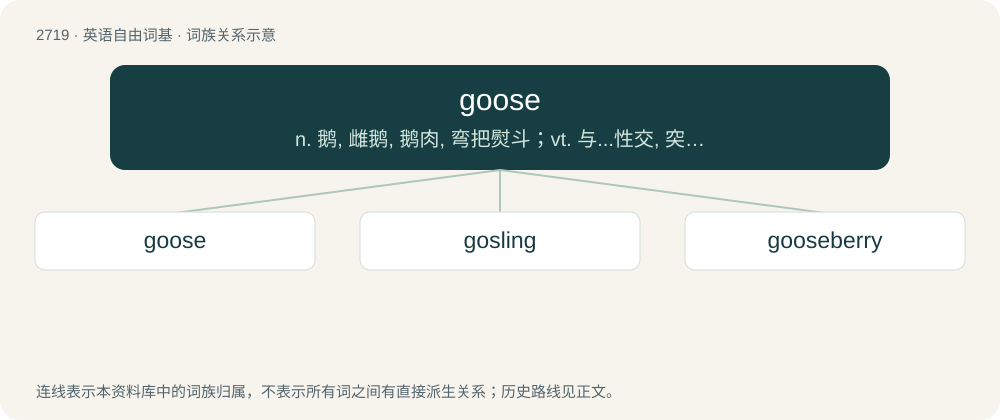

# 2820 · goose — n. 鹅, 雌鹅, 鹅肉, 弯把熨斗；vt. 与...性交, 突然加大油门, 使生色, 喝倒彩

[总目录](../00_总目录_按常用程度.md)

**类型**：英语自由词基　｜　**来源语言**：见词源记录

## 核心含义与来源

- 核心含义：n. 鹅, 雌鹅, 鹅肉, 弯把熨斗；vt. 与...性交, 突然加大油门, 使生色, 喝倒彩
- 英文含义：Any of various grazing waterfowl of the family Anatidae, which have feathers and webbed feet and are capable of flying, swimming, and walking on land, and which are generally bigger than ducks.
- 词形：goose

**来源记录 1**（名词；Any of various grazing waterfowl of the family Anatidae, which have feathers and webbed feet and are capable of flying, swimming, and walking on land, and which are generally bigger than ducks.）

From Middle English goos, gos, from Old English gōs, from Proto-West Germanic \*gans, from Proto-Germanic \*gans, from Proto-Indo-European \*ǵʰh₂éns. Cognates Compare West Frisian goes, North Frisian göis (also Fering-Öömrang dialect North Frisian gus; Sölring dialect North Frisian Guus; Heligoland dialect North Frisian gus), Low German Goos, Gans, Dutch gans, German Gans, Danish, Swedish and Norwegian gås, Icelandic gæs, Irish gé, Latin ānser, Latvian zùoss, Russian гусь (gusʹ), Albanian gatë, Ancient Greek χήν (khḗn), Avestan 𐬰𐬁 (zā), Sanskrit हंस (haṃsá). \* The tailor's iron is so called from the likeness of the handle to the neck of a goose.

## 词族图

## 单词速览（常用到不常用）

| 单词 | 音标 | 释义 |
|---|---|---|
| [goose](#w-1) | 英 /ɡuːs/；美 /ɡus/ | n. 鹅, 雌鹅, 鹅肉, 弯把熨斗；vt. 与...性交, 突然加大油门, 使生色, 喝倒彩 |
| [gosling](#w-2) | 英 /ˈɡɒzlɪŋ/；美 /ˈɡɑzlɪŋ/ | n. 小鹅, 年轻无知的人 |
| [gooseberry](#w-3) | 英 /ˈɡʊzb(ə)ɹi/；美 /ˈɡusˌbɛɹi/ | n. 醋栗, 醋栗酒 |

## 逐词详解

### 1. goose

**词性**：名词　｜　**音标**：英 /ɡuːs/；美 /ɡus/

**中文释义**：n. 鹅, 雌鹅, 鹅肉, 弯把熨斗；vt. 与...性交, 突然加大油门, 使生色, 喝倒彩

**英文义项**：Any of various grazing waterfowl of the family Anatidae, which have feathers and webbed feet and are capable of flying, swimming, and walking on land, and which are generally bigger than ducks. / A female goose.

**词源与演化**：

From Middle English goos, gos, from Old English gōs, from Proto-West Germanic \*gans, from Proto-Germanic \*gans, from Proto-Indo-European \*ǵʰh₂éns. Cognates Compare West Frisian goes, North Frisian göis (also Fering-Öömrang dialect North Frisian gus; Sölring dialect North Frisian Guus; Heligoland dialect North Frisian gus), Low German Goos, Gans, Dutch gans, German Gans, Danish, Swedish and Norwegian gås, Icelandic gæs, Irish gé, Latin ānser, Latvian zùoss, Russian гусь (gusʹ), Albanian gatë, Ancient Greek χήν (khḗn), Avestan 𐬰𐬁 (zā), Sanskrit हंस (haṃsá). \* The tailor's iron is so called from the likeness of the handle to the neck of a goose.

**例句**：

> We must cook his goose before he can do any more harm.

### 2. gosling

**词性**：名词　｜　**音标**：英 /ˈɡɒzlɪŋ/；美 /ˈɡɑzlɪŋ/

**中文释义**：n. 小鹅, 年轻无知的人

**英文义项**：A young goose. / An inexperienced and immature, or foolish and naive, young person.

**构词拆分**：goose + -ling

**词源与演化**：

From Late Middle English goslyng (“gosling”), alteration (due to Middle English goos (“goose”)) of earlier gesling (“gosling”), of North Germanic origin, from Old Norse gæsling, géslingr (“gosling”), from gás (“goose”) + -lingr (“-ling”), equivalent to goose + -ling. Cognate with Danish gæsling (“gosling”), Swedish gässling (“gosling”). Compare also Low German gossel, gössel (“gosling”), German Gänslein (“gosling”).

**例句**：

> The cat pounced on the stray gosling.

### 3. gooseberry

**词性**：名词　｜　**音标**：英 /ˈɡʊzb(ə)ɹi/；美 /ˈɡusˌbɛɹi/

**中文释义**：n. 醋栗, 醋栗酒

**英文义项**：A fruit of species Ribes uva-crispa, related to the currant. / Any other plant or fruit in the subgenus Grossularia, distinguished from currants by bearing spines, including Ribes hirtellum (American gooseberry).

**构词拆分**：goose + berry

**词源与演化**：

From goose + berry. It is possible that the first element was originally something related to the gros- of French groseille and/or the kruis- of Dutch kruisbes but has been altered by folk etymology.

**例句**：

> Robert and Susan were so in love with each other that nobody could go near them without feeling like a gooseberry.

该用例对应义项：An additional person who is neither necessary nor wanted in a given situation.
