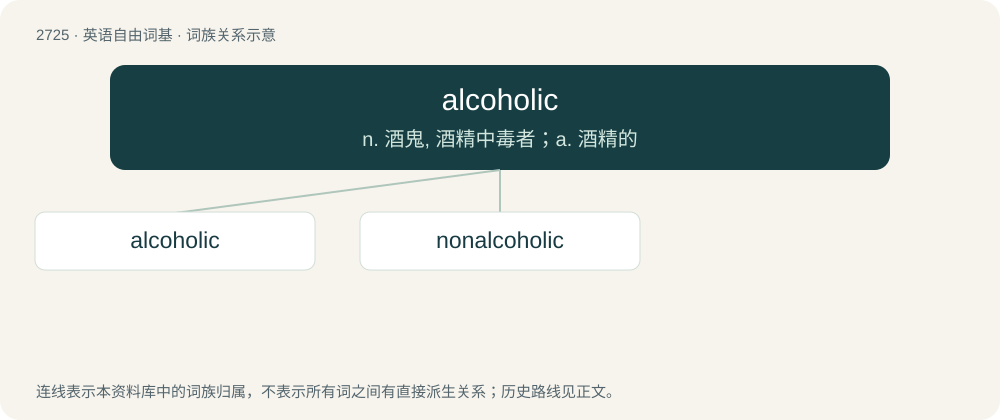

# 2825 · alcoholic — n. 酒鬼, 酒精中毒者；a. 酒精的

[总目录](../00_总目录_按常用程度.md)

**类型**：英语自由词基　｜　**来源语言**：见词源记录

## 核心含义与来源

- 核心含义：n. 酒鬼, 酒精中毒者；a. 酒精的
- 英文含义：A person who is addicted to alcohol.
- 词形：alcoholic

**来源记录 1**（名词；A person who is addicted to alcohol.）

First attested 1891, from alcohol + -ic.

## 词族图

## 单词速览（常用到不常用）

| 单词 | 音标 | 释义 |
|---|---|---|
| [alcoholic](#w-1) | 英 /ˌæl.kəˈhɒl.ɪk/；美 /ˌæl.kəˈhɔ.lɪk/ | n. 酒鬼, 酒精中毒者；a. 酒精的 |
| [nonalcoholic](#w-2) | /.nɒnælkəˈhɒlik/ | a. 不含酒精的 |

## 逐词详解

### 1. alcoholic

**词性**：形容词　｜　**音标**：英 /ˌæl.kəˈhɒl.ɪk/；美 /ˌæl.kəˈhɔ.lɪk/

**中文释义**：n. 酒鬼, 酒精中毒者；a. 酒精的

**英文义项**：Of or pertaining to alcohol. / Having more than a trace amount of alcohol in its contents.

**构词拆分**：alcohol + -ic

**词源与演化**：

First attested 1891, from alcohol + -ic.

**例句**：

> The oysters were sour, and excessively alcoholic.

该用例对应义项：Having more than a trace amount of alcohol in its contents.

### 2. nonalcoholic

**词性**：形容词　｜　**音标**：/.nɒnælkəˈhɒlik/

**中文释义**：a. 不含酒精的

**英文义项**：Containing no more than trace amounts of alcohol. / Not involving alcohol as its cause.

**构词拆分**：non- + alcoholic

**词源与演化**：

From non- + alcoholic.

**例句**：

> My favorite nonalcoholic drink is an avocado shake. Yum, it's so delicious!
