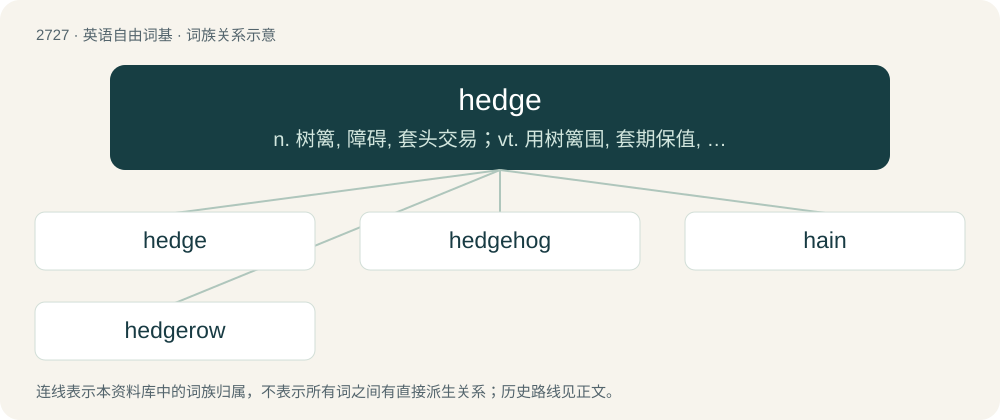

# 2827 · hedge — n. 树篱, 障碍, 套头交易；vt. 用树篱围, 套期保值, 妨碍, 两面下注以防...的损失；vi. 筑树篱, 躲闪, 两面下注以防损失

[总目录](../00_总目录_按常用程度.md)

**类型**：英语自由词基　｜　**来源语言**：见词源记录

## 核心含义与来源

- 核心含义：n. 树篱, 障碍, 套头交易；vt. 用树篱围, 套期保值, 妨碍, 两面下注以防...的损失；vi. 筑树篱, 躲闪, 两面下注以防损失
- 英文含义：A thicket of bushes or other shrubbery, especially one planted as a fence between two portions of land, or to separate the parts of a garden.
- 词形：hedge

**多个词源／构词路径**：同一拼写可能有不同来源；以下按词性和含义分别列出。

**来源记录 1**（名词；A thicket of bushes or other shrubbery, especially one planted as a fence between two portions of land, or to separate the parts of a garden.）

From Middle English hegge, from Old English heċġ, from Proto-West Germanic \*haggju, from Proto-Germanic \*hagjō, from Proto-Indo-European \*kagʰyóm (“enclosure”). Cognate with Dutch heg, German Hecke. Doublet of hey (a choreographic figure) and quay. More at haw.

**来源记录 2**（动词；To enclose with a hedge or hedges.）

Inherited from Middle English heggen, from the noun (see above).

## 词族图

## 单词速览（常用到不常用）

| 单词 | 音标 | 释义 |
|---|---|---|
| [hedge](#w-1) | 英 /ˈhɛd͡ʒ/ | n. 树篱, 障碍, 套头交易；vt. 用树篱围, 套期保值, 妨碍, 两面下注以防...的损失；vi. 筑树篱, 躲闪, 两面下注以防损失 |
| [hedgehog](#w-2) | 美 /ˈhɛd͡ʒ.hɔɡ/；/ˈhɛd͡ʒ.hɒɡ/ | n. 豪猪, 刺猬, 难交朋友的人, 防卫森严的阵地 |
| [hain](#w-3) |  | 围起用作牧场 |
| [hedgerow](#w-4) | /ˈhɛd͡ʒɹəʊ/ | n. 灌木篱墙 |

## 逐词详解

### 1. hedge

**词性**：名词　｜　**音标**：英 /ˈhɛd͡ʒ/

**中文释义**：n. 树篱, 障碍, 套头交易；vt. 用树篱围, 套期保值, 妨碍, 两面下注以防...的损失；vi. 筑树篱, 躲闪, 两面下注以防损失

**英文义项**：A thicket of bushes or other shrubbery, especially one planted as a fence between two portions of land, or to separate the parts of a garden. / A barrier (often consisting of a line of persons or objects) to protect someone or something from harm.

**词源与演化**：

From Middle English hegge, from Old English heċġ, from Proto-West Germanic \*haggju, from Proto-Germanic \*hagjō, from Proto-Indo-European \*kagʰyóm (“enclosure”). Cognate with Dutch heg, German Hecke. Doublet of hey (a choreographic figure) and quay. More at haw.

**例句**：

> The asset class acts as a hedge.

该用例对应义项：Contract or arrangement reducing one's exposure to risk (for example the risk of price movements or interest rate movements).

### 2. hedgehog

**词性**：名词　｜　**音标**：美 /ˈhɛd͡ʒ.hɔɡ/；/ˈhɛd͡ʒ.hɒɡ/

**中文释义**：n. 豪猪, 刺猬, 难交朋友的人, 防卫森严的阵地

**英文义项**：A small mammal of the subfamily Erinaceinae, characterized by their spiny back and often by the habit of rolling up into a ball when attacked, native to Afro-Eurasia. / Any of several spiny mammals, such as the porcupine, that are similar to the hedgehog.

**构词拆分**：hedge + hog

**词源与演化**：

From Middle English heyghoge; equivalent to hedge + hog. Eclipsed non-native Middle English yrchoun, irchoun (“hedgehog”), from Old French hirchoun, herichon (“hedgehog”); and displaced earlier Middle English il, from Old English īl, iġil (“hedgehog”). In the philosophical sense, from the 1953 essay The Hedgehog and the Fox by Isaiah Berlin. Compare typologically Korean 고슴도치 (goseumdochi) (&lt;&lt;+ Middle Korean 돝 (twoth, “pig, swine”)).

**例句**：

> A tiger surprised by a hedgehog will bow before the chestnut burrs.

### 3. hain

**词性**：动词

**中文释义**：围起用作牧场

**英文义项**：To hedge or fence in; enclose; protect by hedging. / To save; spare; refrain from using or spending.

**构词拆分**：hedge + -en

**词源与演化**：

From earlier hayne, from Middle English \*haynen, \*heynen, from Old Norse hegna (“to protect; defend”), from Proto-Germanic \*haginjaną (“to hedge”), equivalent to hedge + -en. Cognate with Icelandic hegna (“to fence; confine; punish”), Swedish hägna (“to fence off; enclose; protect”), Danish hegne (“to enclose; fence in”). Related to hedge. The noun is from Middle English heyn.

**例句**：

> "Have you found it, Wiggins?" "No, sir, we hain't," said one of the youths.

### 4. hedgerow

**词性**：名词　｜　**音标**：/ˈhɛd͡ʒɹəʊ/

**中文释义**：n. 灌木篱墙

**英文义项**：A row of closely planted bushes or trees forming a hedge.

**构词拆分**：hedge + row

**词源与演化**：

From Middle English heggerowe, heggerewe, heggerawe, from Old English \*heċġrāw, \*heċġrǣw (attested only as Old English heġerǣwe, heġerēwe (“hedgerow”)), equivalent to hedge + row.

**例句**：

> We planted blackthorn and whitethorn to make a new hedgerow.
