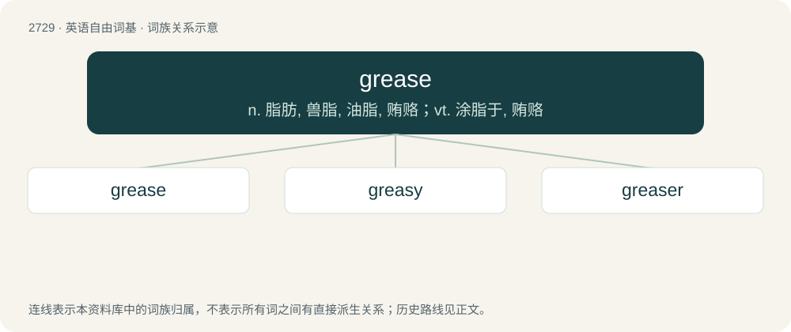

# 2828 · grease — n. 脂肪, 兽脂, 油脂, 贿赂；vt. 涂脂于, 贿赂

[总目录](../00_总目录_按常用程度.md)

**类型**：英语自由词基　｜　**来源语言**：见词源记录

## 核心含义与来源

- 核心含义：n. 脂肪, 兽脂, 油脂, 贿赂；vt. 涂脂于, 贿赂
- 英文含义：Animal fat in a melted or soft state.
- 词形：grease

**来源记录 1**（名词；Animal fat in a melted or soft state.）

From Middle English grece, from Anglo-Norman grece, from Vulgar Latin \*crassia, noun derived from Latin crassus (“fat, thick”). Doublet of crass.

## 词族图

## 单词速览（常用到不常用）

| 单词 | 音标 | 释义 |
|---|---|---|
| [grease](#w-1) | 英 /ɡɹiːs/；美 /ɡɹis/ | n. 脂肪, 兽脂, 油脂, 贿赂；vt. 涂脂于, 贿赂 |
| [greasy](#w-2) | 英 /ˈɡɹiː.si/；美 /ˈɡɹi.si/ | a. 油腻的, 含脂肪多的 |
| [greaser](#w-3) | /ˈ^riːsə/ | n. 加油脂/涂油脂的工人, 加润滑脂的器具, (美)(非正式)贿赂者；\[化\] 润滑器具 |

## 逐词详解

### 1. grease

**词性**：动词　｜　**音标**：英 /ɡɹiːs/；美 /ɡɹis/

**中文释义**：n. 脂肪, 兽脂, 油脂, 贿赂；vt. 涂脂于, 贿赂

**英文义项**：To put grease or fat on something, especially in order to lubricate. / To bribe.

**词源与演化**：

From Middle English grece, from Anglo-Norman grece, from Vulgar Latin \*crassia, noun derived from Latin crassus (“fat, thick”). Doublet of crass.

**例句**：

> The wheel that squeaks the loudest is the one that gets the grease.

### 2. greasy

**词性**：形容词　｜　**音标**：英 /ˈɡɹiː.si/；美 /ˈɡɹi.si/

**中文释义**：a. 油腻的, 含脂肪多的

**英文义项**：Having a slippery surface; having a surface covered with grease. / Containing a lot of grease or fat.

**构词拆分**：grease + -y

**词源与演化**：

From Middle English gresi, gressy, equivalent to grease + -y.

**用法示例／搭配（非完整句）**：

> a greasy mineral

该用例对应义项：Having a slippery surface; having a surface covered with grease.

### 3. greaser

**词性**：名词　｜　**音标**：/ˈ^riːsə/

**中文释义**：n. 加油脂/涂油脂的工人, 加润滑脂的器具, (美)(非正式)贿赂者；\[化\] 润滑器具

**英文义项**：Someone or something that greases (applies grease). / A mechanic.

**构词拆分**：grease + -er

**词源与演化**：

From grease + -er. Applied to mechanics because they frequently become greasy during the course of their work. Applied to toughs because they frequently greased their hair, and, like greaseball, to Italians for the same reason. Applied to Mexicans because, at the time the phrase originated, they commonly worked greasing the axles of carts.
