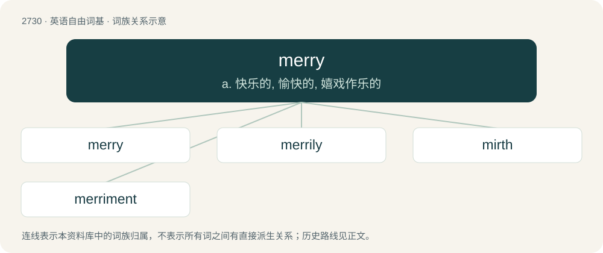

# 2829 · merry — a. 快乐的, 愉快的, 嬉戏作乐的

[总目录](../00_总目录_按常用程度.md)

**类型**：英语自由词基　｜　**来源语言**：见词源记录

## 核心含义与来源

- 核心含义：a. 快乐的, 愉快的, 嬉戏作乐的
- 英文含义：Jolly and full of high spirits; happy.
- 词形：merry

**多个词源／构词路径**：同一拼写可能有不同来源；以下按词性和含义分别列出。

**来源记录 1**（形容词；Jolly and full of high spirits; happy.）

From Middle English myrie, merie, mery, from Old English myrġe, myriġe (“pleasing, agreeable; pleasant, sweet, delightful; melodious”), from Proto-West Germanic \*murgī (“short, slow, leisurely”), from Proto-Germanic \*murguz (“short, slow”), from Proto-Indo-European \*mréǵʰus (“short”). Cognate with Scots mery, mirry (“merry”), Middle Dutch mergelijc (“pleasant, agreeable, joyful”), Norwegian dialectal myrjel (“small object, figurine”), Latin brevis (“short, small, narrow, shallow”), Ancient Greek βραχύς (brakhús, “short”). Doublet of brief.

**来源记录 2**（名词；An English wild cherry.）

From French merise.

## 词族图

## 单词速览（常用到不常用）

| 单词 | 音标 | 释义 |
|---|---|---|
| [merry](#w-1) | 英 /ˈmɛ.ɹi/；美 /ˈmɛ.ɹi/ | a. 快乐的, 愉快的, 嬉戏作乐的 |
| [merrily](#w-2) | /ˈmɛɹɪli/ | adv. 愉快地, 高兴地 |
| [mirth](#w-3) | 英 /mɜːθ/；美 /mɜɹθ/ | n. 欢笑, 欢乐, 愉快 |
| [merriment](#w-4) | 美 /ˈmɛɹimɪnt/ | n. 欢喜, 嬉戏 |

## 逐词详解

### 1. merry

**词性**：形容词　｜　**音标**：英 /ˈmɛ.ɹi/；美 /ˈmɛ.ɹi/

**中文释义**：a. 快乐的, 愉快的, 嬉戏作乐的

**英文义项**：Jolly and full of high spirits; happy. / Festive and full of fun and laughter.

**词源与演化**：

From Middle English myrie, merie, mery, from Old English myrġe, myriġe (“pleasing, agreeable; pleasant, sweet, delightful; melodious”), from Proto-West Germanic \*murgī (“short, slow, leisurely”), from Proto-Germanic \*murguz (“short, slow”), from Proto-Indo-European \*mréǵʰus (“short”). Cognate with Scots mery, mirry (“merry”), Middle Dutch mergelijc (“pleasant, agreeable, joyful”), Norwegian dialectal myrjel (“small object, figurine”), Latin brevis (“short, small, narrow, shallow”), Ancient Greek βραχύς (brakhús, “short”). Doublet of brief.

**例句**：

> Some of us got a little merry at the office Christmas party.

该用例对应义项：Drunk; tipsy.

### 2. merrily

**词性**：副词　｜　**音标**：/ˈmɛɹɪli/

**中文释义**：adv. 愉快地, 高兴地

**英文义项**：In a cheerful or merry way.

**构词拆分**：merry + -ly

**词源与演化**：

From Middle English myriely, from Old English myriġlīċe; equivalent to merry + -ly.

**例句**：

> The children sang merrily as they walked home.

该用例对应义项：In a cheerful or merry way.

### 3. mirth

**词性**：名词　｜　**音标**：英 /mɜːθ/；美 /mɜɹθ/

**中文释义**：n. 欢笑, 欢乐, 愉快

**英文义项**：The emotion usually following humor and accompanied by laughter. / That which causes merriment.

**构词拆分**：merry + -th (abstract nominal suffix)

**词源与演化**：

From Middle English merth, myrthe, murhthe, from Old English myrgþ (“mirth, joy”), from Proto-West Germanic \*murgiþu (“briefness, brevity”); equivalent to merry + -th (abstract nominal suffix). Cognate with Middle Dutch merchte (“pleasure, joy, delight”).

**例句**：

> This joke is a source of mirth for the audience.

### 4. merriment

**词性**：名词　｜　**音标**：美 /ˈmɛɹimɪnt/

**中文释义**：n. 欢喜, 嬉戏

**英文义项**：A state of enjoyable exuberance. / Playful fun.

**构词拆分**：merry + -ment

**词源与演化**：

From merry + -ment.

**例句**：

> An extraordinary change had come over his face. It was writhing with inward merriment.
