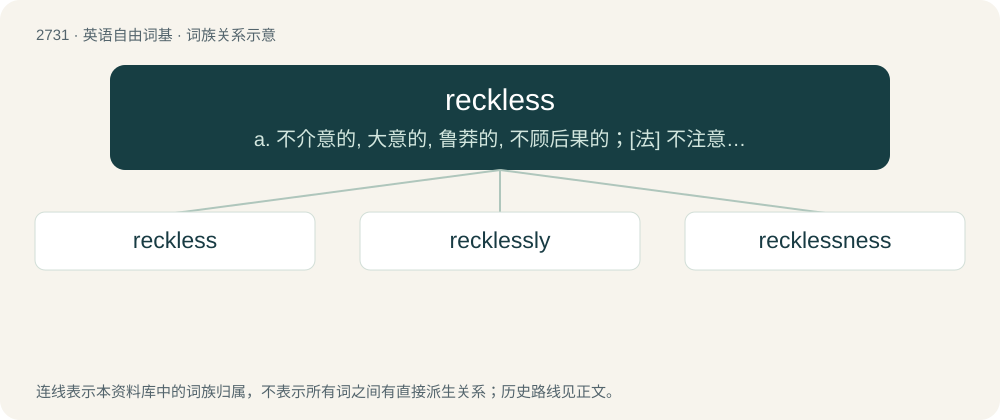

# 2830 · reckless — a. 不介意的, 大意的, 鲁莽的, 不顾后果的；\[法\] 不注意的, 粗心大意的, 鲁莽的

[总目录](../00_总目录_按常用程度.md)

**类型**：英语自由词基　｜　**来源语言**：见词源记录

## 核心含义与来源

- 核心含义：a. 不介意的, 大意的, 鲁莽的, 不顾后果的；\[法\] 不注意的, 粗心大意的, 鲁莽的
- 英文含义：Careless or heedless; headstrong or rash.
- 词形：reckless

**来源记录 1**（形容词；Careless or heedless; headstrong or rash.）

From Middle English rekles, reckeles, rekkeles, (also recheles), from Old English rēcelēas (“reckless, careless, negligent”), equivalent to reck + -less. Cognate with West Frisian roekeleas (“reckless”), Dutch roekeloos (“reckless”), German Low German ruuklos (“careless”), German ruchlos (“careless, notorious”).

## 词族图

## 单词速览（常用到不常用）

| 单词 | 音标 | 释义 |
|---|---|---|
| [reckless](#w-1) | /ˈɹɛkləs/ | a. 不介意的, 大意的, 鲁莽的, 不顾后果的；\[法\] 不注意的, 粗心大意的, 鲁莽的 |
| [recklessly](#w-2) |  | adv. 不注意, 粗心大意, 不在乎, 鲁莽, 不顾后果, 不顾一切, 妄动 |
| [recklessness](#w-3) |  | \[法\] 鲁莽, 粗心大意 |

## 逐词详解

### 1. reckless

**词性**：形容词　｜　**音标**：/ˈɹɛkləs/

**中文释义**：a. 不介意的, 大意的, 鲁莽的, 不顾后果的；\[法\] 不注意的, 粗心大意的, 鲁莽的

**英文义项**：Careless or heedless; headstrong or rash. / Indifferent or oblivious to danger or the consequences thereof.

**构词拆分**：reck + -less

**词源与演化**：

From Middle English rekles, reckeles, rekkeles, (also recheles), from Old English rēcelēas (“reckless, careless, negligent”), equivalent to reck + -less. Cognate with West Frisian roekeleas (“reckless”), Dutch roekeloos (“reckless”), German Low German ruuklos (“careless”), German ruchlos (“careless, notorious”).

**例句**：

> Became the fiercest and most reckless of partisans.

该用例对应义项：marked by defiant disregard for danger or consequences

### 2. recklessly

**词性**：副词

**中文释义**：adv. 不注意, 粗心大意, 不在乎, 鲁莽, 不顾后果, 不顾一切, 妄动

**英文义项**：In a rash or reckless manner, without regard for cost or consequence / With contempt for the rights, feelings, or well-being of others.

**构词拆分**：reckless + -ly

**词源与演化**：

From Middle English reklesly, from Old English rēcelēaslīce; equivalent to reckless + -ly.

**例句**：

> He survived an accident last year, but still drives recklessly.

### 3. recklessness

**词性**：名词

**中文释义**：\[法\] 鲁莽, 粗心大意

**英文义项**：The state or quality of being reckless or heedless, of taking unnecessary risks.

**构词拆分**：reckless + -ness

**词源与演化**：

From Middle English reklesnes, reklesnesse, rekelesnesse (also assibilated as rechelesnes, reccheleesnesse), from Old English rēcelēasnes (“recklessness, carelessness, negligence”), equivalent to reckless + -ness.

**例句**：

> His recklessness repeatedly put him in danger.

该用例对应义项：The state or quality of being reckless or heedless, of taking unnecessary risks.
